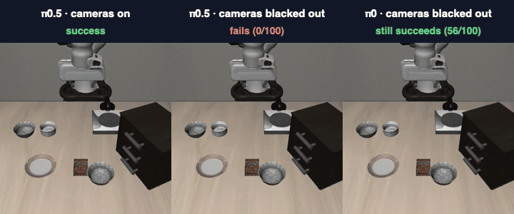
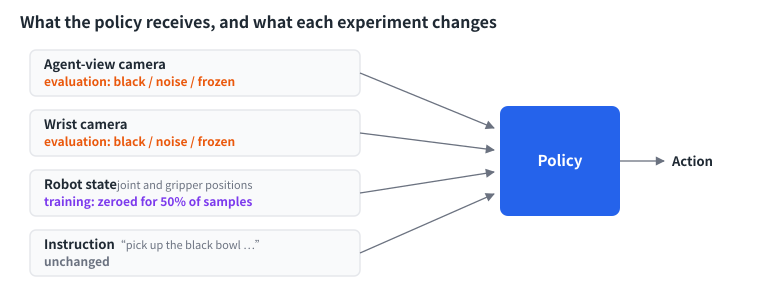
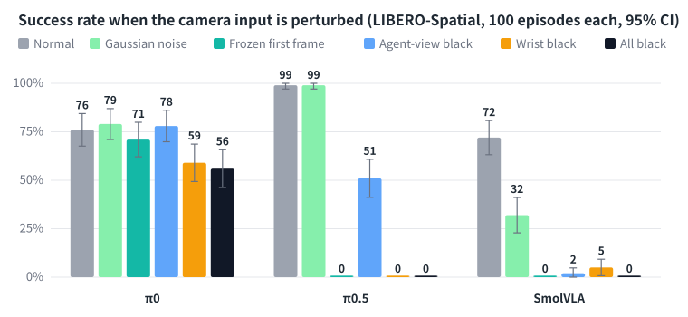
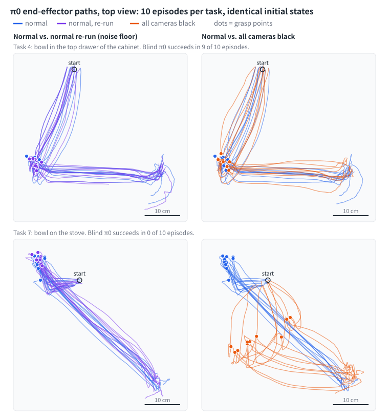
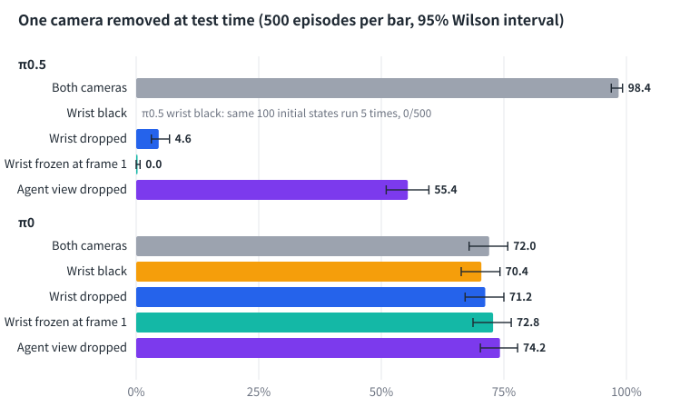
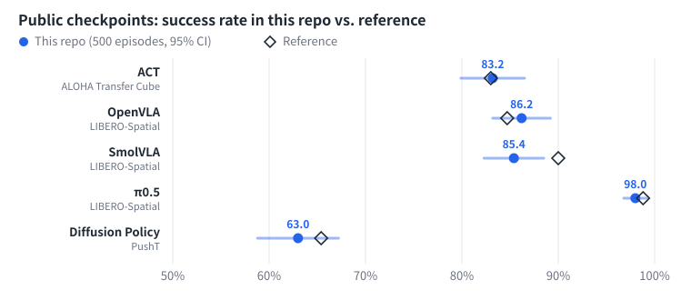

<div align="center">

# Camera-input ablations of four robot policies on LIBERO-Spatial

**Three of the four policies fail without a live camera image. One public π0 checkpoint still succeeds 53–56% of the time with every camera blacked out.**

[](https://github.com/chaoshengsc/libero-camera-ablation/actions/workflows/ci.yml)
[](https://github.com/chaoshengsc/libero-camera-ablation/releases)
[](https://chaoshengsc.github.io/libero-camera-ablation/dashboard/)
[](https://github.com/huggingface/lerobot/tree/v0.6.1)
[](pyproject.toml)
[](LICENSE)

**English** | [中文](README_CN.md)

</div>

<p align="center">
  
  <br><sub>Same task, same initial state. The videos show what happened in the simulator; in the two right-hand runs the policy itself received black images.</sub>
</p>

- **What was done.** Four public LIBERO checkpoints (π0, π0.5, OpenVLA, SmolVLA) were evaluated with the camera input blacked out, frozen at the first frame, noised, or with one of the two cameras removed. Robot state and instruction were left unchanged.
- **Result.** π0.5, OpenVLA and SmolVLA drop to 0% with black cameras, and π0.5 and SmolVLA also drop to 0% when the image is frozen. LeRobot's public π0 checkpoint scores 71–76% normally, 53–56% with black cameras (five runs each), and 71% and 80% in two runs with a frozen image. With the wrist camera dropped (500 episodes each), π0.5 falls from 98.4% to 4.6% and π0 is unchanged (71.2% vs. 72.0% with both cameras).
- **What follows from it.** On LIBERO-Spatial, a success rate alone does not show whether a policy uses its cameras. Blacking out or freezing the image is a cheap way to check.
- **Scope.** One suite, one seed, 100 episodes per run (500 in section 1.4); the single-camera, noise and frozen-image conditions were each run twice. The π0 checkpoint is under-trained, so its result describes this checkpoint and not π0 in general.

Before the ablations, five public checkpoints were reproduced to within sampling error of their reference success rates ([section 2](#2-reproduction-of-the-public-checkpoints)). Everything runs on one workstation (RTX A5000 24 GB, Ubuntu 24.04, headless EGL rendering), with wrapper scripts that leave upstream source untouched. CI recomputes the result tables on this page from the raw evaluation files in `dashboard/data/`.

## News

- **2026-10-28** · Single-camera experiment, 500 episodes per condition ([section 1.4](#14-wrist-camera-removed-500-episodes)). While setting it up, found that LeRobot silently shifts camera slots when a camera is missing: reported as [lerobot#5118](https://github.com/huggingface/lerobot/issues/5118), fix proposed in [lerobot#5129](https://github.com/huggingface/lerobot/pull/5129).
- **2026-10-14** · [v1.3](https://github.com/chaoshengsc/libero-camera-ablation/releases/tag/v1.3): every ablation run a second time; the claim that π0 depends on the wrist camera was withdrawn.
- **2026-10-07** · [v1.2](https://github.com/chaoshengsc/libero-camera-ablation/releases/tag/v1.2): repository renamed; SmolVLA ablations re-run with the checkpoint used in the reproduction table.

**Contents:** [Camera ablations](#1-camera-ablations) · [Reproduction](#2-reproduction-of-the-public-checkpoints) · [Quick start](#quick-start) · [Layout](#repository-layout) · [Limitations](#limitations) · [Acknowledgements](#acknowledgements-and-licenses) · [Citation](#citation)

## 1. Camera ablations

A LIBERO policy receives two camera images, the robot state (end-effector pose and gripper opening) and a language instruction. Each experiment changes only the camera input.



Except in section 1.4, every number in this section is a success rate over 100 episodes (10 tasks × 10 initial states, same seed for every condition). Sampling error alone means two conditions have to differ by about 13 points. For π0 the bar is higher: the same condition run twice differed by up to 18 points (section 1.2).

### 1.1 All cameras black

| Model | Normal | All cameras black |
|---|---|---|
| π0.5 | 99% | 0% |
| OpenVLA | 81% | 0% |
| SmolVLA | 83% | 0% |
| **π0** | 76% | **56%** |

Three models cannot act without images, and a second run of each gave 0% again. π0 succeeds in 56% of episodes: 6 to 9 out of 10 on seven tasks, and 0 or 1 out of 10 on the other three. Four more runs gave 54%, 56%, 54% and 53%, and [lerobot#3591](https://github.com/huggingface/lerobot/issues/3591) reports about 60% for the same checkpoint.

### 1.2 One camera, noise, frozen image



Success rate (%) in two runs of 100 episodes each, first run / second run. The second run repeats the same scripts with the same seed.

| Model | Normal | Gaussian noise | Frozen first frame | Agent-view black | Wrist black | All black |
|---|---|---|---|---|---|---|
| π0 | 76 / 72 | 79 / 67 | 71 / 80 | 78 / 68 | 59 / 77 | 56 / 56 |
| π0.5 | 99 / 98 | 99 / 97 | 0 / 0 | 51 / 57 | 0 / 0 | 0 / 0 |
| SmolVLA | 83 / – | 78 / 73 | 0 / 0 | 33 / 31 | 4 / 4 | 0 / 0 |

- **π0.5 and SmolVLA need a live image.** A frozen first frame is a real, in-distribution image, and it takes both to 0% in both runs. Noise changes neither beyond sampling error.
- **Only blacking out both cameras changes π0 reliably.** That costs about 20 points in every run. With noise, a frozen first frame, or one camera black, its two runs differ by 9 to 18 points and all land between 59% and 80%, around its normal 71–76%. These runs cannot show that π0 depends on either single camera (section 1.4 answers this with 500 episodes). The first run alone suggested a wrist-camera dependence (59%). Four more runs with the wrist camera black gave 77%, 72%, 67% and 70%, so the five average 69%, against 74% for five normal runs.
- **For π0.5 and SmolVLA the wrist camera matters more than the agent view**, in both runs.

OpenVLA takes only the agent-view image and the instruction, so only the all-black condition applies to it.

### 1.3 Where blind π0 succeeds, it follows the sighted path

The end-effector position was logged at every step, and paths were compared with dynamic time warping, which removes speed differences.



| Comparison | Path difference | Grasp-point difference |
|---|---|---|
| Blind π0 vs. sighted π0, on the tasks blind π0 solves at least half the time | 2.8 / 3.2 cm | 2.4 / 2.2 cm |
| π0.5 vs. π0, both sighted, same tasks | 2.9 / 3.0 cm | 2.6 / 2.5 cm |
| Sighted π0 vs. its own re-run | 3.4 / 3.3 cm | 2.4 / 2.4 cm |
| Blind π0 vs. sighted π0, on task 7, where blind π0 never succeeds | 10.9 / 10.3 cm | 24.1 / 23.7 cm |

Each cell gives the first and the second run of the whole comparison. Blind π0 solves seven tasks at least half the time in the first run (0–4, 6, 8) and six in the second (0–4, 6).

On the tasks it solves, blind π0 is as close to sighted π0 as two sighted runs are to each other, in both runs. On task 7 it goes somewhere else in both runs; two sighted runs differ by 2.6 and 2.2 cm there. Task 9, where blind π0 succeeds 0 and 1 times out of 10, points the same way but less clearly: the path differs by 7.8 and 4.9 cm, against 3.3 and 3.6 cm between sighted runs. Task 5 (3 and 4 successes) is inconclusive: 6.0 and 6.6 cm, against 6.6 and 4.7 cm between sighted runs.

The re-run row leaves out tasks where the two sighted runs are still almost identical, because they use the same seed and had not yet diverged, so they say nothing about noise. These are tasks 0–3 in the first run and task 0 in the second.

This does not show whether blind π0 replays a memorised motion. The comparison cannot separate a policy that tracks the bowl from one that repeats one motion per task, and how much the bowl position varies between initial states was not measured here. Per-task numbers are in [`results/trajectory.csv`](results/trajectory.csv) and on the [dashboard](https://chaoshengsc.github.io/libero-camera-ablation/dashboard/).

### 1.4 Wrist camera removed: 500 episodes

Section 1.2 leaves two questions open. Is π0.5's 0% with the wrist camera black caused by needing the wrist view, or by a black image it never saw in training? And with 100 episodes per run, π0 varies too much to show which camera it relies on. This section runs both models for 500 episodes per condition (10 tasks × 50 initial states, the same initial states for every condition run in this round) and treats the wrist camera in three ways:

- **Black**: pixels 0, attention mask still 1, so the model attends to a black image.
- **Dropped**: inside the model the camera's slot is filled with the empty-camera placeholder and its mask set to 0, the same way LeRobot fills the always-empty third camera slot in the configuration.
- **Frozen**: the whole episode gets the real image from the episode's first frame.

The design, acceptance checks and expected results were written down before the runs (the pre-registration in [docs/NOTES.md](docs/NOTES.md); it was not committed before the results, see the note there).



| Wrist camera | π0.5 | π0 |
|---|---|---|
| Both cameras | 98.4% | 72.0% (rerun 71.2%) |
| Black | 0/500 (the same 100 initial states run 5 times: the two runs in section 1.2 and three more) | 70.4% |
| Dropped | 4.6% | 71.2% (rerun 72.6%) |
| Frozen at frame 1 | 0.0% | 72.8% |
| Agent view dropped, wrist only | 55.4% | 74.2% |

- **π0.5 needs the live wrist image.** All three treatments are near 0, so the earlier 0% was not caused by the black image. A real but stale wrist image (0.0%) is worse than none (4.6%).
- **Removing the wrist camera does not change π0's success rate.** Paired by initial state against both cameras, every difference has a 95% interval inside the pre-set ±8-point margin (McNemar p ≥ 0.58). π0 also keeps 53–56% with both cameras black (section 1.1), so this shows that this checkpoint relies little on images, not that the agent view is enough.
- **With the wrist view only, π0.5 keeps 55.4%**, in line with 51% and 57% for agent-view black in section 1.2; tasks differ widely (task 5: 1/50, task 2: 49/50).
- **A pitfall.** In LeRobot v0.6.1, removing the agent-view key from the input moves the wrist image into the agent-view slot without any error ([lerobot#5118](https://github.com/huggingface/lerobot/issues/5118), proposed fix in [lerobot#5129](https://github.com/huggingface/lerobot/pull/5129), under review). "Dropped" here masks the camera in its own slot, and every run logs each slot's mask as evidence.

Per-episode results and first-frame hashes are in `results/single_camera.csv`; the summary and paired statistics are in `results/single_camera_summary.csv`.

<details>
<summary><b>Notes on these numbers</b>: the π0 checkpoint, the normal column, confidence intervals, run-to-run variation, noise, related work</summary>

- **π0 checkpoint.** `lerobot/pi0_libero_finetuned_v044` scores 73.4% over 500 normal episodes. An earlier OpenPI README gave 96.8% on Spatial for π0 trained with its `pi0_libero` config. OpenPI's README never listed that checkpoint, but it can be downloaded from OpenPI's public bucket (`gs://openpi-assets/checkpoints/pi0_libero`), and [LIBERO-Plus](https://arxiv.org/abs/2510.13626) reports 94.2% for it unperturbed and at most 2% with every camera black (their Table 1 and Figure 2; not yet re-run here). An earlier version of this README said that no official π0 LIBERO checkpoint had been released; that was wrong (see the correction in [`docs/NOTES.md`](docs/NOTES.md)). A LeRobot maintainer has said the LeRobot one is under-trained ([lerobot#2114](https://github.com/huggingface/lerobot/issues/2114)).
- **Normal column.** The first number is the first 10 episodes per task of each model's 500-episode run, which use the same initial states as the ablation runs. The second is a separate 100-episode run; SmolVLA has none. π0's five normal runs gave 76%, 73%, 76%, 72% and 71%.
- **Confidence intervals.** The 95% interval of a single number is up to ±10 points. Episodes of one task are correlated, which makes these intervals optimistic.
- **Run-to-run variation.** Runs with the same seed are not identical: the evaluation fixes the random seed but does not make GPU computation deterministic, the end-effector paths of two π0 runs differ from the first step, and a repeat is in effect a new sample. π0.5 and SmolVLA repeat within 6 points; π0 differs by up to 18 points on the same condition.
- **Noise.** Gaussian, standard deviation 0.1, on pixels in [0, 1].
- **Related work.** [LIBERO-PRO](https://arxiv.org/abs/2510.03827) and [LIBERO-Plus](https://arxiv.org/abs/2510.13626) study the robustness of LIBERO policies under a much wider set of perturbations.

</details>

## 2. Reproduction of the public checkpoints



| Model | Task | This repo (500 episodes) | Reference | Reproduced |
|---|---|---|---|---|
| ACT | ALOHA Transfer Cube | **83.2%** | 83.0% (Hugging Face repo) | ✅ |
| OpenVLA | LIBERO-Spatial | **86.2%** | 84.7 ± 0.9% (official README) | ✅ |
| SmolVLA | LIBERO-Spatial | **85.4%** | 90% (paper, 100 episodes) | ✅ |
| π0.5 | LIBERO-Spatial | **98.0%** | 98.8% (OpenPI), 97.0% (LeRobot) | ✅ |
| Diffusion Policy | PushT (2-D, not MuJoCo) | **63.0%** | 65.4% (LeRobot model card) | ✅ |

The 95% confidence interval at 500 episodes is ±1–4 points. "Reproduced" means the two intervals overlap. SmolVLA is `lerobot/smolvla_libero` with `n_action_steps=10`, the same checkpoint as in section 1. It was trained on LIBERO-Spatial only, while the paper trains on all four LIBERO suites, and the paper's 100 episodes give a reference interval of about ±6 points.

<p align="center"><br><sub>ACT on ALOHA Transfer Cube: the right arm picks up the cube and hands it to the left arm.</sub></p>

Per-task results are on the [dashboard](https://chaoshengsc.github.io/libero-camera-ablation/dashboard/). Replay videos are too large to publish; the dashboard plays them when the files are present locally. Sources of the reference numbers and the full experiment log are in [`docs/NOTES.md`](docs/NOTES.md).

## Quick start

```bash
# environments, caches, checkpoints and logs all live here
export EMB_ROOT=/path/to/workdir

# after setting up as described in docs/INSTALL.md:
# ACT, 500 episodes, about 17 minutes on an RTX A5000
bash scripts/eval/run_act.sh
python3 scripts/analysis/summarize_eval.py act_cube_500

# four LIBERO models, every camera black, 100 episodes each
bash scripts/eval/run_blackout_all.sh
python3 scripts/analysis/summarize_blackout.py
```

To regenerate the figures and tables in this README from the evaluation files in `dashboard/data/`, with no GPU and no dependencies:

```bash
python3 dashboard/build.py
python3 scripts/analysis/make_figures.py
```

| Document | Content |
|---|---|
| [`docs/INSTALL.md`](docs/INSTALL.md) | Step-by-step setup of the three conda environments, checkpoints, tokenizer |
| [`docs/TROUBLESHOOTING.md`](docs/TROUBLESHOOTING.md) | Every problem hit during setup and evaluation, with cause and fix |
| [`scripts/README.md`](scripts/README.md) | Which entry script and which summary script produce each result |
| [`env/lock/`](env/lock/) | Full package lists exported from the environments that produced the results |

## Repository layout

| Path | Content |
|---|---|
| `scripts/eval/` | Evaluation entry scripts; blackout, perturbation and trajectory-logging wrappers |
| `scripts/analysis/` | Metrics, summaries, figure generation |
| `scripts/checks/` | Self-checks for GPU, headless EGL rendering and video decoding |
| `scripts/train/` | π0 fine-tuning scripts for an experiment recorded in `docs/NOTES.md` (not part of the results above) |
| `results/` | Result tables (CSV) generated from `dashboard/data`, and the trajectories plotted in 1.3 |
| `dashboard/` | Results dashboard and the raw `eval_info.json` of every run |
| `media/` | Figures and demos used in this README (Chinese versions in `media/zh/`) |
| `docs/` | Installation, troubleshooting, reproduction notes |
| `env/` | Environment file, pip constraints, exported package lists |
| `tests/` | Unit tests for the metrics, consistency checks on the published numbers, entry-script regression tests |
| `viewer/` | Replay a policy trajectory locally in the interactive MuJoCo viewer |
| `.github/` | CI workflow and issue templates |

## Limitations

- One benchmark suite (LIBERO-Spatial) and one seed.
- The ablations in sections 1.1–1.3 use 100 episodes per run (section 1.4 uses 500), so differences under about 13 points are not meaningful; for π0, repeated runs of one condition differed by up to 18 points.
- The π0 checkpoint is under-trained. A properly trained π0 may behave differently.
- How much the scene varies between initial states of a task was not measured, so nothing here says how much vision the benchmark itself requires.
- Diffusion Policy was evaluated on PushT (2-D physics), not in MuJoCo.

## Acknowledgements and licenses

This repository contains no model weights and no upstream source code. It builds on:

| Project | Used for | License |
|---|---|---|
| [LeRobot](https://github.com/huggingface/lerobot) v0.6.1 | ACT, Diffusion Policy, SmolVLA, π0, π0.5 evaluation and π0 fine-tuning | Apache-2.0 |
| [OpenVLA](https://github.com/openvla/openvla) | OpenVLA evaluation | MIT |
| [OpenPI](https://github.com/Physical-Intelligence/openpi) | π0 and π0.5 reference numbers | Apache-2.0 |
| [LIBERO](https://github.com/Lifelong-Robot-Learning/LIBERO) | benchmark | MIT |
| [Diffusion Policy](https://github.com/real-stanford/diffusion_policy), [ACT](https://github.com/tonyzhaozh/act) | original methods | MIT |
| [MuJoCo](https://github.com/google-deepmind/mujoco), [gym-aloha](https://github.com/huggingface/gym-aloha), [gym-pusht](https://github.com/huggingface/gym-pusht) | simulation | Apache-2.0 |

Checkpoints: `lerobot/act_aloha_sim_transfer_cube_human`, `openvla/openvla-7b-finetuned-libero-spatial`, `lerobot/smolvla_libero`, `lerobot/pi05_libero_finetuned_v044`, `lerobot/pi0_libero_finetuned_v044`, `lerobot/diffusion_pusht`. Exact commits are in [`results/reproduction.csv`](results/reproduction.csv) and [`docs/NOTES.md`](docs/NOTES.md). Each checkpoint has its own license. The π0 tokenizer comes from the gated `google/paligemma-3b-pt-224` repository under the Gemma terms and is not included.

Papers: [ACT](https://arxiv.org/abs/2304.13705) · [Diffusion Policy](https://arxiv.org/abs/2303.04137) · [OpenVLA](https://arxiv.org/abs/2406.09246) · [LIBERO](https://arxiv.org/abs/2306.03310) · [SmolVLA](https://arxiv.org/abs/2506.01844) · [π0](https://arxiv.org/abs/2410.24164) · [π0.5](https://arxiv.org/abs/2504.16054)

## Citation

If you use these results or scripts, please cite:

```bibtex
@software{shengchao2026liberocameraablation,
  author  = {ShengChao},
  title   = {libero-camera-ablation: Camera-input ablations of four robot policies on LIBERO-Spatial},
  year    = {2026},
  version = {1.4.0},
  url     = {https://github.com/chaoshengsc/libero-camera-ablation}
}
```

The same entry is in [`CITATION.cff`](CITATION.cff), which GitHub's "Cite this repository" button reads.
