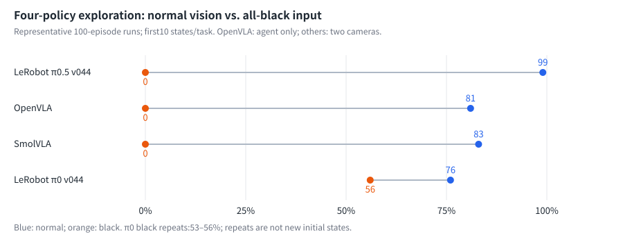
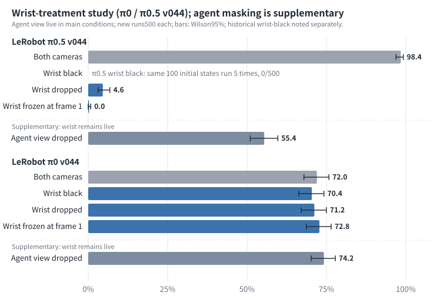
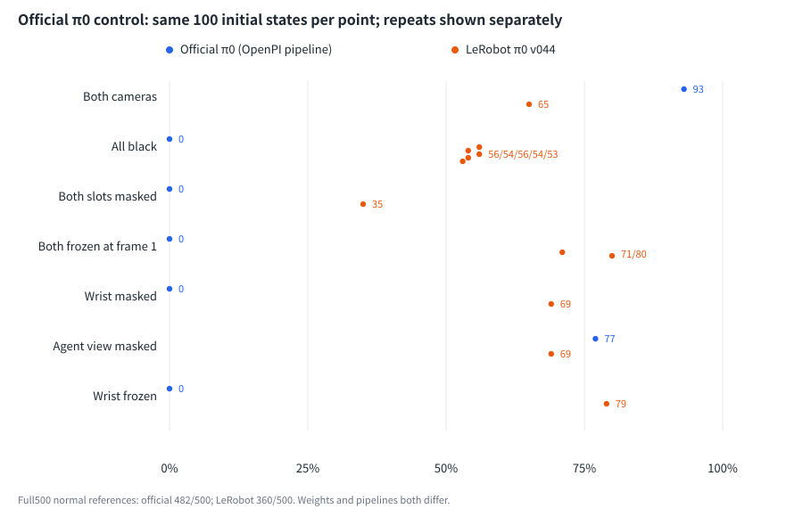
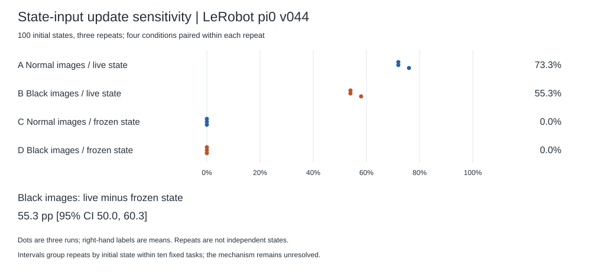
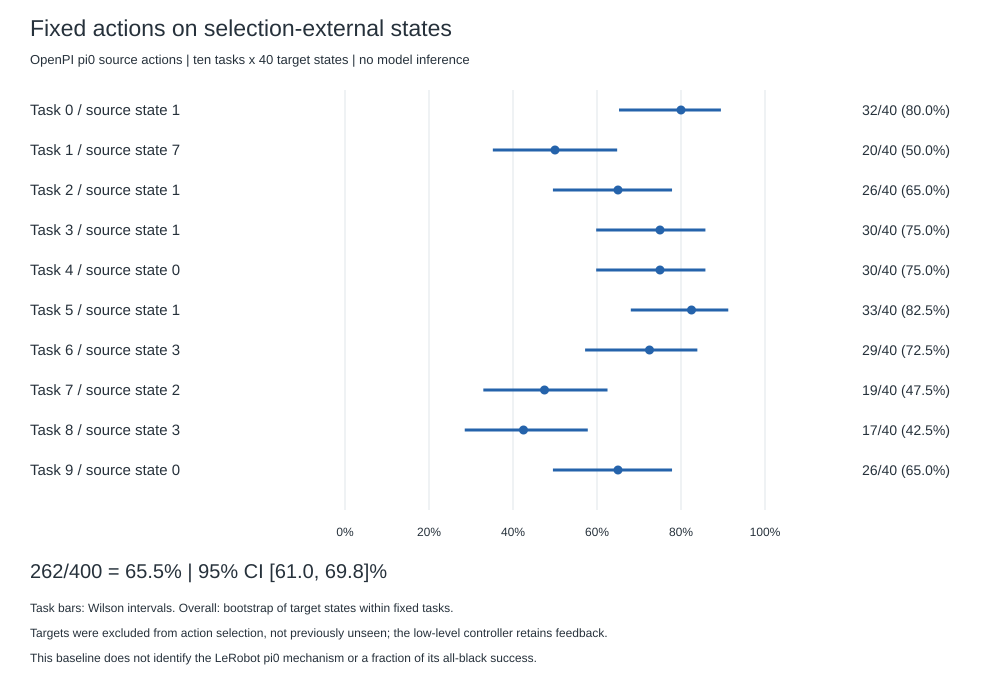
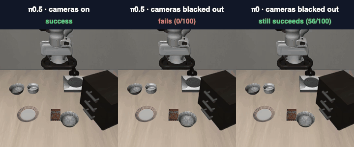
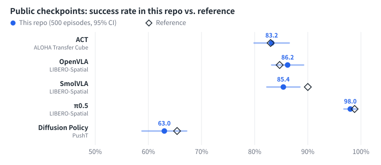

<div align="center">

# Do robot policies actually use their cameras?

**Visual dependence in robot policies · LIBERO-Spatial simulation**

**English** · [中文](README_CN.md) · [Open interactive results](https://chaoshengsc.github.io/libero-camera-ablation/dashboard/?lang=en)

[](https://github.com/chaoshengsc/libero-camera-ablation/actions/workflows/ci.yml)
[](https://github.com/chaoshengsc/libero-camera-ablation/releases)
[](LICENSE)

</div>

**Does completing a simulated task establish that a robot uses its cameras?** This project intervenes on visual inputs to public policy checkpoints and tracks success, trajectories and preprocessing. Four-policy exploration leads to a focused two-policy wrist-treatment study, with separate controls bounding the interpretation.

## Project contributions

| Work | Concrete output | Evidence |
|---|---|---|
| **Multi-policy evaluation and interventions** | π0, π0.5, OpenVLA and SmolVLA; blackout, original-slot masks, frozen first frames | [Execution entries](scripts/README.md) · [Pinned environments](env/README.md) |
| **Controlled follow-up to anomalous results** | Two-policy wrist study; supplementary agent masking; official π0, state-update and fixed-action checks | Figures below · [Full study structure](docs/STUDY_MAP.md) |
| **Upstream camera-slot bug report and fix PR** | Identified silent image shifting when an earlier camera is missing; fix covers six policies | [Issue #5118](https://github.com/huggingface/lerobot/issues/5118) · [PR #5129](https://github.com/huggingface/lerobot/pull/5129) |

**Scope: four checkpoints in all-black exploration, three dual-view checkpoints in early perturbations, π0/π0.5 in the wrist follow-up.** Coverage differs by stage; this is not a full intervention suite for every model. The study evaluates public checkpoints.

<a id="1-camera-ablations"></a>

## 1. Four-policy overview: what happens with all-black visual inputs?



**The tested π0.5, OpenVLA and SmolVLA checkpoints have no all-black successes; LeRobot π0 v044 retains some.** Each plotted condition is a representative 100-episode result. π0 scores 53–56% across five runs reusing the same 100 states, not 500 independent states. OpenVLA has only an agent-view camera; the others have agent and wrist views.

[Per-task counts](results/blackout_per_task.csv) · [Repeats and protocol](docs/EXPERIMENTS.md#11-all-cameras-black)

<details>
<summary>Expand the four-policy figure's values</summary>

| Policy | Normal vision | All visual inputs black |
|---|---|---|
| π0.5 | 99% | 0% |
| OpenVLA | 81% | 0% |
| SmolVLA | 83% | 0% |
| π0 · LeRobot v044 | 76% | 56% |

</details>

## 2. Focused study: change the wrist treatment, keep the agent view live

This later study covers **LeRobot π0/π0.5 v044 only**. π0.5 previously approached zero success with wrist-black input: does this persist with original-slot masking or first-frame freezing? π0 v044 provides a contrasting response.

The table first shows the two policies’ common new500-state conditions; the figure separately labels historical wrist-black evidence and the supplementary condition.

| Wrist condition (agent view always live) | π0.5 v044 | π0 v044 |
|---|---|---|
| Live | **492/500 · 98.4%** | 360/500 · 72.0% |
| Original-slot mask false | **23/500 · 4.6%** | 356/500 · 71.2% |
| First wrist frame frozen | **0/500 · 0.0%** | 364/500 · 72.8% |



**π0.5 is highly sensitive to the tested wrist interventions; π0 v044 does not show the same decrease.** These observations concern the tested checkpoints and protocols. Freezing also changes image–state synchronization; it does not uniquely identify an internal mechanism.

**Keep two evidence types separate:** π0.5 wrist black borrows five historical 100-state repeats, all 0/100, not a paired arm over the same 500 states. Agent masking is supplementary: π0.5 277/500 = 55.4%, π0 371/500 = 74.2%. Agent-only freezing and single-camera noise were not run; π0.5 both-camera masking is also untested.

[Design and missing conditions](docs/STUDY_MAP.md#2-main-experiment-change-the-wrist-treatment-keep-the-agent-view-live) · [Paired differences and 95% intervals](results/single_camera_summary.csv)

## 3. Why does π0 retain all-black successes? Bound the interpretation

| Additional check | Key observation | Interpretation limit |
|---|---|---|
| **Official π0/OpenPI** | Matched100 states: official normal 93/100, black 0/100; LeRobot normal 65/100, black 53–56/100 across five runs | Weights and pipelines both change; conversion or training cannot be uniquely blamed |
| **P1: state-input updates** | LeRobot π0 three-run means: normal 73.3%, black 55.3%; frozen first model state gives 0% in both | State-update sensitivity, without separating online correction, phase cues and input mismatch |
| **P2: fixed-action replay** | Preselected official π0 actions succeed on 262/400 selection-excluded states = 65.5%; 95% interval 61.0–69.8% | Fixed actions can succeed; this does not establish internal replay or permit subtraction from P1 |

These **bound the anomalous π0 result**; they do not causally validate the wrist experiment. P1 uses its own paired normal runs; P2 makes no policy calls. Their rates should not be combined as one normal/intervention experiment.

<details>
<summary>Expand technical control figures and complete statistics</summary>



All points use 100 episodes; 500-episode runs contribute only their first ten initial states per task. Separate full500 references: official 482/500 = 96.4%, LeRobot 360/500 = 72.0%. Repeated states receive no pooled Wilson interval. Matching task/init indices does not establish bitwise-matched policy noise or complete states.





[Matched100 records](results/official_pi0_matched100.csv) · [Full official-control table](results/official_pi0_summary.csv) · [P1 paired statistics](results/state_feedback_comparisons.csv) · [P2 task statistics](results/replay_holdout_summary.csv)

</details>

## 4. Engineering contribution: prevent camera shifts from confounding ablations

While building the ablations, this project identified a LeRobot behavior: missing an earlier camera packs subsequent images into earlier slots. **A wrist image can silently enter the agent-view slot.** The resulting intervention changes image layout as well as camera availability.

The study masks cameras in their original slots. The upstream fix PR covers **six policies**. Before submission, new regression cases scored **21 failed / 6 passed on the old implementation → 27/27 passed with the fix**. These establish reproduction and regression coverage. A submitted PR is not a claim of merge or adoption.

[Issue and reproduction](https://github.com/huggingface/lerobot/issues/5118) · [Fix and test evidence](https://github.com/huggingface/lerobot/pull/5129)

## Experiment coverage at a glance

| Policy / workstream | Completed | Untested / inapplicable |
|---|---|---|
| π0 / π0.5 v044 | Single/all black, both-camera noise/freezing; wrist follow-up; supplementary agent mask | Agent-only freezing, single-camera noise; π0.5 both-mask untested |
| SmolVLA | Single/all black, both-camera noise/freezing | Original-slot masks and wrist-only freezing untested |
| OpenVLA | Blackout of its sole agent-view input | Wrist inapplicable; masks/freezing/noise untested |
| Official π0/OpenPI | Additional checkpoint/pipeline control; selected render checks | Not a same-weight pipeline comparison |
| Engineering references | ACT, OpenVLA, SmolVLA, π0.5, Diffusion Policy; 500 episodes each | Different membership from the four-policy camera study; no common-protocol ranking |

[Full coverage map](docs/STUDY_MAP.md) · [All experiments and limits](docs/EXPERIMENTS.md) · [Public source records](dashboard/data/) · [Interactive results](https://chaoshengsc.github.io/libero-camera-ablation/dashboard/?lang=en)

<details>
<summary>Expand task demos (selected two-policy examples, not a four-policy overview)</summary>



Same task and initial state. The two right-hand runs receive black images; videos show simulator actions. These selected episodes illustrate the phenomenon; aggregate results support the findings.

</details>

<a id="2-reproduction-of-the-public-checkpoints"></a>

<details>
<summary>Expand engineering reference comparisons for five public checkpoints</summary>



Each checkpoint has 500 episodes. The project uses overlap between its 95% interval and each source's reference range as an engineering convention, not an equivalence test or identical-protocol reproduction. ACT and PushT are outside the LIBERO camera study; π0 is not one of these five reference entries.

| Checkpoint | This repo (500 episodes) |
|---|---|
| ACT | 83.2% |
| OpenVLA | 86.2% |
| SmolVLA | 85.4% |
| π0.5 | 98.0% |
| Diffusion Policy | 63.0% |

[Numbers and sources](results/reproduction.csv) · [Criteria and configuration differences](docs/EXPERIMENTS.md#2-reproduction-of-the-public-checkpoints)

</details>

## Version and evidence

**v1.5.2 · 2026-11-09:** the overview, figures and data navigation now distinguish four-policy exploration from two-policy follow-up. Matched100 normal controls are explicit; repeated states receive no pooled independent-sample interval. Original records are unchanged, and no missing condition was rerun. The v1.5.1 tag stays fixed. The separate fine-tuning project is excluded.

[Study structure and audit findings](docs/STUDY_MAP.md) · [Freeze scope](docs/FREEZE.md) · [Public evidence SHA-256](results/freeze_20261109_v1.5.2.sha256)

<details>
<summary>Reproduction, installation, repository layout and full limitations</summary>

## Quick start

**Recompute included results first: no GPU or model weights required.** From the repository root, with Python 3.10+:

```bash
python3 -m venv .venv
. .venv/bin/activate
python -m pip install numpy
python dashboard/build.py
python scripts/analysis/make_figures.py
python scripts/analysis/summarize_followup.py
```

The first three commands create/activate a local analysis environment and install NumPy for the P1/P2 bootstrap; skip them if your environment is ready. The last three build dashboard data, the original tables/figures, and the P1/P2 episode tables and grouped intervals. Outputs are in [results/](results/README.md) and [media/](media/); the [data guide](docs/README.md#experiments-and-evidence) links their sources.

For a missing NumPy import, check the active environment. Missing raw files require checking the checkout, not another model run.

**Run a camera ablation:** configure Ubuntu/EGL, `EMB_ROOT` and the checkpoint using [installation](docs/INSTALL.md), then follow the [minimal camera evaluation](scripts/README.md#minimal-camera-evaluation). It runs ten simulation episodes as an entry-point check. Full reproduction, P1 and P2 entries are in the [script index](scripts/README.md).

## Repository layout

```text
libero-camera-ablation/
├── README.md / README_CN.md   Project overview and key findings
├── docs/                     Full experiments, setup, troubleshooting, history
├── scripts/                  Evaluation, interventions, summaries, figures
├── env/                      Configuration, constraints, package inventories
├── results/                  Recomputable result tables and trajectory data
├── media/                    Figures and demos; Chinese assets in zh/
├── dashboard/                Interactive results and data builder
│   └── data/                 Raw evaluations and diagnostics
├── viewer/                   Local MuJoCo trajectory viewer
├── tests/                    Metrics and published-number consistency
└── .github/                  CI and issue templates
```

[Document map](docs/README.md) · [Execution entry points](scripts/README.md) · [Results directory](results/README.md) · [Environment directory](env/README.md)

## Limitations

- Camera studies cover LIBERO-Spatial only. Earlier camera runs fix the environment seed; P1 adds three policy-noise repeats on the same 100 initial states, without new tasks or real robots.
- [Experiments 1.1–1.3](docs/EXPERIMENTS.md#11-all-cameras-black) use 100 episodes per run; the [single-camera study](docs/EXPERIMENTS.md#14-wrist-camera-removed-500-episodes) uses 500. Repeating initial states does not add independent samples. Comparisons depend on pairing and repeat structure, not a universal 13-point threshold. Earlier π0 repeats of one condition differed by up to 18 points.
- The π0 results concern the tested checkpoint/pipeline combinations. The official control uses native GCS assets and the accepted OpenPI path. A separate HF candidate scores 0/50 and fails checkpoint-identity verification, so it is not a same-weight pipeline control. Official π0 scores 0/100 with black input at 256 and 360 rendering; weights and other inference differences remain unseparated. Each ablation condition was run once, 100 episodes.
- [Replay](docs/EXPERIMENTS.md#16-fixed-action-replay) concerns the selected sequences and states. P2 targets were excluded from action selection but had appeared in earlier evaluations; they are not a hidden test set. P1/P2 use different checkpoint/state protocols and cannot be subtracted to assign mechanism contributions. P1 lacks stepwise terminal flags and full images; state freezing does not identify a unique mechanism. Full NPZ audit artifacts remain outside Git; published records reproduce rates and intervals.
- Diffusion Policy was evaluated on PushT (2-D physics), not in MuJoCo.


</details>

## Acknowledgements and licenses

Code is [MIT licensed](LICENSE). Upstream projects, checkpoints, and tokenizers retain their own terms. Model weights and tokenizer files are not included.

<details>
<summary>Upstream projects, checkpoints, and papers</summary>

This repository contains no model weights and no upstream source code. It builds on:

| Project | Used for | License |
|---|---|---|
| [LeRobot](https://github.com/huggingface/lerobot) v0.6.1 | ACT, Diffusion Policy, SmolVLA, π0, π0.5 evaluation | Apache-2.0 |
| [OpenVLA](https://github.com/openvla/openvla) | OpenVLA evaluation | MIT |
| [OpenPI](https://github.com/Physical-Intelligence/openpi) | Native π0 inference and π0 / π0.5 reference numbers | Apache-2.0 |
| [LIBERO](https://github.com/Lifelong-Robot-Learning/LIBERO) | benchmark | MIT |
| [Diffusion Policy](https://github.com/real-stanford/diffusion_policy), [ACT](https://github.com/tonyzhaozh/act) | original methods | MIT |
| [MuJoCo](https://github.com/google-deepmind/mujoco), [gym-aloha](https://github.com/huggingface/gym-aloha), [gym-pusht](https://github.com/huggingface/gym-pusht) | simulation | Apache-2.0 |

Hugging Face checkpoints: `lerobot/act_aloha_sim_transfer_cube_human`, `openvla/openvla-7b-finetuned-libero-spatial`, `lerobot/smolvla_libero`, `lerobot/pi05_libero_finetuned_v044`, `lerobot/pi0_libero_finetuned_v044`, `lerobot/diffusion_pusht`. Revision prefixes are in [`results/reproduction.csv`](results/reproduction.csv); provenance and corrections are in [`docs/NOTES.md`](docs/NOTES.md). Each checkpoint retains its own license.

Native OpenPI π0 uses `gs://openpi-assets/checkpoints/pi0_libero`; the [OpenPI guide](docs/OPENPI.md) records its pinned implementation, download manifest and separate GCS tokenizer cache. LeRobot π0 / π0.5 use the gated `google/paligemma-3b-pt-224` tokenizer under its terms. Neither tokenizer files nor access credentials are distributed here.

Papers: [ACT](https://arxiv.org/abs/2304.13705) · [Diffusion Policy](https://arxiv.org/abs/2303.04137) · [OpenVLA](https://arxiv.org/abs/2406.09246) · [LIBERO](https://arxiv.org/abs/2306.03310) · [SmolVLA](https://arxiv.org/abs/2506.01844) · [π0](https://arxiv.org/abs/2410.24164) · [π0.5](https://arxiv.org/abs/2504.16054)

</details>

## Citation

If you use these results or scripts, please cite:

```bibtex
@software{shengchao2026liberocameraablation,
  author  = {ShengChao},
  title   = {libero-camera-ablation: Camera-input ablations of four robot policies on LIBERO-Spatial},
  year    = {2026},
  version = {1.5.2},
  url     = {https://github.com/chaoshengsc/libero-camera-ablation}
}
```

The same entry is in [`CITATION.cff`](CITATION.cff), which GitHub's "Cite this repository" button reads.

The v1.5.2 tag freezes the camera-ablation evidence; see the [freeze scope and verification](docs/FREEZE.md). The v1.5 tag includes P1/P2 results, their public data and reproduction guides. The earlier v1.4 tag records the single-camera snapshot. For changes after v1.5, also record the commit used.
