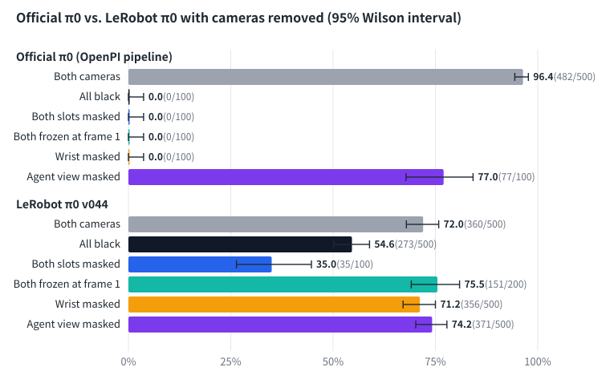

<div align="center">

# Do robot policies actually use their cameras?

Camera ablations of four robot policies on LIBERO-Spatial

[](https://github.com/chaoshengsc/libero-camera-ablation/actions/workflows/ci.yml)
[](https://github.com/chaoshengsc/libero-camera-ablation/releases)
[](LICENSE)

**English** · [中文](README_CN.md)

[Findings](#1-camera-ablations) · [Reproduction](#2-reproduction-of-the-public-checkpoints) · [Quick start](#quick-start) · [Data](results/README.md) · [Docs](docs/README.md)

</div>

**Does completing a simulated task mean a robot uses its cameras?** We reproduce five public checkpoints and test how π0, π0.5, OpenVLA, and SmolVLA depend on vision on LIBERO-Spatial.

**With every camera blacked out, three policies score 0%. LeRobot π0 v044 retains 53–56%; official π0 in OpenPI scores 0/100.**

<p align="center">
  
  <br><sub>Same task and initial state. The two right-hand policies receive black images; the videos show their actual actions in the simulator.</sub>
</p>

| Your goal | Start here |
|---|---|
| Understand the findings | [Key findings](#1-camera-ablations) → [Full experiments & figures](docs/EXPERIMENTS.md) |
| Reproduce an experiment | [Install](docs/INSTALL.md) → [Script index](scripts/README.md) → [Troubleshoot](docs/TROUBLESHOOTING.md) |
| Verify a number | [Result tables](results/README.md) → [Raw evaluations](dashboard/data/) → [Notes & corrections](docs/NOTES.md) |

[Docs & data guide](docs/README.md) · [Interactive results](https://chaoshengsc.github.io/libero-camera-ablation/dashboard/?lang=en) · [Repository layout](#repository-layout) · [Limitations](#limitations)

## 1. Camera ablations

### All cameras black

| Policy | Normal vision | All cameras black |
|---|---|---|
| π0.5 | 99% | 0% |
| OpenVLA | 81% | 0% |
| SmolVLA | 83% | 0% |
| **π0 · LeRobot v044** | 76% | **56%** |

These are representative 100-episode runs. Normal vision uses the first 10 episodes per task of each 500-episode evaluation. The first three policies also score 0% in a repeat.

π0 scores **53–56%** across five all-black runs. They use the same 100 initial states, so they are not 500 independent states.

<a id="15-official-π0-control"></a>

### Official π0 control



With normal vision, official π0 in OpenPI scores **96.4%** and LeRobot π0 v044 in LeRobot scores **72.0%** (500 episodes each). With all cameras black, they score **0/100** and **53–56%** across five LeRobot runs, respectively.

**Success without vision was observed only for the tested LeRobot π0 checkpoint together with its pipeline.**

Both the weights and the inference pipeline differ between the two sides; the difference cannot be attributed to the weights alone.

A re-run at 360 rendering ruled out rendering resolution. Two further checks add context:

- **Live images.** π0.5 and SmolVLA score 0% with frozen first frames in both runs. Removing the wrist camera brings π0.5 from 98.4% to 4.6% (500 episodes per condition).
- **Fixed-action replay.** Cross-replay succeeds in **348/873 = 39.9%**; self-replay is 95/97. The post-hoc best per-task score of 77.8% is selection-biased. Replay does not establish the mechanism behind blind LeRobot π0.

See the [full experiments](docs/EXPERIMENTS.md) for designs, repeated runs, per-task results, and statistical scope. The [notes](docs/NOTES.md) retain chronological records and corrections.

## 2. Reproduction of the public checkpoints

| Model | Task | This repo (500 episodes) | Reference | Reproduced |
|---|---|---|---|---|
| ACT | ALOHA Transfer Cube | **83.2%** | 83.0% (Hugging Face repo) | ✅ |
| OpenVLA | LIBERO-Spatial | **86.2%** | 84.7 ± 0.9% (official README) | ✅ |
| SmolVLA | LIBERO-Spatial | **85.4%** | 90% (paper, 100 episodes) | ✅ |
| π0.5 | LIBERO-Spatial | **98.0%** | 98.8% (OpenPI), 97.0% (LeRobot) | ✅ |
| Diffusion Policy | PushT (2-D, not MuJoCo) | **63.0%** | 65.4% (LeRobot model card) | ✅ |

“Reproduced” means the two 95% confidence intervals overlap. Each evaluation has 500 episodes, giving an interval of about ±1–4 points.

SmolVLA uses `lerobot/smolvla_libero` with `n_action_steps=10`, trained on LIBERO-Spatial only. The paper trains on four suites; its 100-episode reference has an interval of about ±6 points.

See [reproduction details](docs/EXPERIMENTS.md#2-reproduction-of-the-public-checkpoints) for the full reference context.

## Quick start

These results were obtained on Ubuntu 24.04 with an RTX A5000 24 GB. Follow [installation](docs/INSTALL.md) for environment versions and setup. Find checkpoint sources and revisions in the [results guide](results/README.md).

After configuring the environments, `EMB_ROOT`, and checkpoints, run an ACT example from the repository root:

```bash
bash scripts/eval/run_act.sh
python3 scripts/analysis/summarize_eval.py act_cube_500
```

The first runs 500 GPU evaluation episodes; the second summarizes the output. For missing environments or checkpoints, use [installation](docs/INSTALL.md) and [troubleshooting](docs/TROUBLESHOOTING.md).

Find other models and ablations in the [script index](scripts/README.md).

<details>
<summary>No GPU: regenerate tables and figures from included data</summary>

From the repository root, use Python 3.10+ and the standard library:

```bash
python3 dashboard/build.py
python3 scripts/analysis/make_figures.py
```

The first builds dashboard data from raw records; the second generates CSVs and bilingual SVGs. Inspect [results/](results/README.md) and [media/](media/) afterward. Missing raw files require investigation.

</details>

## Repository layout

```text
libero-camera-ablation/
├── README.md / README_CN.md   Project overview and key findings
├── docs/                     Full experiments, setup, troubleshooting, history
├── scripts/                  Evaluation, interventions, summaries, figures
├── env/                      Configuration, constraints, package inventories
├── results/                  Recomputable result tables and trajectory data
├── media/                    Figures and demos; Chinese assets in zh/
├── dashboard/                Interactive results and data builder
│   └── data/                 Raw evaluations and diagnostics
├── viewer/                   Local MuJoCo trajectory viewer
├── tests/                    Metrics and published-number consistency
└── .github/                  CI and issue templates
```

[Document map](docs/README.md) · [Execution entry points](scripts/README.md) · [Results directory](results/README.md) · [Environment directory](env/README.md)

## Limitations

- One benchmark suite (LIBERO-Spatial) and one seed.
- The ablations in [experiments 1.1–1.3](docs/EXPERIMENTS.md#11-all-cameras-black) use 100 episodes per run ([the single-camera experiment](docs/EXPERIMENTS.md#14-wrist-camera-removed-500-episodes) uses 500), so differences under about 13 points are not meaningful; for π0, repeated runs of one condition differed by up to 18 points.
- The π0 ablation results come from LeRobot's v044 checkpoint. Official π0 was tested only in OpenPI's own pipeline; the two sides differ in pipeline (rendering resolution was ruled out by a re-run at 360), so the difference cannot be attributed to the weights alone. Each official π0 ablation condition was run once, 100 episodes.
- The [official control and replay study](docs/EXPERIMENTS.md#15-official-π0-control) measures object positions across 50 initial states per task: the largest coordinate spans are 3–9 cm, and fixed-action cross-replay succeeds in 39.9% of trials. This describes the tested states and sequences; it does not determine the visual requirements of the entire benchmark or the mechanism behind LeRobot π0's success without vision.
- Diffusion Policy was evaluated on PushT (2-D physics), not in MuJoCo.

## Acknowledgements and licenses

Code is [MIT licensed](LICENSE). Upstream projects, checkpoints, and the tokenizer retain their own terms. Model weights and the tokenizer are not included.

<details>
<summary>Upstream projects, checkpoints, and papers</summary>

This repository contains no model weights and no upstream source code. It builds on:

| Project | Used for | License |
|---|---|---|
| [LeRobot](https://github.com/huggingface/lerobot) v0.6.1 | ACT, Diffusion Policy, SmolVLA, π0, π0.5 evaluation and π0 fine-tuning | Apache-2.0 |
| [OpenVLA](https://github.com/openvla/openvla) | OpenVLA evaluation | MIT |
| [OpenPI](https://github.com/Physical-Intelligence/openpi) | π0 and π0.5 reference numbers | Apache-2.0 |
| [LIBERO](https://github.com/Lifelong-Robot-Learning/LIBERO) | benchmark | MIT |
| [Diffusion Policy](https://github.com/real-stanford/diffusion_policy), [ACT](https://github.com/tonyzhaozh/act) | original methods | MIT |
| [MuJoCo](https://github.com/google-deepmind/mujoco), [gym-aloha](https://github.com/huggingface/gym-aloha), [gym-pusht](https://github.com/huggingface/gym-pusht) | simulation | Apache-2.0 |

Checkpoints: `lerobot/act_aloha_sim_transfer_cube_human`, `openvla/openvla-7b-finetuned-libero-spatial`, `lerobot/smolvla_libero`, `lerobot/pi05_libero_finetuned_v044`, `lerobot/pi0_libero_finetuned_v044`, `lerobot/diffusion_pusht`. Exact commits are in [`results/reproduction.csv`](results/reproduction.csv) and [`docs/NOTES.md`](docs/NOTES.md). Each checkpoint has its own license. The π0 tokenizer comes from the gated `google/paligemma-3b-pt-224` repository under the Gemma terms and is not included.

Papers: [ACT](https://arxiv.org/abs/2304.13705) · [Diffusion Policy](https://arxiv.org/abs/2303.04137) · [OpenVLA](https://arxiv.org/abs/2406.09246) · [LIBERO](https://arxiv.org/abs/2306.03310) · [SmolVLA](https://arxiv.org/abs/2506.01844) · [π0](https://arxiv.org/abs/2410.24164) · [π0.5](https://arxiv.org/abs/2504.16054)

</details>

## Citation

If you use these results or scripts, please cite:

```bibtex
@software{shengchao2026liberocameraablation,
  author  = {ShengChao},
  title   = {libero-camera-ablation: Camera-input ablations of four robot policies on LIBERO-Spatial},
  year    = {2026},
  version = {1.4.0},
  url     = {https://github.com/chaoshengsc/libero-camera-ablation}
}
```

The same entry is in [`CITATION.cff`](CITATION.cff), which GitHub's "Cite this repository" button reads.
