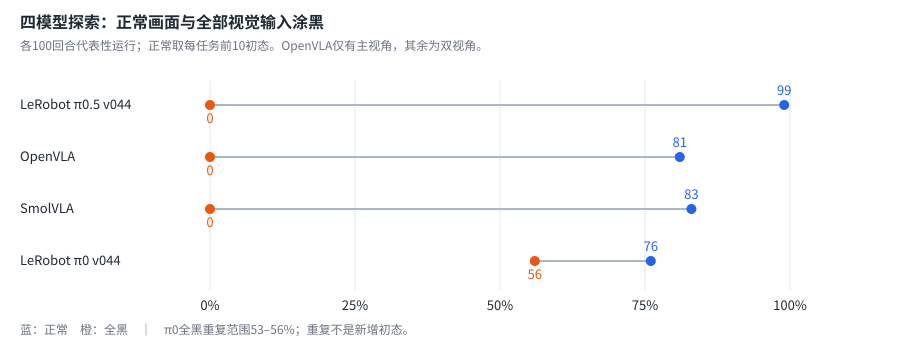
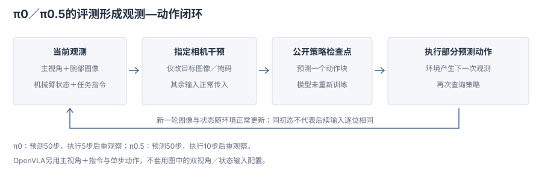
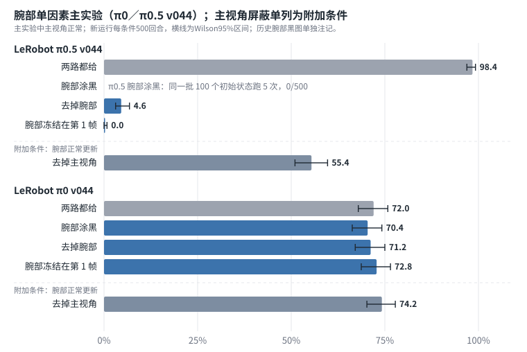
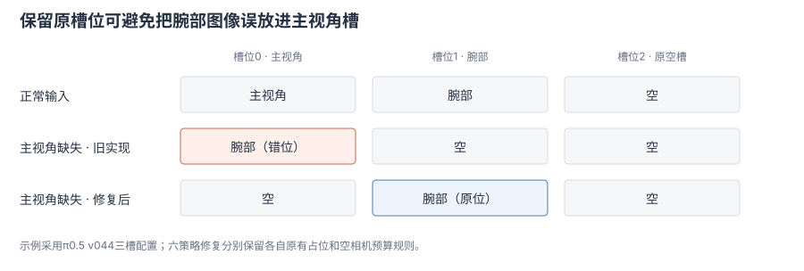
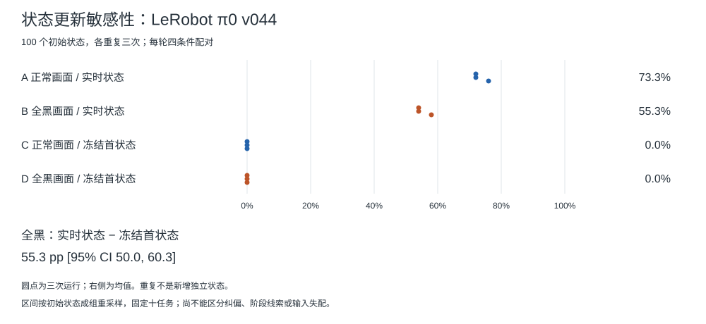
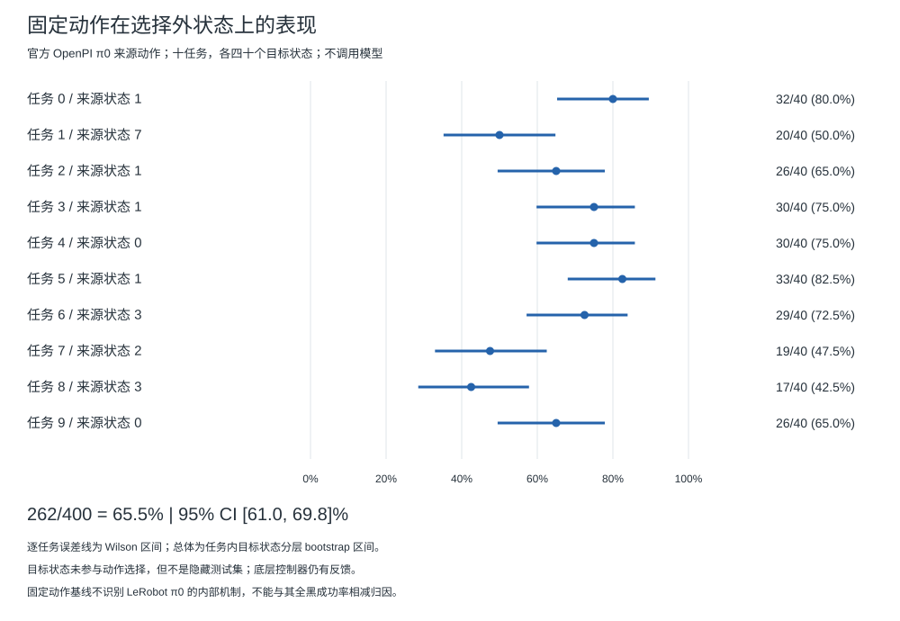
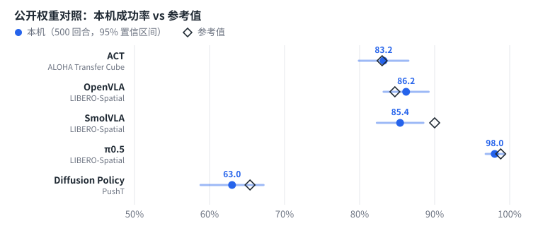

<div align="center">

# 机器人策略对相机干预呈现不同响应

**机器人策略的视觉依赖研究 · LIBERO-Spatial 仿真实验**

[English](README.md) · **中文** · [直接打开交互结果页](https://chaoshengsc.github.io/libero-camera-ablation/dashboard/?lang=zh)

[](https://github.com/chaoshengsc/libero-camera-ablation/actions/workflows/ci.yml)
[](https://github.com/chaoshengsc/libero-camera-ablation/releases)
[](LICENSE)

</div>

**本项目通过相机输入干预与管线核查，分析公开机器人策略的视觉依赖。** 腕部主实验中，π0.5屏蔽腕部后从 **98.4%降至4.6%**；全黑探索中，LeRobot π0 v044仍保留 **53–56%** 成功。两项观察分别对应下方不同对照组。

## 项目产物覆盖评测、分析与问题定位

| 工作 | 直接产物 | 证据 |
|---|---|---|
| 多策略评测与可控相机干预 | 四模型全黑总览；双模型腕部深入；同初态配对分析 | 下方结果 · [完整结构](docs/STUDY_MAP_CN.md) |
| 输入管线问题定位与上游贡献 | 修复PR覆盖 **6策略**；提交前回归 **旧21失败／6通过 → 修后27/27通过** | [问题 #5118](https://github.com/huggingface/lerobot/issues/5118) · [PR #5129](https://github.com/huggingface/lerobot/pull/5129) |
| 公开证据与离线重算 | 逐回合记录、统计表、图件和CI一致性检查 | [公开数据](dashboard/data/) · [执行与分析入口](scripts/README_CN.md) |

**本人在上游贡献中的职责：** 在相机消融中发现槽位问题、确定修复范围、审阅改动并提交问题与PR。

**覆盖范围：** 四模型全黑探索 → 三个双视角模型早期扰动 → π0／π0.5腕部深入。研究使用公开检查点；不同阶段覆盖不同。

<a id="1-相机消融"></a>

## 1. 四模型在全部视觉输入变黑后呈现不同表现



**π0.5、OpenVLA、SmolVLA在所测全黑回合中均为0%；LeRobot π0 v044仍有成功。** 图中每个条件是100回合代表性结果；π0全黑五次为53–56%，复用相同100初态，不是500独立初态。OpenVLA只有主视角，其余三个有主视角与腕部输入。

[逐任务结果](results/blackout_per_task.csv) · [重复与协议](docs/EXPERIMENTS_CN.md#11-所有相机涂黑)

<details>
<summary>展开四模型图中数值</summary>

| 模型 | 正常画面 | 全部视觉输入涂黑 |
|---|---|---|
| π0.5 | 99% | 0% |
| OpenVLA | 81% | 0% |
| SmolVLA | 83% | 0% |
| π0 · LeRobot v044 | 76% | 56% |

</details>

## 2. 核心深入：只改变腕部，主视角保持正常

后期主实验只覆盖 **LeRobot π0／π0.5 v044**。π0.5先前在腕部黑图下接近零。后续实验用槽位屏蔽和首帧冻结检验这一现象，同时记录π0 v044的不同响应。

### 任务场景与闭环流程说明了实验对象

一个实际任务是“拿起盘子与小烤碗之间的黑碗，放到盘子上”。主视角提供场景画面，腕部相机提供手边画面；π0／π0.5还接收机械臂状态和任务指令，输出控制动作。



正常、腕部屏蔽与腕部冻结的新运行条件各含 **10任务×50初态＝500回合**；π0.5腕部黑图沿用历史同100初态的5次执行。各回合按环境任务成功标记计分。检查点各自的控制预算与重推理间隔保留，不能据此作统一协议模型排名。

| 腕部干预 | 模型实际收到的输入 | 设计作用 |
|---|---|---|
| 黑图 | 像素置零，视觉掩码保持真 | 保留该路视觉槽位并改变画面内容 |
| 屏蔽输入 | 原槽位使用空占位，掩码为0 | 关闭该路视觉掩码，其他相机不挪位 |
| 首帧冻结 | 重复本回合首张真实腕部画面，掩码保持真 | 停止腕部图像更新，主视角与状态继续更新 |

### 同一批初态上的腕部结果形成主比较

两模型的下列共同条件各500回合；图中另注历史腕部黑图与主视角附加条件。

| 腕部条件（主视角始终正常） | π0.5 v044 | π0 v044 |
|---|---|---|
| 正常更新 | **492/500 · 98.4%** | 360/500 · 72.0% |
| 屏蔽腕部输入（原槽位mask＝0） | **23/500 · 4.6%** | 356/500 · 71.2% |
| 固定本回合腕部首帧 | **0/500 · 0.0%** | 364/500 · 72.8% |



**π0.5对所测腕部干预高度敏感；π0 v044没有呈现相同的降幅。** 这限定于对应检查点和协议。首帧冻结也改变图像—状态同步，不能据此唯一识别模型内部机制。

**按同任务／初态索引配对，腕部屏蔽减正常：** π0.5为 **−93.8个百分点，95%区间[−96.0, −91.6]**；π0为 **−0.8个百分点，[−6.1, 4.5]**。区间为配对成功标记差的均值±1.96倍标准误（正态近似），不代表新任务泛化区间。

π0.5腕部黑图复用历史同100初态的5次运行，均0/100，不并入这组500初态配对臂。缺失条件与补做安排统一列在后文。

[主实验、附加条件与未测项](docs/STUDY_MAP_CN.md#2-主实验只改变腕部主视角始终正常) · [配对差值与95%区间](results/single_camera_summary.csv)

### 主视角（全局相机）单独屏蔽已有500回合结果

这组附加对照只改变主视角处理，腕部与本体状态正常更新。表中主视角与全局相机指同一路agent-view输入。

| 主视角处理（腕部正常） | π0.5 v044 | π0 v044 |
|---|---|---|
| 正常更新 | 492/500 · 98.4% | 360/500 · 72.0% |
| 原槽位mask为0 | **277/500 · 55.4%** | **371/500 · 74.2%** |

主视角单独涂黑另有早期100回合结果；主视角单独冻结尚未完成，已列入下方补做计划。

## 3. 工程贡献：避免把“相机挪位”测成“相机缺失”

在搭建消融时发现：LeRobot缺失排在前面的相机键后，会将仍在场的图像向前排列。**腕部图像可能进入主视角槽位，而程序不报错。** 这会让相机消融测到错误的输入布局。



本项目的正式mask干预保持相机原槽位；上游修复PR覆盖 **6个策略**。提交前新增测试在旧实现上 **21失败／6通过**，修复后 **27/27通过**。这说明错误已被回归用例复现和覆盖；PR链接代表已提交贡献，不表示已合并。

[原始问题与复现](https://github.com/huggingface/lerobot/issues/5118) · [修复代码与测试说明](https://github.com/huggingface/lerobot/pull/5129)

## 4. 补充对照限定了π0全黑成功的解释范围

| 补充检查 | 关键观察 | 结论边界 |
|---|---|---|
| **官方π0/OpenPI对照** | 同100初态：官方正常93/100、全黑0/100；LeRobot正常65/100、全黑五次53–56/100 | 权重和管线同时变化，不能唯一归因于转换或训练 |
| **P1：状态输入更新** | LeRobot π0三轮均值：正常73.3%、全黑55.3%；冻结模型首状态后均0% | 支持状态更新敏感性，未分开在线纠偏、阶段线索和输入失配 |
| **P2：固定动作回放** | 预先选定的官方π0动作在选择外状态成功262/400＝65.5%，95%区间61.0–69.8% | 固定动作也能成功，不证明LeRobot内部就是回放；不能与P1相减归因 |

这些是 **π0异常结果的解释边界**，不是腕部单因素实验的额外因果验证。P1有自己的配对正常组；P2不调用策略模型。它们不能拼进同一组正常／干预柱图。

<details>
<summary>展开技术对照图与完整统计</summary>


图中所有条件每点100回合，500回合运行只取每任务前10初态。完整正常500回合另列参考：官方482/500＝96.4%，LeRobot360/500＝72.0%。同100初态重复不画合并Wilson区间。 按task/init索引匹配，不代表策略噪声或完整状态逐位相同。





[匹配100回合记录](results/official_pi0_matched100.csv) · [官方对照完整表](results/official_pi0_summary.csv) · [P1配对统计](results/state_feedback_comparisons.csv) · [P2逐任务统计](results/replay_holdout_summary.csv)

</details>

## 实验覆盖随研究阶段逐步聚焦

| 模型／工作线 | 已做 | 未做或不适用 |
|---|---|---|
| π0、π0.5 v044 | 单路/全黑、双路噪声/冻结；腕部深入、主视角mask附加条件 | 主视角单独冻结、单路噪声；π0.5双路mask未测 |
| SmolVLA | 单路/全黑、双路噪声/冻结 | 原槽位mask、腕部单独冻结未测 |
| OpenVLA | 唯一主视角的黑图干预 | 腕部不适用；mask/冻结/噪声未测 |
| 官方π0/OpenPI | 额外检查点与管线对照、部分渲染复测 | 不是同权重管线对照 |
| 工程参考对照 | ACT、OpenVLA、SmolVLA、π0.5、Diffusion Policy，各500回合 | 与四模型相机研究不是同一组模型；不作统一排名 |

[完整模型×干预覆盖](docs/STUDY_MAP_CN.md) · [全部实验与限制](docs/EXPERIMENTS_CN.md) · [原始公开记录](dashboard/data/) · [交互结果页](https://chaoshengsc.github.io/libero-camera-ablation/dashboard/?lang=zh)

## 后续将补齐尚未完成的适用对照

主视角单独屏蔽已有500回合结果，主视角单独涂黑已有早期100回合重复。已有腕部主实验和主视角mask附加对照已经完成。下列补做用于扩充控制条件与模型覆盖，尚未启动，不计入当前结果。

### 核心补证将扩展主实验的对照条件

| 尚未完成的内容 | 当前边界 | 后续补做安排 |
|---|---|---|
| π0／π0.5的主视角完整单因素对照 | 仅mask进入后期500回合组；单独冻结未做，黑图只有早期100回合组 | 补主视角单独冻结与匹配主实验规模的黑图对照，腕部保持正常更新 |
| π0.5双路同时mask | 正常、腕部mask、主视角mask已有；双路mask未做 | 补双路mask，形成完整的相机可用性四条件比较 |

### 模型与扰动扩展将补齐适用的覆盖

| 尚未完成的内容 | 当前边界 | 后续补做安排 |
|---|---|---|
| 单相机噪声 | 已有噪声同时作用于两路，不能分开单路效应 | 对适用双视角模型分别补主视角单独噪声与腕部单独噪声 |
| SmolVLA的mask与腕部单独冻结 | 目前只有早期黑图、双路噪声和双路冻结 | 先核对接口与相机槽位语义，再补适用的单路mask和腕部冻结 |
| OpenVLA的其他单视角干预 | 当前仅测试其唯一主视角的黑图；冻结和噪声未做 | 补唯一主视角的首帧冻结与噪声，并核验mask接口的适用性 |

OpenVLA没有腕部输入，腕部条件不适用，不作为缺失实验或待补结果。每项补做前将固定检查点、对应正常组、任务/初态、干预与回合数；完成并验收后再更新结果。上述安排不表示实验已经启动。

<details>
<summary>展开任务演示（两个模型的选例，不是四模型总览）</summary>


同一任务、同一初始状态。右侧两次策略接收黑图；视频展示实际仿真动作。选例用于说明现象，完整结论以统计结果为准。

</details>

<a id="2-公开权重的复现"></a>

<details>
<summary>展开五个公开检查点的工程参考对照</summary>



每个检查点500回合。项目以本仓库95%区间与来源参考范围是否重叠作工程判据，不是性能等效检验或严格同协议复现。ACT和PushT不属于LIBERO相机消融；π0不在这五项参考表中。

| 检查点 | 本仓库（500回合） |
|---|---|
| ACT | 83.2% |
| OpenVLA | 86.2% |
| SmolVLA | 85.4% |
| π0.5 | 98.0% |
| Diffusion Policy | 63.0% |

[逐项数字与来源](results/reproduction.csv) · [判据和配置差异](docs/EXPERIMENTS_CN.md#2-公开权重的复现)

</details>

## 版本与证据

**v1.5.4 · 2026-11-09**：已完成腕部主实验、主视角mask附加对照与公开证据验收；上述补做实验尚未启动。评测证据沿用v1.5.3，旧冻结标签保持不动。

[研究结构与覆盖范围](docs/STUDY_MAP_CN.md) · [冻结说明](docs/FREEZE_CN.md) · [公开证据SHA-256](results/freeze_20261109_v1.5.3.sha256)

<details>
<summary>复现、安装、仓库结构与完整局限（无需阅读这些也可理解上方结果）</summary>

## 快速开始

**先从已有数据重算结果，无需 GPU 或模型权重。** 在仓库根目录，使用 Python 3.10+：

```bash
python3 -m venv .venv
. .venv/bin/activate
python -m pip install numpy
python dashboard/build.py
python scripts/analysis/make_figures.py
python scripts/analysis/summarize_followup.py
```

前三条创建并启用本地分析环境、安装 NumPy（P1/P2 的 bootstrap 需要）；若已有合适环境，可跳过。
后三条依次生成看板数据、原有表格和图件、P1/P2 的逐回合表与配对区间。
产物在 [results/](results/README_CN.md) 和 [media/](media/)，原始结果入口见[数据导航](docs/README_CN.md#实验与证据对应)。

若提示缺少 NumPy，检查是否启用了上述环境；缺少原始文件时应先核对完整检出，不用重新跑模型补表。

**运行相机消融：** 先按[安装指南](docs/INSTALL_CN.md)配置 Ubuntu/EGL、`EMB_ROOT` 与对应权重，再使用[最小相机评测示例](scripts/README_CN.md#最小相机评测)。该示例执行10个仿真回合，只检查入口；完整复现、P1和P2入口均在[脚本索引](scripts/README_CN.md)。

## 仓库结构

```text
libero-camera-ablation/
├── README.md / README_CN.md   项目概览与主要结论
├── docs/                     完整实验、安装、排错与历史记录
├── scripts/                  评测、干预、汇总与出图
├── env/                      环境配置、版本约束与导出清单
├── results/                  可重算的结果表与轨迹数据
├── media/                    图表与演示；中文图在 zh/
├── dashboard/                交互结果页及数据生成入口
│   └── data/                 原始评测与诊断记录
├── viewer/                   本地 MuJoCo 轨迹查看器
├── tests/                    指标与公开数字的一致性检查
└── .github/                  CI 与问题模板
```

[文档地图](docs/README_CN.md) · [执行入口](scripts/README_CN.md) · [结果目录](results/README_CN.md) · [环境目录](env/README_CN.md)

## 局限

- 相机研究仅覆盖 LIBERO-Spatial。早期相机实验固定环境 seed；P1 在同一批100个初始状态上增加三轮模型噪声重复，未扩展新任务或真机。
- [实验1.1–1.3](docs/EXPERIMENTS_CN.md#11-所有相机涂黑)每次100回合，[单路相机实验](docs/EXPERIMENTS_CN.md#14-只去掉腕部相机500-回合)为500回合。重复同一初始状态不增加独立样本；差异须按对应配对与重复结构解释，不设统一的13点阈值。π0 的早期同条件重复最多相差18点。
- π0的结果限于所测检查点与管线组合。官方对照使用原生GCS资产与通过门槛的OpenPI路径。另行试用的HF检查点冒烟0/50，且未通过同源性核验，不能作为同权重的管线对照。官方π0在256/360渲染下全黑均为0/100；这未隔离权重与其他推理差异，各消融条件只跑一次100回合。
- [回放](docs/EXPERIMENTS_CN.md#16-固定动作回放)只覆盖所选动作与状态；P2目标未参与动作选择，但此前已用于其他评测，不是隐藏测试集。它与P1的模型/状态协议不同，不能相减计算机制贡献。P1未保存逐步终止标记和完整图像，冻结状态仍无法唯一识别机制。完整NPZ审计工件留在Git外；公开数据可独立重算成功率与区间。
- Diffusion Policy 评测的是 PushT（2D 物理），不在 MuJoCo 里。


</details>

## 致谢与许可证

代码使用 [MIT 许可证](LICENSE)。模型、分词器与上游项目各自的许可证仍适用；权重和分词器不包含在仓库里。

<details>
<summary>上游项目、权重来源与论文</summary>

本仓库不包含任何模型权重，也不包含上游源码。它建立在这些项目之上：

| 项目 | 用途 | 许可证 |
|---|---|---|
| [LeRobot](https://github.com/huggingface/lerobot) v0.6.1 | ACT、Diffusion Policy、SmolVLA、π0、π0.5 的评测 | Apache-2.0 |
| [OpenVLA](https://github.com/openvla/openvla) | OpenVLA 评测 | MIT |
| [OpenPI](https://github.com/Physical-Intelligence/openpi) | 原生π0推理与π0 / π0.5参考数字 | Apache-2.0 |
| [LIBERO](https://github.com/Lifelong-Robot-Learning/LIBERO) | 基准 | MIT |
| [Diffusion Policy](https://github.com/real-stanford/diffusion_policy)、[ACT](https://github.com/tonyzhaozh/act) | 原始方法 | MIT |
| [MuJoCo](https://github.com/google-deepmind/mujoco)、[gym-aloha](https://github.com/huggingface/gym-aloha)、[gym-pusht](https://github.com/huggingface/gym-pusht) | 仿真 | Apache-2.0 |

Hugging Face权重：`lerobot/act_aloha_sim_transfer_cube_human`、`openvla/openvla-7b-finetuned-libero-spatial`、`lerobot/smolvla_libero`、`lerobot/pi05_libero_finetuned_v044`、`lerobot/pi0_libero_finetuned_v044`、`lerobot/diffusion_pusht`。Revision前缀见[`results/reproduction.csv`](results/reproduction.csv)，来源和更正见[`docs/NOTES_CN.md`](docs/NOTES_CN.md)；各权重保留自己的许可证。

OpenPI原版π0使用`gs://openpi-assets/checkpoints/pi0_libero`；[OpenPI指南](docs/OPENPI_CN.md)记录固定实现、下载清单及独立GCS分词器缓存。LeRobot π0 / π0.5使用受限的`google/paligemma-3b-pt-224`分词器，适用其自身条款；仓库不分发分词器文件或访问凭证。

论文：[ACT](https://arxiv.org/abs/2304.13705) · [Diffusion Policy](https://arxiv.org/abs/2303.04137) · [OpenVLA](https://arxiv.org/abs/2406.09246) · [LIBERO](https://arxiv.org/abs/2306.03310) · [SmolVLA](https://arxiv.org/abs/2506.01844) · [π0](https://arxiv.org/abs/2410.24164) · [π0.5](https://arxiv.org/abs/2504.16054)

</details>

## 引用

如果用到了这里的结果或脚本，请引用：

```bibtex
@software{shengchao2026liberocameraablation,
  author  = {ShengChao},
  title   = {libero-camera-ablation: Camera-input ablations of four robot policies on LIBERO-Spatial},
  year    = {2026},
  version = {1.5.4},
  url     = {https://github.com/chaoshengsc/libero-camera-ablation}
}
```

同样的条目也在 [`CITATION.cff`](CITATION.cff) 里，GitHub 页面上的 “Cite this repository” 按钮读的就是它。

v1.5.3标签是相机消融的证据冻结版，冻结范围与核验方法见[冻结说明](docs/FREEZE_CN.md)。v1.5标签包含P1/P2结果、对应公开数据与复现指南；较早的v1.4标签保留单相机实验快照。引用v1.5之后的改动时，应同时记录实际使用的提交。
