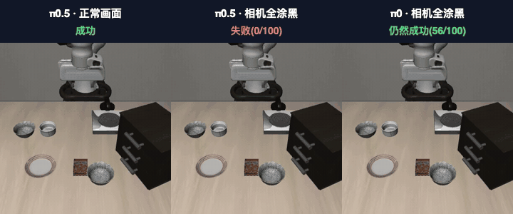
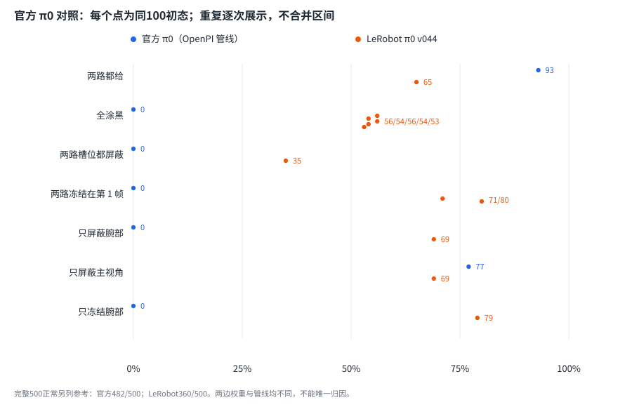

<div align="center">

# Do robot policies actually use their cameras?

Camera ablations of four robot policies on LIBERO-Spatial

[](https://github.com/chaoshengsc/libero-camera-ablation/actions/workflows/ci.yml)
[](https://github.com/chaoshengsc/libero-camera-ablation/releases)
[](LICENSE)

[English](README.md) · **中文**

[主要发现](#1-相机消融) · [复现结果](#2-公开权重的复现) · [快速开始](#快速开始) · [数据](results/README_CN.md) · [文档导航](docs/README_CN.md)

</div>

**机器人在仿真里完成了任务，是否就说明它在用相机？** 我们对 π0、π0.5、OpenVLA、SmolVLA 的公开检查点做相机输入消融，并用官方 π0 对照、固定动作回放和状态输入检查界定结果的含义。五个公开权重的评测与参考对照是工程基础。

**在所测全黑回合中，π0.5、OpenVLA 和 SmolVLA 检查点均为 0%；LeRobot π0 v044 五次为 53–56%，官方 π0 在 OpenPI 中为 0/100。**

<p align="center">
  
  <br><sub>同一任务、同一初始状态。右边两次运行中，模型收到的是全黑图像；视频展示仿真器里的实际动作。</sub>
</p>

| 你想做什么 | 从这里进入 |
|---|---|
| 看结论 | [主要发现](#1-相机消融) → [完整实验与图表](docs/EXPERIMENTS_CN.md) |
| 复现实验 | [安装](docs/INSTALL_CN.md) → [脚本索引](scripts/README_CN.md) → [排错](docs/TROUBLESHOOTING_CN.md) |
| 核对数字 | [结果表](results/README_CN.md) → [原始评测](dashboard/data/) → [实验日志与更正](docs/NOTES_CN.md) |

[文档导航](docs/README_CN.md) · [交互结果页](https://chaoshengsc.github.io/libero-camera-ablation/dashboard/?lang=zh) · [仓库结构](#仓库结构) · [局限](#局限)

## 1. 相机消融

### 所有相机涂黑

| 模型 | 正常画面 | 所有相机涂黑 |
|---|---|---|
| π0.5 | 99% | 0% |
| OpenVLA | 81% | 0% |
| SmolVLA | 83% | 0% |
| **π0 · LeRobot v044** | 76% | **56%** |

表中是各 100 回合的一组结果；正常条件取 500 回合评测中每任务的前 10 回合。前三个模型全涂黑后各重跑一次仍为 0%。π0 全涂黑五次为 **53–56%**，五次使用同一批 100 个初始状态，不能当成 500 个独立状态。

<a id="15-官方-π0-对照"></a>

### 官方 π0 对照



官方 π0 在 OpenPI 中正常为 **96.4%**，LeRobot π0 v044 在 LeRobot 中为 **72.0%**（各 500 回合）；相机全涂黑后，前者为 **0/100**，后者五次为 **53–56%**。

**这些全黑对照中，LeRobot π0 v044 及其管线仍有成功回合，官方 π0/OpenPI 未观察到成功。** 两边同时改变了权重与推理管线，差别不能单独归因到权重；官方 π0 改用 360 渲染后全黑仍为 0/100，这次分辨率变更未恢复成功。

其他检查补全了这幅图景：

- **画面冻结敏感性。** 所测 π0.5 和 SmolVLA 检查点冻结首帧后，两次运行都为 0%；屏蔽原槽位的腕部相机时，π0.5 从 98.4% 降到 4.6%（各 500 回合）。冻结同时改变视觉内容更新与图像—状态同步，尚不能分离两者的作用。
- **固定动作也能成功。** P2 将每任务预先选定的一套官方 π0 动作原样回放，在未参与动作选择的状态上成功 **262/400 = 65.5%**（95% 分层 bootstrap 区间 **61.0–69.8%**），自回放 **10/10**。这补强固定动作基线，不能识别 LeRobot π0 的内部机制。[协议、历史回放与边界](docs/EXPERIMENTS_CN.md#16-固定动作回放) · [数据](results/replay_holdout_summary.csv)。
- **状态输入冻结敏感性。** P1 中 LeRobot π0 v044 正常画面/全黑画面下的三轮均值为 **73.3% / 55.3%**；冻结模型接收的首状态后两者均为 **0%**。这说明状态更新敏感性，尚不能区分在线纠偏、动作阶段线索与输入失配。[配对统计](docs/EXPERIMENTS_CN.md#17-状态输入更新敏感性) · [数据](results/state_feedback_comparisons.csv)。

完整设计、重复运行、逐任务结果与统计口径见[实验说明](docs/EXPERIMENTS_CN.md)；原始记录与更正见[实验日志](docs/NOTES_CN.md)。

评测预算因路径而异：OpenVLA为220控制步，其他LIBERO模型客户端为280步，均另有10步稳定等待。这些结果不构成统一预算的模型排名；官方π0也采用本仓库客户端协议，详见[协议与验收范围](docs/EXPERIMENTS_CN.md#3-评测协议与验收范围)。

## 2. 公开权重的复现

| 模型 | 任务 | 本仓库（500 回合） | 基准 | 本项目判据 |
|---|---|---|---|---|
| ACT | ALOHA Transfer Cube | **83.2%** | 83.0%（Hugging Face 仓库） | ✅ |
| OpenVLA | LIBERO-Spatial | **86.2%** | 84.7 ± 0.9%（官方 README） | ✅ |
| SmolVLA | LIBERO-Spatial | **85.4%** | 90%（论文，100 回合） | ✅ |
| π0.5 | LIBERO-Spatial | **98.0%** | 98.8%（OpenPI），97.0%（LeRobot） | ✅ |
| Diffusion Policy | PushT（2D，非 MuJoCo） | **63.0%** | 65.4%（LeRobot 模型卡） | ✅ |

本项目将本仓库的 95% 置信区间与参考范围比较：来源报告的 ± 值、可按回合数估计的区间，或未给范围时的单点；有重叠记为达到本项目的“复现”判据。这是参考对照约定，不是性能等效检验，也不表示严格复现了相同训练配置。各模型评测 500 回合，本仓库区间约 ±1–4 个百分点。

SmolVLA 使用 `lerobot/smolvla_libero`，`n_action_steps=10`，只在 LIBERO-Spatial 上训练；论文基准来自四套件训练，100 回合的区间约 ±6 个百分点。完整出处见[复现说明](docs/EXPERIMENTS_CN.md#2-公开权重的复现)。

## 快速开始

**先从已有数据重算结果，无需 GPU 或模型权重。** 在仓库根目录，使用 Python 3.10+：

```bash
python3 -m venv .venv
. .venv/bin/activate
python -m pip install numpy
python dashboard/build.py
python scripts/analysis/make_figures.py
python scripts/analysis/summarize_followup.py
```

前三条创建并启用本地分析环境、安装 NumPy（P1/P2 的 bootstrap 需要）；若已有合适环境，可跳过。
后三条依次生成看板数据、原有表格和图件、P1/P2 的逐回合表与配对区间。
产物在 [results/](results/README_CN.md) 和 [media/](media/)，原始结果入口见[数据导航](docs/README_CN.md#实验与证据对应)。

若提示缺少 NumPy，检查是否启用了上述环境；缺少原始文件时应先核对完整检出，不用重新跑模型补表。

**运行相机消融：** 先按[安装指南](docs/INSTALL_CN.md)配置 Ubuntu/EGL、`EMB_ROOT` 与对应权重，再使用[最小相机评测示例](scripts/README_CN.md#最小相机评测)。该示例执行10个仿真回合，只检查入口；完整复现、P1和P2入口均在[脚本索引](scripts/README_CN.md)。

## 仓库结构

```text
libero-camera-ablation/
├── README.md / README_CN.md   项目概览与主要结论
├── docs/                     完整实验、安装、排错与历史记录
├── scripts/                  评测、干预、汇总与出图
├── env/                      环境配置、版本约束与导出清单
├── results/                  可重算的结果表与轨迹数据
├── media/                    图表与演示；中文图在 zh/
├── dashboard/                交互结果页及数据生成入口
│   └── data/                 原始评测与诊断记录
├── viewer/                   本地 MuJoCo 轨迹查看器
├── tests/                    指标与公开数字的一致性检查
└── .github/                  CI 与问题模板
```

[文档地图](docs/README_CN.md) · [执行入口](scripts/README_CN.md) · [结果目录](results/README_CN.md) · [环境目录](env/README_CN.md)

## 局限

- 相机研究仅覆盖 LIBERO-Spatial。早期相机实验固定环境 seed；P1 在同一批100个初始状态上增加三轮模型噪声重复，未扩展新任务或真机。
- [实验1.1–1.3](docs/EXPERIMENTS_CN.md#11-所有相机涂黑)每次100回合，[单路相机实验](docs/EXPERIMENTS_CN.md#14-只去掉腕部相机500-回合)为500回合。重复同一初始状态不增加独立样本；差异须按对应配对与重复结构解释，不设统一的13点阈值。π0 的早期同条件重复最多相差18点。
- π0 的结果限于所测检查点与管线组合。官方对照采用通过正常评测门槛的 OpenPI 路径，LeRobot 转换路径冒烟为 0/50、未通过验收。官方 π0 在 256/360 渲染下全黑均为 0/100；这一检查不隔离权重、转换或其他推理差异。官方 π0 的消融条件各只跑了一次 100 回合。
- [回放](docs/EXPERIMENTS_CN.md#16-固定动作回放)只覆盖所选动作与状态；P2目标未参与动作选择，但此前已用于其他评测，不是隐藏测试集。它与P1的模型/状态协议不同，不能相减计算机制贡献。P1未保存逐步终止标记和完整图像，冻结状态仍无法唯一识别机制。完整NPZ审计工件留在Git外；公开数据可独立重算成功率与区间。
- Diffusion Policy 评测的是 PushT（2D 物理），不在 MuJoCo 里。

## 致谢与许可证

代码使用 [MIT 许可证](LICENSE)。模型、分词器与上游项目各自的许可证仍适用；权重和分词器不包含在仓库里。

<details>
<summary>上游项目、权重来源与论文</summary>

本仓库不包含任何模型权重，也不包含上游源码。它建立在这些项目之上：

| 项目 | 用途 | 许可证 |
|---|---|---|
| [LeRobot](https://github.com/huggingface/lerobot) v0.6.1 | ACT、Diffusion Policy、SmolVLA、π0、π0.5 的评测与 π0 微调 | Apache-2.0 |
| [OpenVLA](https://github.com/openvla/openvla) | OpenVLA 评测 | MIT |
| [OpenPI](https://github.com/Physical-Intelligence/openpi) | 原生π0推理与π0 / π0.5参考数字 | Apache-2.0 |
| [LIBERO](https://github.com/Lifelong-Robot-Learning/LIBERO) | 基准 | MIT |
| [Diffusion Policy](https://github.com/real-stanford/diffusion_policy)、[ACT](https://github.com/tonyzhaozh/act) | 原始方法 | MIT |
| [MuJoCo](https://github.com/google-deepmind/mujoco)、[gym-aloha](https://github.com/huggingface/gym-aloha)、[gym-pusht](https://github.com/huggingface/gym-pusht) | 仿真 | Apache-2.0 |

Hugging Face权重：`lerobot/act_aloha_sim_transfer_cube_human`、`openvla/openvla-7b-finetuned-libero-spatial`、`lerobot/smolvla_libero`、`lerobot/pi05_libero_finetuned_v044`、`lerobot/pi0_libero_finetuned_v044`、`lerobot/diffusion_pusht`。Revision前缀见[`results/reproduction.csv`](results/reproduction.csv)，来源和更正见[`docs/NOTES_CN.md`](docs/NOTES_CN.md)；各权重保留自己的许可证。

OpenPI原版π0使用`gs://openpi-assets/checkpoints/pi0_libero`；[OpenPI指南](docs/OPENPI_CN.md)记录固定实现、下载清单及独立GCS分词器缓存。LeRobot π0 / π0.5使用受限的`google/paligemma-3b-pt-224`分词器，适用其自身条款；仓库不分发分词器文件或访问凭证。

论文：[ACT](https://arxiv.org/abs/2304.13705) · [Diffusion Policy](https://arxiv.org/abs/2303.04137) · [OpenVLA](https://arxiv.org/abs/2406.09246) · [LIBERO](https://arxiv.org/abs/2306.03310) · [SmolVLA](https://arxiv.org/abs/2506.01844) · [π0](https://arxiv.org/abs/2410.24164) · [π0.5](https://arxiv.org/abs/2504.16054)

</details>

## 引用

如果用到了这里的结果或脚本，请引用：

```bibtex
@software{shengchao2026liberocameraablation,
  author  = {ShengChao},
  title   = {libero-camera-ablation: Camera-input ablations of four robot policies on LIBERO-Spatial},
  year    = {2026},
  version = {1.5.0},
  url     = {https://github.com/chaoshengsc/libero-camera-ablation}
}
```

同样的条目也在 [`CITATION.cff`](CITATION.cff) 里，GitHub 页面上的 “Cite this repository” 按钮读的就是它。

v1.5标签包含P1/P2结果、对应公开数据与复现指南；较早的v1.4标签保留单相机实验快照。引用v1.5之后的改动时，应同时记录实际使用的提交。
