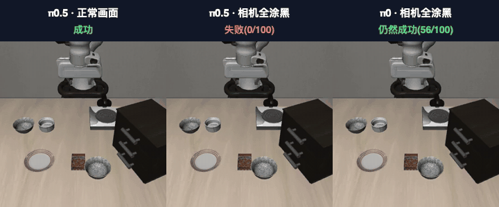
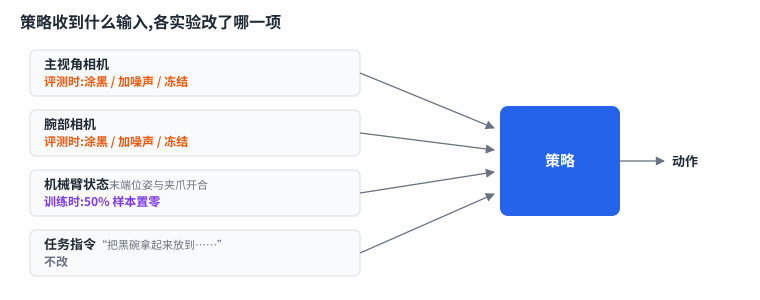
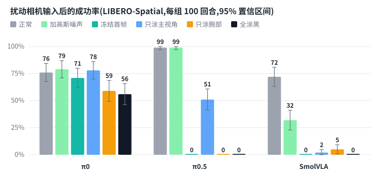
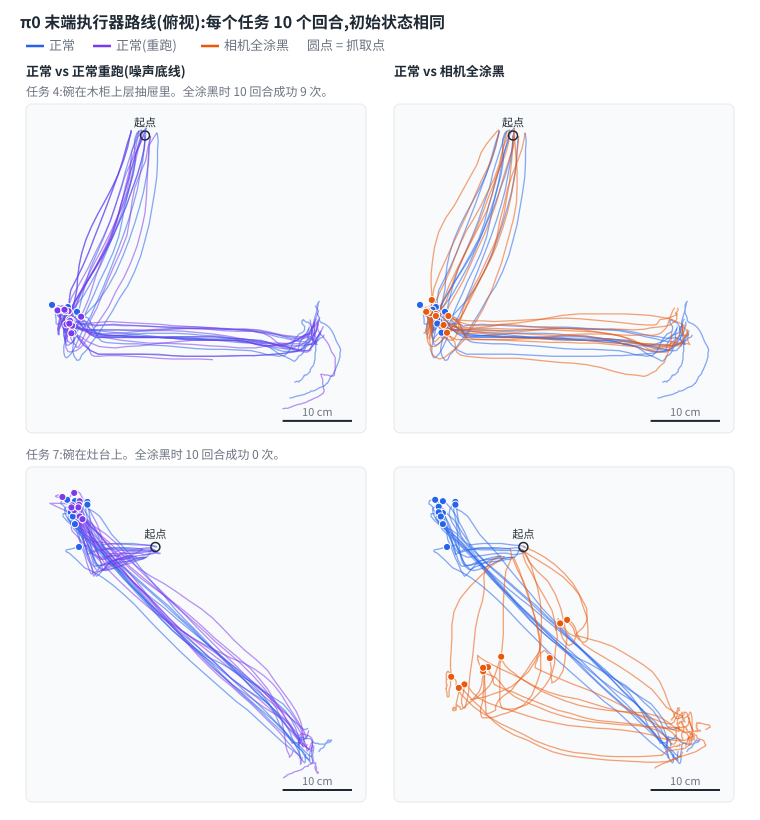
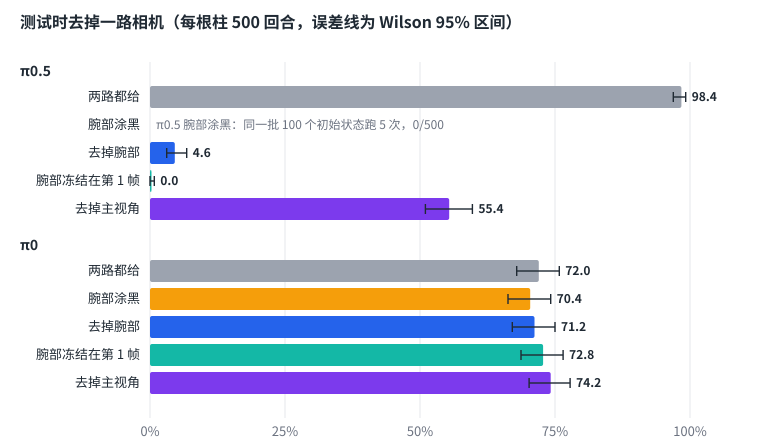
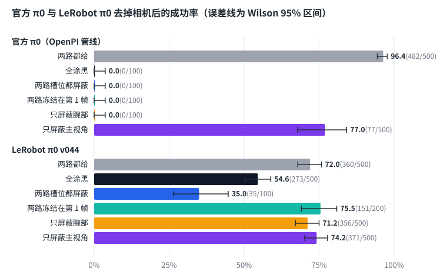
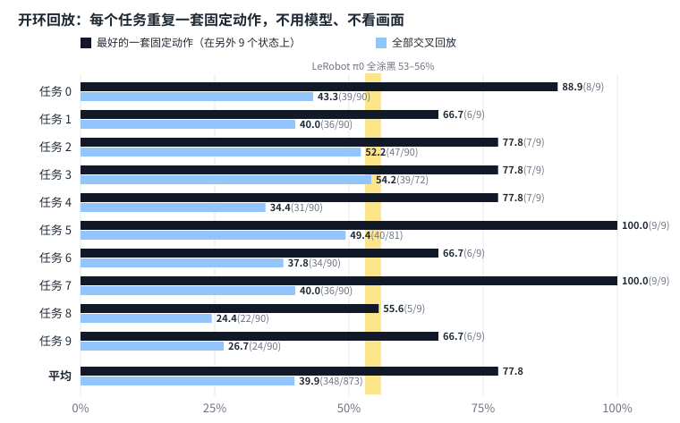
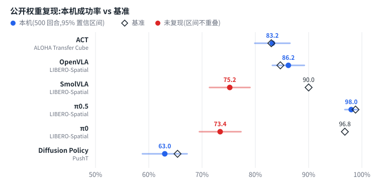
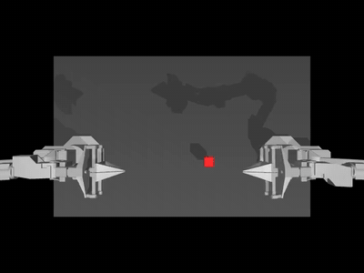

<div align="center">

# 四个机器人策略在 LIBERO-Spatial 上的相机输入消融

**四个策略里有三个离开实时相机画面就无法完成任务；一个公开的 π0 权重在所有相机涂黑后仍有 53–56% 的成功率。**

[](https://github.com/chaoshengsc/libero-camera-ablation/actions/workflows/ci.yml)
[](https://github.com/chaoshengsc/libero-camera-ablation/releases)
[](https://chaoshengsc.github.io/libero-camera-ablation/dashboard/?lang=zh)
[](https://github.com/huggingface/lerobot/tree/v0.6.1)
[](pyproject.toml)
[](LICENSE)

[English](README.md) | **中文**

</div>

<p align="center">
  
  <br><sub>同一任务、同一初始状态。视频是仿真器里实际发生的情况；右边两次运行中，策略收到的是全黑图像。</sub>
</p>

- **做了什么。** 对四个公开的 LIBERO 权重（π0、π0.5、OpenVLA、SmolVLA）改动相机输入：全涂黑、冻结在第一帧、加噪声、只去掉两路相机中的一路。机械臂状态和任务指令不变。
- **结果。** 相机全涂黑后，π0.5、OpenVLA、SmolVLA 降到 0%；画面冻结后，π0.5 和 SmolVLA 也降到 0%。LeRobot 的公开 π0 权重正常时是 71–76%，全涂黑后是 53–56%（各五次运行，全涂黑的五次用的是同一批 100 个初始状态），画面冻结后的两次运行是 71% 和 80%，两路相机都在模型内部屏蔽后是 35%（一次运行）。只去掉腕部相机时（各 500 回合），π0.5 从 98.4% 降到 4.6%，π0 不变（71.2%，两路都给是 72.0%）。官方 π0（OpenPI 原版，正常 96.4%）两路相机全涂黑或在槽位里屏蔽后都是 0/100，只屏蔽腕部也是 0/100，只屏蔽主视角为 77/100（[1.5 节](#15-官方-π0-对照)）。
- **由此可知。** 在 LIBERO-Spatial 上，只看成功率看不出策略有没有在用相机。涂黑或冻结画面是一种成本很低的检查。LeRobot π0 的画面冻结后几乎不掉，而全涂黑与屏蔽两种去法相差约 20 个百分点：它更像主要依靠机械臂状态和指令，剩下多少成功率取决于去掉画面的方式，不能简单说成“不需要画面”。
- **适用范围。** 一个套件、一个种子、每次运行 100 回合（1.4 节为 500 回合）；单路相机、噪声、冻结画面这几个条件各跑了两次。π0 看不见也能成功只在 LeRobot 这个权重上出现，官方 π0 在 OpenPI 原版管线下去掉视觉后是 0%（1.5 节）；两边的推理管线不同，原因没有检验。只有 1.5 节主体的预注册在出结果前推送到仓库（提交 `6c54c5d`）；1.4 节和 1.5 节后补的条件只在本地写了事前记录，没有公开时间戳，相应结论按探索性结果看待。

做消融之前，先把五个公开权重复现到了基准成功率的抽样误差范围内（[第 2 节](#2-公开权重的复现)）。全部在一台工作站上完成（RTX A5000 24 GB，Ubuntu 24.04，EGL 无头渲染），所有改动都是包装脚本，不改上游源码。本页的结果表由 CI 从 `dashboard/data/` 里的原始评测文件重新计算并核对。

## 更新动态

- **2026-10-29** · 官方 π0 对照（[1.5 节](#15-官方-π0-对照)）：OpenPI 原版正常 96.4%，去掉视觉后 0%；只屏蔽腕部 0%，只屏蔽主视角 77%。旧版说 LeRobot π0 权重“训练不足”，本仓库没有检验过这一点，已改为陈述事实。
- **2026-10-28** · 单相机实验，每个条件 500 回合（[1.4 节](#14-只去掉腕部相机500-回合)）。搭实验时发现 LeRobot 在缺一路相机时会悄悄错位相机槽位：已报告为 [lerobot#5118](https://github.com/huggingface/lerobot/issues/5118)，修复提交为 [lerobot#5129](https://github.com/huggingface/lerobot/pull/5129)。
- **2026-10-14** · [v1.3](https://github.com/chaoshengsc/libero-camera-ablation/releases/tag/v1.3)：所有消融各重跑一次；撤回了“π0 依赖腕部相机”的结论。
- **2026-10-07** · [v1.2](https://github.com/chaoshengsc/libero-camera-ablation/releases/tag/v1.2)：仓库改名；SmolVLA 消融改用复现表里的同一个权重重跑。

**目录：** [相机消融](#1-相机消融) · [复现](#2-公开权重的复现) · [快速开始](#快速开始) · [仓库结构](#仓库结构) · [局限](#局限) · [致谢与许可证](#致谢与许可证) · [引用](#引用)

## 1. 相机消融

LIBERO 上的策略收到两路相机画面、机械臂状态（末端位姿与夹爪开合）和一句任务指令。每个实验只改相机输入。



除 1.4 节外，本节所有数字都是 100 回合的成功率（10 个任务 × 10 个初始状态，各条件用同一个种子）。只算抽样误差，两个条件要相差约 13 个百分点以上才有意义。对 π0 门槛更高：同一个条件跑两次最多相差 18 个百分点（见 1.2 节）。

### 1.1 所有相机涂黑

| 模型 | 正常 | 全涂黑 |
|---|---|---|
| π0.5 | 99% | 0% |
| OpenVLA | 81% | 0% |
| SmolVLA | 83% | 0% |
| **π0** | 76% | **56%** |

三个模型没有画面就完全不能动作，各自重跑一次仍是 0%。π0 仍有 56% 的回合成功：七个任务上 10 次成功 6 到 9 次，另外三个任务上 0 或 1 次。另外四次运行是 54%、56%、54% 和 53%，[lerobot#3591](https://github.com/huggingface/lerobot/issues/3591) 对同一个权重报告的是约 60%。

### 1.2 单路相机、噪声、冻结画面



两次运行的成功率（%），各 100 回合，写作“第一次 / 第二次”。第二次用同样的脚本和同一个种子重跑。

| 模型 | 正常 | 加高斯噪声 | 冻结首帧 | 只涂主视角 | 只涂腕部 | 全涂黑 |
|---|---|---|---|---|---|---|
| π0 | 76 / 72 | 79 / 67 | 71 / 80 | 78 / 68 | 59 / 77 | 56 / 56 |
| π0.5 | 99 / 98 | 99 / 97 | 0 / 0 | 51 / 57 | 0 / 0 | 0 / 0 |
| SmolVLA | 83 / – | 78 / 73 | 0 / 0 | 33 / 31 | 4 / 4 | 0 / 0 |

- **π0.5 和 SmolVLA 需要实时画面。** 冻结的第一帧是真实的、分布内的画面，但两个模型在两次运行里都降到 0%。加噪声对两者的影响都在抽样误差之内。
- **对 π0，只有两路相机都涂黑才有稳定的影响。** 每次运行都因此掉约 20 个百分点。加噪声、冻结首帧、只涂一路相机时，两次运行相差 9 到 18 个百分点，结果都落在 59% 到 80% 之间，围绕它正常时的 71–76%。这些运行说明不了 π0 依赖其中哪一路相机（1.4 节用 500 回合回答了这个问题）。只看第一次运行，像是依赖腕部相机（59%）。只涂黑腕部相机又跑了四次，是 77%、72%、67% 和 70%，五次平均 69%，而正常的五次平均是 74%。
- **对 π0.5 和 SmolVLA，腕部相机比主视角更重要**，两次运行都是如此。

OpenVLA 只接收主视角画面和指令，所以对它只有“全涂黑”这一个条件。

### 1.3 看不见的 π0 在成功的任务上走的是同一条路线

逐步记录了末端执行器的位置，用动态时间规整比较路线（消除速度差异）。



| 比较 | 路线差异 | 抓取点差异 |
|---|---|---|
| 看不见的 π0 对看得见的 π0，取前者至少成功一半的任务 | 2.8 / 3.2 cm | 2.4 / 2.2 cm |
| π0.5 对 π0，都看得见，同样的任务 | 2.9 / 3.0 cm | 2.6 / 2.5 cm |
| 看得见的 π0 对它自己的重跑 | 3.4 / 3.3 cm | 2.4 / 2.4 cm |
| 看不见的 π0 对看得见的 π0，任务 7（前者从未成功） | 10.9 / 10.3 cm | 24.1 / 23.7 cm |

每格是整套比较的第一次和第二次运行。看不见的 π0 至少成功一半的任务，第一次有七个（0–4、6、8），第二次有六个（0–4、6）。

在能完成的任务上，看不见的 π0 与看得见的 π0 之间的差别，和两次正常运行之间的差别一样大，两次运行都是这样。在任务 7 上，两次它都走到了别处；这个任务上两次正常运行之间只相差 2.6 和 2.2 cm。任务 9（看不见时 10 次成功 0 次和 1 次）方向相同，但没有那么清楚：路线相差 7.8 和 4.9 cm，两次正常运行之间是 3.3 和 3.6 cm。任务 5（成功 3 次和 4 次）下不了结论：相差 6.0 和 6.6 cm，两次正常运行之间是 6.6 和 4.7 cm。

“重跑”一行不计两次正常运行几乎重合的任务：它们用同一个种子，还没有分叉，不能反映噪声。第一次是任务 0–3，第二次只有任务 0。

这不能说明看不见的 π0 是不是在重复记住的动作。这种比较分不出“跟着碗走”的策略和“每个任务重复一套动作”的策略，而同一任务的不同初始状态之间碗的位置变化有多大，这里没有测。各任务的数字见 [`results/trajectory.csv`](results/trajectory.csv) 和[看板](https://chaoshengsc.github.io/libero-camera-ablation/dashboard/?lang=zh)。

### 1.4 只去掉腕部相机：500 回合

1.2 节的“只涂腕部”留下两个问题：π0.5 的 0% 是因为离不开腕部画面，还是因为一张训练时没见过的黑图把它搞乱了；π0 每次 100 回合、波动太大，看不出它依赖哪一路相机。这一节对两个模型的每个条件各跑 500 回合（10 个任务 × 50 个初始状态，这一轮新跑的条件都用同一批初始状态），处理腕部相机的方式有三种：

- **涂黑**：像素为 0，注意力掩码仍为 1，模型照常“看”这张黑图。
- **去掉**：在模型内部把这一路的槽位填空、掩码设为 0，与配置里那个始终为空的第三个相机槽的填法相同。
- **冻结**：整个回合都给它本回合第 1 帧的真实画面。

实验设计、验收条件和预期都在运行前写下（[docs/NOTES_CN.md](docs/NOTES_CN.md) 的“预先登记”一节）。它没有在出结果前提交到仓库，没有公开时间戳，所以只是事前记录，不是严格意义上的预注册。



| 腕部相机 | π0.5 | π0 |
|---|---|---|
| 两路都给 | 98.4% | 72.0%（重跑 71.2%） |
| 涂黑 | 0/500（同一批 100 个初始状态跑 5 次：1.2 节的两次，另加三次） | 70.4% |
| 去掉 | 4.6% | 71.2%（重跑 72.6%） |
| 冻结在第 1 帧 | 0.0% | 72.8% |
| 去掉主视角，只给腕部 | 55.4% | 74.2% |

- **π0.5 离不开腕部的实时画面。** 三种处理都接近 0，所以此前的 0% 不是黑图造成的。给一张真实但不更新的腕部画面（0.0%）比完全不给（4.6%）还差。
- **去掉腕部不改变 π0 的成功率。** 三种处理与“两路都给”按初始状态配对比较，差值的 95% 区间都在事前记录的 ±8 个百分点之内（McNemar 检验 p ≥ 0.58）。但它两路全涂黑仍有 53–56%（1.1 节），这只说明这个权重不太依赖画面，不说明主视角就够用。
- **只给腕部时 π0.5 还剩 55.4%**，与 1.2 节“只涂主视角”的 51% 和 57% 一致；各任务差别很大（任务 5 为 1/50，任务 2 为 49/50）。
- **做法上要注意。** 在 LeRobot v0.6.1 里，直接从输入里删掉主视角会让腕部画面挪进主视角的槽位，不会报错（[lerobot#5118](https://github.com/huggingface/lerobot/issues/5118)，修复已提交为 [lerobot#5129](https://github.com/huggingface/lerobot/pull/5129)，待审）。这里的“去掉”是在原槽位上屏蔽，每次运行都在日志里打印各槽位的掩码作为证据。

每回合的结果与首帧哈希在 `results/single_camera.csv`，汇总与配对统计在 `results/single_camera_summary.csv`。

### 1.5 官方 π0 对照

LeRobot π0 全涂黑仍有 53–56%，这是 π0 的共性，还是这个权重的特性？这一节换成 Physical Intelligence 官方的 `pi0_libero` 检查点，在同一环境、同一批初始状态上重复去掉视觉。设计、门槛（正常 ≥ 92%）和判读规则在运行前写好并推送到仓库（提交 `6c54c5d`）；后补的单路相机和 360 渲染条件也在运行前写下，但只在本地记录、没有公开时间戳，是事前记录而不是预注册，相应结论属探索性。

- **先用 LeRobot 转换版，跑不出来。** `lerobot/pi0_libero_base` 在 LeRobot v0.6.1 管线下冒烟 0/50，三组对照各 0/20。LeRobot 维护者说过，把 OpenPI 的图像处理和归一化移植进 LeRobot 并不直接（[lerobot#2533](https://github.com/huggingface/lerobot/issues/2533)）。按预先写好的退路改用 OpenPI 原版：OpenPI 在独立环境里作为本机服务给出动作块，LeRobot 的 LIBERO 环境当客户端（`scripts/openpi/`）。
- **门槛与初始状态。** 正常 500 回合 482/500 = 96.4%，与 OpenPI 旧 README 的 96.8% 一致。每回合第 1 步的末端位置与 1.4 节 π0 的正常运行逐回合相同（500/500）。



| 条件 | 官方 π0（OpenPI，渲染 256） | LeRobot π0 v044（LeRobot，渲染 360） |
|---|---|---|
| 两路都给 | 96.4%（500 回合） | 72.0%（500 回合） |
| 全涂黑 | **0/100** | 53–56%（五次，各 100 回合） |
| 两路槽位都屏蔽 | **0/100** | 35/100 |
| 两路冻结在第 1 帧（辅助） | 0/100 | 71%、80% |
| 只屏蔽腕部 | **0/100** | 71.2%（500 回合） |
| 只屏蔽主视角 | **77/100** | 74.2%（500 回合） |
| 只冻结腕部（第 1 帧真实画面） | **0/100** | 72.8%（500 回合） |

- **官方 π0 离开视觉就不能完成任务。** 按 `6c54c5d` 公开的规则，“看不见也能成功”是 LeRobot 这个权重的特性，不是 π0 的共性。LeRobot π0 的槽位屏蔽只有 35%，低于规则里的 40%，所以这个结论只以全涂黑为依据。
- **官方 π0 离不开腕部相机，主视角是部分依赖（探索性）。** 只屏蔽腕部 0/100；只屏蔽主视角还剩 77%（区间 68–84%），同一批 100 个初始状态上正常为 93/100（配对 McNemar p = 0.0025），没到事前记录的 85%，不算“可以拿掉”（这两个阈值是在看到两路去掉为 0% 之后定的）。腕部改成整回合给第 1 帧的真实画面、掩码保持为真，仍是 0/100（事前记录在运行前推送，提交 `c7e9023`）：它需要随时间更新的腕部画面，屏蔽时的 0% 不是陌生输入形态造成的。这是测试时拿掉一路相机，不是只用一路相机训练。
- **不能归因到权重。** 两边不只换了权重，还换了推理管线（JAX 与 PyTorch、图像缩放、归一化与增量还原）和渲染分辨率（分辨率随后已排除，见下一条）。同一份官方权重在 LeRobot 管线下 0/50、在 OpenPI 管线下 50/50，可见管线本身就能造成很大差别。所以这里的“这个权重”指的是该权重连同它的推理管线；旁证是同一 LeRobot 管线下 π0.5 全涂黑为 0%，管线本身不会让策略看不见也能成功。LeRobot π0 为什么看不见也能成功，这里没有检验。
- **分辨率不是原因。** 官方 π0 改用与 LeRobot 一侧相同的 360 渲染再跑一次（事前记录，只在本地）：正常 99/100，全涂黑 0/100，两路槽位都屏蔽 0/100；首帧哈希与 1.4 节逐回合相同。剩下的差别只有权重与推理管线。
- **同一个 LeRobot 权重，去视觉的方式不同，结果也不同。** 槽位屏蔽 35% 低于五次全涂黑（53–56%）中的每一次。五次全涂黑用的是同一批 100 个初始状态，不是 500 个独立样本，所以不合并检验，只报告逐次按初始状态配对的范围：McNemar p 为 0.0015–0.0064。

**开环回放基线：固定动作能成功相当一部分，但解释不了全部。** 不用模型、不看画面，把官方 π0 正常运行时记录的动作原样回放到同一任务的其他初始状态上（设计在运行前推送，提交 `c7e9023`）。自回放 95/97，回放有效。全部交叉回放合计 **348/873 = 39.9%**，同一任务里物体位置最多只差 3–9 cm。事前定的指标“每任务最好的一套”平均 77.8%，但它是事后挑最大值：即使每套都只有 39.9%，挑出来的期望也有 64.8%，所以我们收回了事前规则所附的“主要反映基准”。分任务也对不上：任务 5、7 固定动作都能 9/9，LeRobot π0 全涂黑只有 30% 和 0%（分任务 Spearman ρ = 0.40，p = 0.25）。结论：场景变化小，能解释 LeRobot π0 全涂黑成功的一部分；它不看画面时并不只是在重复一套固定动作。这是对事前判读的 1 处事后修改，见 [docs/NOTES_CN.md](docs/NOTES_CN.md) 的更正。



原始数据在 `dashboard/data/official_pi0/`，汇总与初始状态核对在 `results/official_pi0_summary.csv`（其中 LeRobot 全涂黑一行是同一批 100 个状态五次运行的合计），过程与偏离见 [docs/NOTES_CN.md](docs/NOTES_CN.md) 2026-10-28/29 各节。

<details>
<summary><b>关于这些数字</b>：π0 权重、“正常”一列、置信区间、两次运行之间的波动、噪声、相关工作</summary>

- **π0 权重。** `lerobot/pi0_libero_finetuned_v044` 500 回合的正常成功率是 73.4%。OpenPI 旧版 README 给出过按 `pi0_libero` 配置训练的 π0 在 Spatial 上 96.8%。这个权重从没写进 OpenPI 的 README，但可以从 OpenPI 的公开存储桶下载（`gs://openpi-assets/checkpoints/pi0_libero`）；[LIBERO-Plus](https://arxiv.org/abs/2510.13626) 报告它不加扰动时 94.2%，所有相机涂黑后不超过 2%（其 Table 1 与图 2）；本仓库在 OpenPI 原版管线下复测，正常为 96.4%（1.5 节）。本 README 旧版写过“没有发布官方 π0 LIBERO 权重”，这是错的（见 [`docs/NOTES_CN.md`](docs/NOTES_CN.md) 的更正）。LeRobot 维护者在 [lerobot#2114](https://github.com/huggingface/lerobot/issues/2114) 说过更早的 LeRobot π0 权重还需要更多训练；v044 是否如此本仓库没有检验，它与官方权重差距的原因未知。
- **“正常”一列。** 第一个数取自各模型 500 回合评测里每个任务的前 10 回合，它们与消融实验用的是同一批初始状态。第二个数是另外单独跑的 100 回合；SmolVLA 没有跑。π0 的五次正常运行是 76%、73%、76%、72% 和 71%。
- **置信区间。** 单个数字的 95% 置信区间最宽约 ±10 个百分点。同一任务的回合之间相关，所以这些区间偏乐观。
- **两次运行之间的波动。** 同一个种子的两次运行并不完全相同：评测固定了随机种子，但没有让 GPU 计算确定化，π0 两次运行的末端路线从第一步起就不一样，重跑一次实际上是重新抽样。π0.5 和 SmolVLA 两次相差不超过 6 个百分点；π0 在同一个条件上最多相差 18 个百分点。
- **噪声。** 高斯噪声，标准差 0.1，像素范围 [0, 1]。
- **相关工作。** [LIBERO-PRO](https://arxiv.org/abs/2510.03827) 和 [LIBERO-Plus](https://arxiv.org/abs/2510.13626) 用范围大得多的扰动研究了 LIBERO 策略的鲁棒性。

</details>

## 2. 公开权重的复现



| 模型 | 任务 | 本仓库（500 回合） | 基准 | 是否复现 |
|---|---|---|---|---|
| ACT | ALOHA Transfer Cube | **83.2%** | 83.0%（Hugging Face 仓库） | ✅ |
| OpenVLA | LIBERO-Spatial | **86.2%** | 84.7 ± 0.9%（官方 README） | ✅ |
| SmolVLA | LIBERO-Spatial | **85.4%** | 90%（论文，100 回合） | ✅ |
| π0.5 | LIBERO-Spatial | **98.0%** | 98.8%（OpenPI），97.0%（LeRobot） | ✅ |
| Diffusion Policy | PushT（2D，非 MuJoCo） | **63.0%** | 65.4%（LeRobot 模型卡） | ✅ |

500 回合的 95% 置信区间为 ±1–4 个百分点。“复现”指两个区间有重叠。SmolVLA 是 `lerobot/smolvla_libero`，评测时 `n_action_steps=10`，与第 1 节是同一个权重。它只在 LIBERO-Spatial 上训练，论文则在四个 LIBERO 套件上训练；论文的 100 回合对应的基准区间约为 ±6 个百分点。

<p align="center"><br><sub>ACT · ALOHA Transfer Cube：右臂抓起方块交给左臂。</sub></p>

各任务明细在[看板](https://chaoshengsc.github.io/libero-camera-ablation/dashboard/?lang=zh)上。回放视频体积大，没有发布；本地有视频文件时看板可以播放。基准出处与完整实验记录见 [`docs/NOTES_CN.md`](docs/NOTES_CN.md)。

## 快速开始

```bash
# 环境、缓存、权重、日志都放在这个目录下
export EMB_ROOT=/path/to/workdir

# 按 docs/INSTALL_CN.md 装好环境并下载权重后：
# ACT，500 回合，RTX A5000 上约 17 分钟
bash scripts/eval/run_act.sh
python3 scripts/analysis/summarize_eval.py act_cube_500

# 四个 LIBERO 模型相机全涂黑，各 100 回合
bash scripts/eval/run_blackout_all.sh
python3 scripts/analysis/summarize_blackout.py
```

从 `dashboard/data/` 里的评测文件重新生成本页的图和表（不需要 GPU，不需要装任何依赖）：

```bash
python3 dashboard/build.py
python3 scripts/analysis/make_figures.py
```

| 文档 | 内容 |
|---|---|
| [`docs/INSTALL_CN.md`](docs/INSTALL_CN.md) | 三个 conda 环境、权重、分词器的逐步安装 |
| [`docs/TROUBLESHOOTING_CN.md`](docs/TROUBLESHOOTING_CN.md) | 安装和评测中遇到的每个问题：现象、原因、解决 |
| [`scripts/README_CN.md`](scripts/README_CN.md) | 每个结果对应哪个入口脚本和汇总脚本 |
| [`env/lock/`](env/lock/) | 从实际跑出结果的环境导出的完整包清单 |

## 仓库结构

| 路径 | 内容 |
|---|---|
| `scripts/eval/` | 评测入口；涂黑、扰动、轨迹记录的包装脚本 |
| `scripts/openpi/` | 在 OpenPI 环境里运行官方 π0 的本机服务、检查点下载脚本（1.5 节） |
| `scripts/analysis/` | 指标、汇总、出图 |
| `scripts/checks/` | GPU、EGL 无头渲染、视频解码自检 |
| `scripts/train/` | π0 微调脚本，对应 `docs/NOTES_CN.md` 里记录的一个实验（不属于上面的结果） |
| `results/` | 由 `dashboard/data` 生成的结果表（CSV），以及 1.3 节画图用的轨迹 |
| `dashboard/` | 结果看板，以及每次评测的原始 `eval_info.json` |
| `media/` | 本页用的图与演示（中文版在 `media/zh/`） |
| `docs/` | 安装、排查、复现笔记 |
| `env/` | 环境文件、pip 约束、导出的包清单 |
| `tests/` | 指标的单元测试、已发布数字的一致性检查、入口脚本的回归测试 |
| `viewer/` | 在本地用 MuJoCo 交互查看器回放策略轨迹 |
| `.github/` | CI 工作流与 issue 模板 |

## 局限

- 只用了一个基准套件（LIBERO-Spatial）和一个种子。
- 1.1–1.3 节的消融每次运行 100 回合，约 13 个百分点以内的差异没有意义（1.4 节为 500 回合）；对 π0，同一个条件重复运行最多相差 18 个百分点。
- π0 的消融结论来自 LeRobot v044 权重；官方 π0 只在 OpenPI 原版管线下测过，两边的管线不同（渲染分辨率已用 360 复测排除），差别不能单独归因到权重。官方 π0 的消融条件各只跑了一次 100 回合。
- 同一任务的不同初始状态之间场景变化有多大，这里没有测，所以本仓库不能说明这个基准本身需要多少视觉。
- Diffusion Policy 评测的是 PushT（2D 物理），不在 MuJoCo 里。

## 致谢与许可证

本仓库不包含任何模型权重，也不包含上游源码。它建立在这些项目之上：

| 项目 | 用途 | 许可证 |
|---|---|---|
| [LeRobot](https://github.com/huggingface/lerobot) v0.6.1 | ACT、Diffusion Policy、SmolVLA、π0、π0.5 的评测与 π0 微调 | Apache-2.0 |
| [OpenVLA](https://github.com/openvla/openvla) | OpenVLA 评测 | MIT |
| [OpenPI](https://github.com/Physical-Intelligence/openpi) | π0、π0.5 的基准数字 | Apache-2.0 |
| [LIBERO](https://github.com/Lifelong-Robot-Learning/LIBERO) | 基准 | MIT |
| [Diffusion Policy](https://github.com/real-stanford/diffusion_policy)、[ACT](https://github.com/tonyzhaozh/act) | 原始方法 | MIT |
| [MuJoCo](https://github.com/google-deepmind/mujoco)、[gym-aloha](https://github.com/huggingface/gym-aloha)、[gym-pusht](https://github.com/huggingface/gym-pusht) | 仿真 | Apache-2.0 |

权重：`lerobot/act_aloha_sim_transfer_cube_human`、`openvla/openvla-7b-finetuned-libero-spatial`、`lerobot/smolvla_libero`、`lerobot/pi05_libero_finetuned_v044`、`lerobot/pi0_libero_finetuned_v044`、`lerobot/diffusion_pusht`，具体 commit 见 [`results/reproduction.csv`](results/reproduction.csv) 和 [`docs/NOTES_CN.md`](docs/NOTES_CN.md)。各权重有自己的许可证。π0 的分词器来自受限仓库 `google/paligemma-3b-pt-224`，受 Gemma 条款约束，本仓库不包含。

论文：[ACT](https://arxiv.org/abs/2304.13705) · [Diffusion Policy](https://arxiv.org/abs/2303.04137) · [OpenVLA](https://arxiv.org/abs/2406.09246) · [LIBERO](https://arxiv.org/abs/2306.03310) · [SmolVLA](https://arxiv.org/abs/2506.01844) · [π0](https://arxiv.org/abs/2410.24164) · [π0.5](https://arxiv.org/abs/2504.16054)

## 引用

如果用到了这里的结果或脚本，请引用：

```bibtex
@software{shengchao2026liberocameraablation,
  author  = {ShengChao},
  title   = {libero-camera-ablation: Camera-input ablations of four robot policies on LIBERO-Spatial},
  year    = {2026},
  version = {1.4.0},
  url     = {https://github.com/chaoshengsc/libero-camera-ablation}
}
```

同样的条目也在 [`CITATION.cff`](CITATION.cff) 里，GitHub 页面上的 “Cite this repository” 按钮读的就是它。
