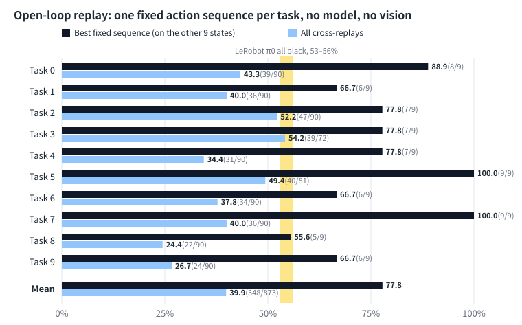

# Experiments & results

[中文](EXPERIMENTS_CN.md) · [Project overview](../README.md) · [Docs & data](README.md)

Full results for camera ablations, the official π0 control, open-loop replay, and public-checkpoint reproduction. The [notes](NOTES.md) retain chronological designs and corrections; this report does not replace the raw records.

[All black](#11-all-cameras-black) · [Noise & freeze](#12-one-camera-noise-frozen-image) · [Trajectories](#13-where-blind-π0-succeeds-it-follows-the-sighted-path) · [Single camera](#14-wrist-camera-removed-500-episodes) · [Official π0](#15-official-π0-control) · [Fixed-action replay](#16-fixed-action-replay) · [Reproduction](#2-reproduction-of-the-public-checkpoints)

---

## 1. Camera ablations

A LIBERO policy receives two camera images, the robot state (end-effector pose and gripper opening) and a language instruction. Each experiment changes only the camera input.

Except in section 1.4, every number in this section is a success rate over 100 episodes (10 tasks × 10 initial states, same seed for every condition). Sampling error alone means two conditions have to differ by about 13 points. For π0 the bar is higher: the same condition run twice differed by up to 18 points (section 1.2).

### 1.1 All cameras black

| Model | Normal | All cameras black |
|---|---|---|
| π0.5 | 99% | 0% |
| OpenVLA | 81% | 0% |
| SmolVLA | 83% | 0% |
| **π0** | 76% | **56%** |

Three models cannot act without images, and a second run of each gave 0% again. π0 succeeds in 56% of episodes: 6 to 9 out of 10 on seven tasks, and 0 or 1 out of 10 on the other three. Four more runs gave 54%, 56%, 54% and 53%, and [lerobot#3591](https://github.com/huggingface/lerobot/issues/3591) reports about 60% for the same checkpoint.

### 1.2 One camera, noise, frozen image

Success rate (%) in two runs of 100 episodes each, first run / second run. The second run repeats the same scripts with the same seed.

| Model | Normal | Gaussian noise | Frozen first frame | Agent-view black | Wrist black | All black |
|---|---|---|---|---|---|---|
| π0 | 76 / 72 | 79 / 67 | 71 / 80 | 78 / 68 | 59 / 77 | 56 / 56 |
| π0.5 | 99 / 98 | 99 / 97 | 0 / 0 | 51 / 57 | 0 / 0 | 0 / 0 |
| SmolVLA | 83 / – | 78 / 73 | 0 / 0 | 33 / 31 | 4 / 4 | 0 / 0 |

- **π0.5 and SmolVLA need a live image.** A frozen first frame is a real, in-distribution image, and it takes both to 0% in both runs. Noise changes neither beyond sampling error.
- **Only blacking out both cameras changes π0 reliably.** That costs about 20 points in every run. With noise, a frozen first frame, or one camera black, its two runs differ by 9 to 18 points and all land between 59% and 80%, around its normal 71–76%. These runs cannot show that π0 depends on either single camera (section 1.4 answers this with 500 episodes). The first run alone suggested a wrist-camera dependence (59%). Four more runs with the wrist camera black gave 77%, 72%, 67% and 70%, so the five average 69%, against 74% for five normal runs.
- **For π0.5 and SmolVLA the wrist camera matters more than the agent view**, in both runs.

OpenVLA takes only the agent-view image and the instruction, so only the all-black condition applies to it.

### 1.3 Where blind π0 succeeds, it follows the sighted path

The end-effector position was logged at every step, and paths were compared with dynamic time warping, which removes speed differences.

| Comparison | Path difference | Grasp-point difference |
|---|---|---|
| Blind π0 vs. sighted π0, on the tasks blind π0 solves at least half the time | 2.8 / 3.2 cm | 2.4 / 2.2 cm |
| π0.5 vs. π0, both sighted, same tasks | 2.9 / 3.0 cm | 2.6 / 2.5 cm |
| Sighted π0 vs. its own re-run | 3.4 / 3.3 cm | 2.4 / 2.4 cm |
| Blind π0 vs. sighted π0, on task 7, where blind π0 never succeeds | 10.9 / 10.3 cm | 24.1 / 23.7 cm |

Each cell gives the first and the second run of the whole comparison. Blind π0 solves seven tasks at least half the time in the first run (0–4, 6, 8) and six in the second (0–4, 6).

On the tasks it solves, blind π0 is as close to sighted π0 as two sighted runs are to each other, in both runs. On task 7 it goes somewhere else in both runs; two sighted runs differ by 2.6 and 2.2 cm there. Task 9, where blind π0 succeeds 0 and 1 times out of 10, points the same way but less clearly: the path differs by 7.8 and 4.9 cm, against 3.3 and 3.6 cm between sighted runs. Task 5 (3 and 4 successes) is inconclusive: 6.0 and 6.6 cm, against 6.6 and 4.7 cm between sighted runs.

The re-run row leaves out tasks where the two sighted runs are still almost identical, because they use the same seed and had not yet diverged, so they say nothing about noise. These are tasks 0–3 in the first run and task 0 in the second.

This does not show whether blind π0 replays a memorised motion. This trajectory comparison cannot separate a policy that tracks the bowl from one that repeats one motion per task; the subsequent scene-variation measurement and open-loop replay are in section 1.5. Per-task numbers are in [`results/trajectory.csv`](../results/trajectory.csv) and on the [dashboard](https://chaoshengsc.github.io/libero-camera-ablation/dashboard/).

### 1.4 Wrist camera removed: 500 episodes

Section 1.2 leaves two questions open. Is π0.5's 0% with the wrist camera black caused by needing the wrist view, or by a black image it never saw in training? And with 100 episodes per run, π0 varies too much to show which camera it relies on. This section runs both models for 500 episodes per condition (10 tasks × 50 initial states, the same initial states for every condition run in this round) and treats the wrist camera in three ways:

- **Black**: pixels 0, attention mask still 1, so the model attends to a black image.
- **Dropped**: inside the model the camera's slot is filled with the empty-camera placeholder and its mask set to 0, the same way LeRobot fills the always-empty third camera slot in the configuration.
- **Frozen**: the whole episode gets the real image from the episode's first frame.

The design, acceptance checks and expected results were written down before the runs (the "pre-registration" section in [docs/NOTES.md](NOTES.md)). It was not committed before the results and has no public timestamp, so it is an advance record, not a pre-registration in the strict sense.

| Wrist camera | π0.5 | π0 |
|---|---|---|
| Both cameras | 98.4% | 72.0% (rerun 71.2%) |
| Black | 0/500 (the same 100 initial states run 5 times: the two runs in section 1.2 and three more) | 70.4% |
| Dropped | 4.6% | 71.2% (rerun 72.6%) |
| Frozen at frame 1 | 0.0% | 72.8% |
| Agent view dropped, wrist only | 55.4% | 74.2% |

- **π0.5 needs the live wrist image.** All three treatments are near 0, so the earlier 0% was not caused by the black image. A real but stale wrist image (0.0%) is worse than none (4.6%).
- **Removing the wrist camera does not change π0's success rate.** Paired by initial state against both cameras, every difference has a 95% interval inside the pre-set ±8-point margin (McNemar p ≥ 0.58). π0 also keeps 53–56% with both cameras black (section 1.1), so this shows that this checkpoint relies little on images, not that the agent view is enough.
- **With the wrist view only, π0.5 keeps 55.4%**, in line with 51% and 57% for agent-view black in section 1.2; tasks differ widely (task 5: 1/50, task 2: 49/50).
- **A pitfall.** In LeRobot v0.6.1, removing the agent-view key from the input moves the wrist image into the agent-view slot without any error ([lerobot#5118](https://github.com/huggingface/lerobot/issues/5118), proposed fix in [lerobot#5129](https://github.com/huggingface/lerobot/pull/5129), under review). "Dropped" here masks the camera in its own slot, and every run logs each slot's mask as evidence.

Per-episode results and first-frame hashes are in `results/single_camera.csv`; the summary and paired statistics are in `results/single_camera_summary.csv`.

### 1.5 Official π0 control

LeRobot's π0 still scores 53–56% with every camera black. Is that π0 in general or this checkpoint? This section repeats the vision removal with Physical Intelligence's own `pi0_libero` checkpoint, in the same environment and on the same initial states. The design, the gate (normal ≥ 92%) and the reading rule were written before the runs and pushed to the repository (commit `6c54c5d`); the single-camera and 360-rendering conditions added later were also written down before their runs, but only locally, without a public timestamp; they are advance records rather than pre-registrations, and their results are exploratory.

- **The LeRobot conversion did not run.** `lerobot/pi0_libero_base` in the LeRobot v0.6.1 pipeline scored 0/50 in the smoke test and 0/20 in each of three diagnostics. A LeRobot maintainer has said that porting OpenPI's image processing and normalization into LeRobot is not straightforward ([lerobot#2533](https://github.com/huggingface/lerobot/issues/2533)). Following the fallback written in advance, OpenPI itself serves action chunks as a local server in its own environment, with LeRobot's LIBERO environment as the client (`scripts/openpi/`).
- **Gate and initial states.** Normal, 500 episodes: 482/500 = 96.4%, matching the 96.8% in the earlier OpenPI README. The first-step end-effector position matches section 1.4's π0 normal run episode by episode (500/500).

| Condition | Official π0 (OpenPI, 256 rendering) | LeRobot π0 v044 (LeRobot, 360 rendering) |
|---|---|---|
| Both cameras | 96.4% (500 episodes) | 72.0% (500 episodes) |
| All black | **0/100** | 53–56% (five runs of 100) |
| Both slots masked | **0/100** | 35/100 |
| Both frozen at frame 1 (auxiliary) | 0/100 | 71%, 80% |
| Wrist masked only | **0/100** | 71.2% (500 episodes) |
| Main view masked only | **77/100** | 74.2% (500 episodes) |
| Wrist frozen at frame 1 only (real image) | **0/100** | 72.8% (500 episodes) |

- **Official π0 cannot do the tasks without vision.** By the rule published in `6c54c5d`, succeeding without vision is a property of LeRobot's checkpoint, not of π0 in general. LeRobot π0 slot-masked is only 35%, below the rule's 40%, so this conclusion rests on the all-black comparison only.
- **Official π0 cannot do without the wrist camera and partly depends on the main view (exploratory).** Wrist masked: 0/100. Main view masked: 77% (interval 68–84%); on the same 100 initial states it scores 93/100 normally (paired McNemar p = 0.0025). That is below the 85% in the advance record, so the main view does not count as removable (both thresholds were set after seeing 0% with both cameras removed). With the wrist camera given the episode's real first frame throughout and its mask kept True, it is still 0/100 (advance record pushed before the run, commit `c7e9023`). A single explanation based on unfamiliar black images or empty slots is therefore insufficient; this checkpoint is sensitive to whether the wrist image updates. However, freezing also desynchronizes the image and robot state, and the roles of current visual content and image–state synchronization have not been separated. This removes a camera at test time; it is not training with one camera.
- **Not attributable to the weights.** The two sides differ not only in weights but also in inference pipeline (JAX vs. PyTorch, image resizing, normalization and delta restoration) and rendering resolution (resolution was later ruled out, see the next point). The same official weights score 0/50 in the LeRobot pipeline and 50/50 in OpenPI's, so the pipeline alone can make a large difference. "This checkpoint" therefore means the checkpoint together with its inference pipeline. Supporting evidence: π0.5 scores 0% all black in the same LeRobot pipeline, so the pipeline by itself does not make a policy succeed without vision. Why LeRobot's π0 succeeds without vision was not tested.
- **Resolution is not the cause.** Official π0 re-run at 360, the same rendering as the LeRobot side (advance record, local only): normal 99/100, all black 0/100, both slots masked 0/100; first-frame hashes match section 1.4 episode by episode. What remains is the weights plus the inference pipeline.
- **On the same LeRobot checkpoint, the way vision is removed matters.** Slot-masked, 35%, is below each of the five all-black runs (53–56%). The five all-black runs use the same 100 initial states, not 500 independent episodes, so they are not pooled into one test; only the range of the per-run paired comparisons is reported: McNemar p 0.0015–0.0064.

### 1.6 Fixed-action replay

**Open-loop replay baseline: fixed sequences succeed a fair share of the time, but do not explain everything.** With no model and no vision, the actions logged in official π0's normal run are replayed unchanged on the other initial states of the same task (design pushed before the run, commit `c7e9023`). Self-replay is 95/97, so replay is valid. All cross-replays together score **348/873 = 39.9%**, and within a task object positions differ by at most 3–9 cm. The measure set in advance, "the best sequence per task", averages 77.8%, but it picks the maximum after the fact: even if every sequence scored only 39.9%, the expected best would be 64.8%, so we withdrew the reading attached to the advance rule ("mainly reflects the benchmark"). Tasks do not line up either: in tasks 5 and 7 a fixed sequence reaches 9/9, while LeRobot π0 all black scores 30% and 0% (per-task Spearman ρ = 0.40, p = 0.25). Conclusion: small scene variation explains part of LeRobot π0's success all black; without vision it is not just repeating one fixed sequence. This is 1 after-the-fact change to the advance reading; see the correction in [docs/NOTES.md](NOTES.md).

Raw data are in `dashboard/data/official_pi0/`, the summary and the initial-state check in `results/official_pi0_summary.csv` (its LeRobot all-black row sums five runs on the same 100 states), and the process and deviations in the 2026-10-28/29 sections of [docs/NOTES.md](NOTES.md).

<b>Notes on these numbers</b>: the π0 checkpoint, the normal column, confidence intervals, run-to-run variation, noise, related work

- **π0 checkpoint.** `lerobot/pi0_libero_finetuned_v044` scores 73.4% over 500 normal episodes. An earlier OpenPI README gave 96.8% on Spatial for π0 trained with its `pi0_libero` config. OpenPI's README never listed that checkpoint, but it can be downloaded from OpenPI's public bucket (`gs://openpi-assets/checkpoints/pi0_libero`), and [LIBERO-Plus](https://arxiv.org/abs/2510.13626) reports 94.2% for it unperturbed and at most 2% with every camera black (their Table 1 and Figure 2); re-run here in OpenPI's own pipeline it scores 96.4% normally (section 1.5). An earlier version of this README said that no official π0 LIBERO checkpoint had been released; that was wrong (see the correction in [`docs/NOTES.md`](NOTES.md)). In [lerobot#2114](https://github.com/huggingface/lerobot/issues/2114) a LeRobot maintainer said an earlier LeRobot π0 checkpoint needed more training; whether that holds for v044 was not tested here, and the cause of its gap to the official checkpoint is unknown.
- **Normal column.** The first number is the first 10 episodes per task of each model's 500-episode run, which use the same initial states as the ablation runs. The second is a separate 100-episode run; SmolVLA has none. π0's five normal runs gave 76%, 73%, 76%, 72% and 71%.
- **Confidence intervals.** The 95% interval of a single number is up to ±10 points. Episodes of one task are correlated, which makes these intervals optimistic.
- **Run-to-run variation.** Runs with the same seed are not identical: the evaluation fixes the random seed but does not make GPU computation deterministic, the end-effector paths of two π0 runs differ from the first step, and a repeat is in effect a new sample. π0.5 and SmolVLA repeat within 6 points; π0 differs by up to 18 points on the same condition.
- **Noise.** Gaussian, standard deviation 0.1, on pixels in [0, 1].
- **Related work.** [LIBERO-PRO](https://arxiv.org/abs/2510.03827) and [LIBERO-Plus](https://arxiv.org/abs/2510.13626) study the robustness of LIBERO policies under a much wider set of perturbations.

## 2. Reproduction of the public checkpoints

| Model | Task | This repo (500 episodes) | Reference | Reproduced |
|---|---|---|---|---|
| ACT | ALOHA Transfer Cube | **83.2%** | 83.0% (Hugging Face repo) | ✅ |
| OpenVLA | LIBERO-Spatial | **86.2%** | 84.7 ± 0.9% (official README) | ✅ |
| SmolVLA | LIBERO-Spatial | **85.4%** | 90% (paper, 100 episodes) | ✅ |
| π0.5 | LIBERO-Spatial | **98.0%** | 98.8% (OpenPI), 97.0% (LeRobot) | ✅ |
| Diffusion Policy | PushT (2-D, not MuJoCo) | **63.0%** | 65.4% (LeRobot model card) | ✅ |

The 95% confidence interval at 500 episodes is ±1–4 points. "Reproduced" means the two intervals overlap. SmolVLA is `lerobot/smolvla_libero` with `n_action_steps=10`, the same checkpoint as in section 1. It was trained on LIBERO-Spatial only, while the paper trains on all four LIBERO suites, and the paper's 100 episodes give a reference interval of about ±6 points.

 ACT on ALOHA Transfer Cube: the right arm picks up the cube and hands it to the left arm.

Per-task results are on the [dashboard](https://chaoshengsc.github.io/libero-camera-ablation/dashboard/). Replay videos are too large to publish; the dashboard plays them when the files are present locally. Sources of the reference numbers and the full experiment log are in [`docs/NOTES.md`](NOTES.md).
