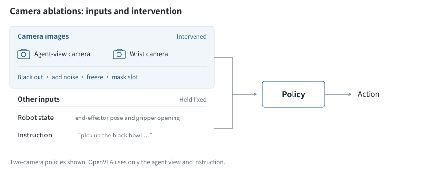
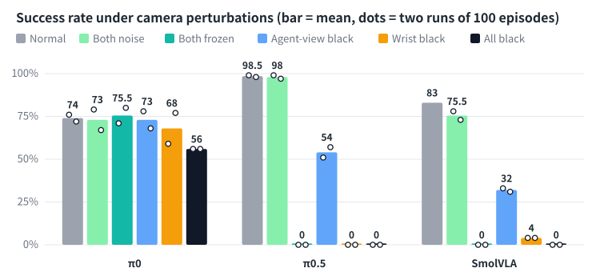
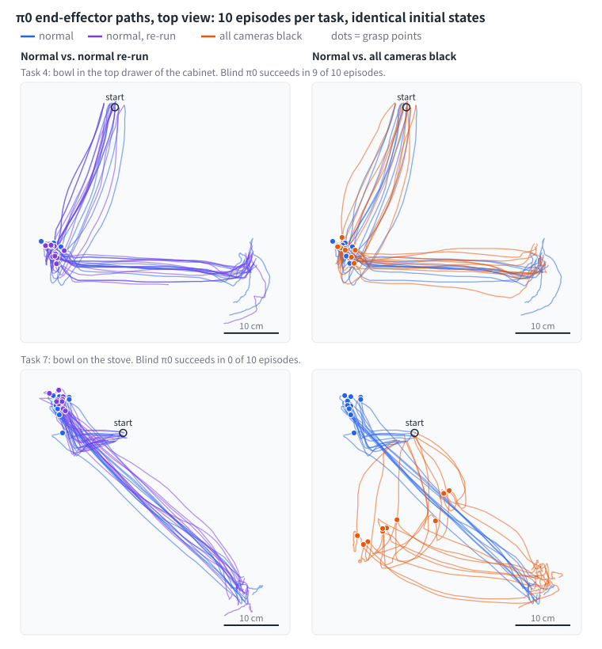
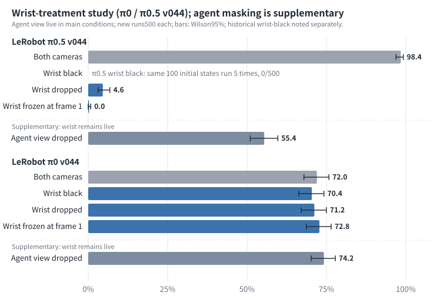
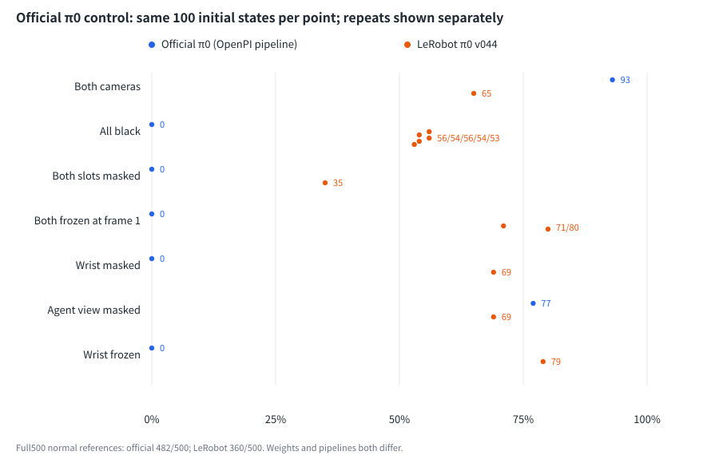
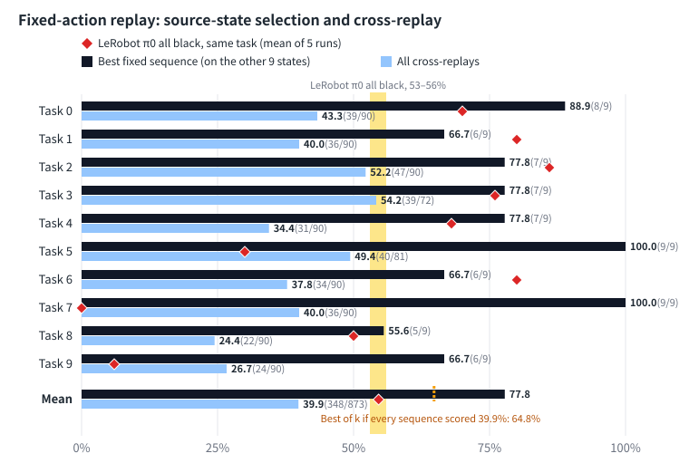
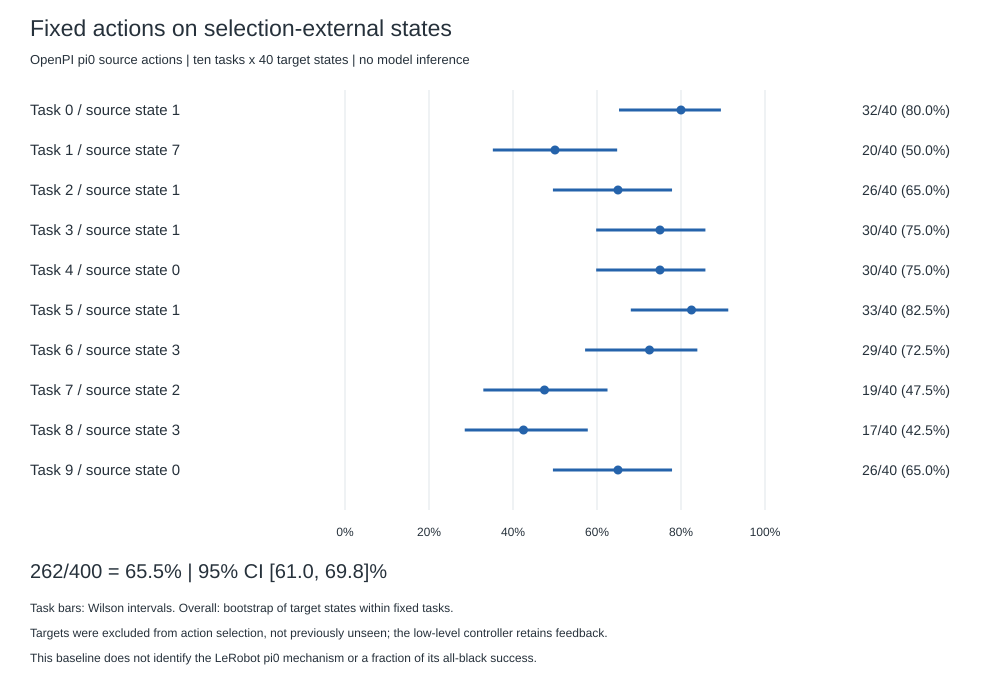
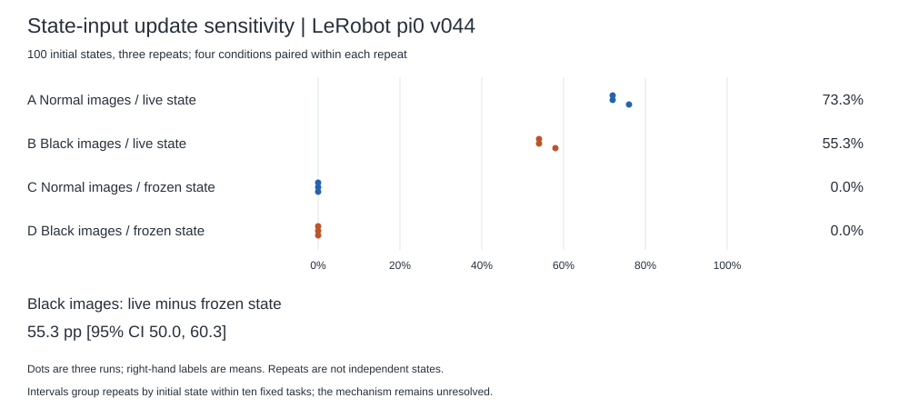
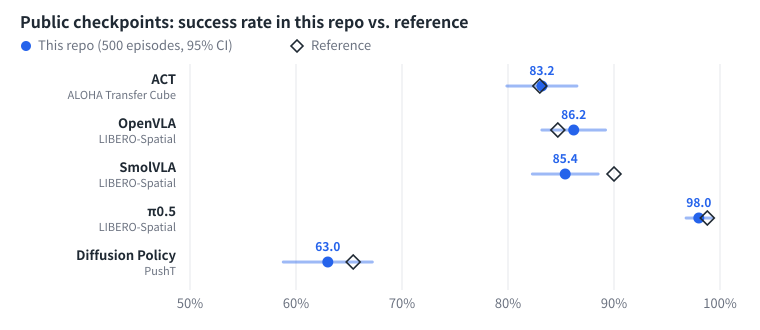
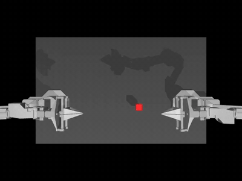

# Experiments & results

[中文](EXPERIMENTS_CN.md) · [Project overview](../README.md) · [Docs & data](README.md)

Full results for camera ablations, the official π0 control, open-loop replay, and public-checkpoint reproduction. The [notes](NOTES.md) retain chronological designs and corrections; this report does not replace the raw records.

[All black](#11-all-cameras-black) · [Noise & freeze](#12-one-camera-noise-frozen-image) · [Trajectories](#13-where-blind-π0-succeeds-it-follows-the-sighted-path) · [Single camera](#14-wrist-camera-removed-500-episodes) · [Official π0](#15-official-π0-control) · [Fixed-action replay](#16-fixed-action-replay) · [State updates](#17-state-input-update-sensitivity) · [Reproduction](#2-reproduction-of-the-public-checkpoints) · [Protocols & audit scope](#3-evaluation-protocols-and-audit-scope)

---

## Read the study structure first

**Four-policy exploration → π0/π0.5 wrist-treatment follow-up → supplementary agent mask.** Official π0 and P1/P2 are separate interpretation controls. Historical section numbers below do not imply an identical design for every policy. Start with [coverage, missing conditions and matched baselines](STUDY_MAP.md).

## 1. Camera ablations

π0, π0.5 and SmolVLA receive two images, robot state and an instruction; OpenVLA receives the agent view and instruction only. Sections 1.1–1.5 alter camera inputs, 1.6 provides a fixed-action baseline, and 1.7 separately alters model state input.

Sections 1.1–1.3 use 100 episodes per run (ten tasks x ten initial states) with matched initial states; later sections specify their own counts. Repeats do not add independent initial states. Comparison uncertainty depends on pairing and repeat structure, not a universal 13-point threshold. Earlier π0 repeats of one condition differed by up to 18 points (section 1.2).

### 1.1 All cameras black

| Model | Normal | All cameras black |
|---|---|---|
| π0.5 | 99% | 0% |
| OpenVLA | 81% | 0% |
| SmolVLA | 83% | 0% |
| **π0** | 76% | **56%** |

Three policies did not complete any tested all-black episode, including the repeat. Zero task success does not mean no movement. π0 succeeds in 56% of episodes: 6 to 9 out of 10 on seven tasks, and 0 or 1 out of 10 on the other three. Four more runs gave 54%, 56%, 54% and 53%, and [lerobot#3591](https://github.com/huggingface/lerobot/issues/3591) reports about 60% for the same checkpoint.

### 1.2 Early three-policy exploration: single black and both-camera noise/freezing

Success rate (%) in two runs of 100 episodes each, first run / second run. The second run repeats the same scripts with the same seed.

| Model | Normal | Both-camera Gaussian noise | Both first frames frozen | Agent-view black | Wrist black | All black |
|---|---|---|---|---|---|---|
| π0 | 76 / 72 | 79 / 67 | 71 / 80 | 78 / 68 | 59 / 77 | 56 / 56 |
| π0.5 | 99 / 98 | 99 / 97 | 0 / 0 | 51 / 57 | 0 / 0 | 0 / 0 |
| SmolVLA | 83 / – | 78 / 73 | 0 / 0 | 33 / 31 | 4 / 4 | 0 / 0 |

- **π0.5 and SmolVLA are sensitive to image freezing.** Both score 0% in both repeats. A real first-frame image does not make the frozen image–state sequence in-distribution: temporal consistency changes too. Noise effects are smaller; visual content, synchronization and distribution shift are not separated.
- **The π0 all-black runs in this group score below their normal runs.** Observed decreases are about 20 points. Noise, first-frame freezing and one-camera blackout vary by 9–18 points between repeats, scoring 59–80% against normal 71–76%. These early results do not determine either camera's role; section 1.4 provides 500-episode paired comparisons. Wrist blackout first scored 59%; four more runs gave 77%, 72%, 67% and 70%, averaging 69% against 74% for five normal runs. This does not establish that other interventions have no effect.
- **The tested π0.5 and SmolVLA checkpoints lose more success under wrist blackout than agent-view blackout**, in both runs. This is intervention-specific sensitivity, not a universal ranking of camera importance.

OpenVLA takes only the agent-view image and instruction; this project tested only its all-black condition.

### 1.3 Descriptive end-effector trajectory comparison

The end-effector position was logged at every step, and paths were compared with dynamic time warping, which removes speed differences.

| Comparison | Path difference | Grasp-point difference |
|---|---|---|
| Blind π0 vs. sighted π0, on the tasks blind π0 solves at least half the time | 2.8 / 3.2 cm | 2.4 / 2.2 cm |
| π0.5 vs. π0, both sighted, same tasks | 2.9 / 3.0 cm | 2.6 / 2.5 cm |
| Sighted π0 vs. its own re-run | 3.4 / 3.3 cm | 2.4 / 2.4 cm |
| Blind π0 vs. sighted π0, on task 7, where blind π0 never succeeds | 10.9 / 10.3 cm | 24.1 / 23.7 cm |

Each cell gives the first and the second run of the whole comparison. Blind π0 solves seven tasks at least half the time in the first run (0–4, 6, 8) and six in the second (0–4, 6).

In task groups selected post hoc by all-black success, normal versus black paths differ by 2.8/3.2 cm on average; the normal-rerun reference is 3.4/3.3 cm. The task groups differ, and no trajectory-equivalence margin or test was defined, so similar means do not establish identical paths. Task 7 shows larger normal-versus-black differences in both runs; two normal runs differ by 2.6 and 2.2 cm there. Task 9 (0 and 1 successes of 10 under black input) is less clear: 7.8 and 4.9 cm versus 3.3 and 3.6 cm between normal runs. Task 5 (3 and 4 successes) is inconclusive: 6.0 and 6.6 cm versus 6.6 and 4.7 cm between normal runs.

The rerun row excludes tasks with nearly overlapping normal paths: tasks 0–3 in run 1 and task 0 in run 2. This exclusion changes the reference task group; the remaining mean describes observed rerun variation, not a universal noise floor.

This does not show whether π0 under black input replays a memorised motion. The trajectory comparison cannot separate bowl tracking from repeating one motion per task; scene-variation summaries and fixed-action replay are in section 1.6. Per-task numbers are in [`results/trajectory.csv`](../results/trajectory.csv) and on the [dashboard](https://chaoshengsc.github.io/libero-camera-ablation/dashboard/).

### 1.4 Wrist-treatment main study and supplementary agent mask

Section 1.2 leaves two questions open: how to separate the role of wrist vision from input mismatch introduced by black images for π0.5, and how to compare single-camera interventions given π0's variation over 100-episode runs. This section uses three wrist interventions, totaling 500 episodes per condition. New runs use ten tasks × 50 initial states; π0.5 wrist blackout instead combines five repeats of the same 100 states, as the table specifies:

- **Black**: pixels 0, attention mask still 1, so the model attends to a black image.
- **Dropped**: inside the model the camera's slot is filled with the empty-camera placeholder and its mask set to 0, the same way LeRobot fills the always-empty third camera slot in the configuration.
- **Frozen**: the whole episode gets the real image from the episode's first frame.

The design, acceptance checks and expected results were written down before the runs (the "pre-registration" section in [docs/NOTES.md](NOTES.md)). It was not committed before the results and has no public timestamp, so it is an advance record, not a pre-registration in the strict sense.

| Wrist camera | π0.5 | π0 |
|---|---|---|
| Both cameras | 98.4% | 72.0% (rerun 71.2%) |
| Black | 0/500 (the same 100 initial states run 5 times: the two runs in section 1.2 and three more) | 70.4% |
| Dropped | 4.6% | 71.2% (rerun 72.6%) |
| Frozen at frame 1 | 0.0% | 72.8% |

**Supplementary condition, separate from the wrist-treatment table.**

| Agent-view treatment (wrist live) | π0.5 | π0 |
|---|---|---|
| Original-slot agent mask | 55.4% (277/500) | 74.2% (371/500) |

- **π0.5 is highly sensitive to wrist-input interventions.** All three treatments are near 0%, so unfamiliar black images alone cannot cover the results. Freezing also changes image–state synchronization; current visual content is not uniquely identified. Frozen input scores 0.0%, masked input 4.6%, under their respective protocols.
- **π0 wrist-intervention differences fall within the advance-recorded ±8-point margin.** Paired by initial state against both cameras, all three treatments have 95% difference intervals inside that margin (McNemar p ≥ 0.58; those p-values alone do not establish equivalence). This bounds the measured success-rate differences under this protocol; it does not show exactly unchanged performance or no camera contribution. The 53–56% all-black results (section 1.1) do not establish that the agent view is sufficient either.
- **With the wrist view only, π0.5 keeps 55.4%**, in line with 51% and 57% for agent-view black in section 1.2; tasks differ widely (task 5: 1/50, task 2: 49/50).
- **A pitfall.** In LeRobot v0.6.1, removing the agent-view key from the input moves the wrist image into the agent-view slot without any error ([lerobot#5118](https://github.com/huggingface/lerobot/issues/5118), proposed fix in [lerobot#5129](https://github.com/huggingface/lerobot/pull/5129)). "Dropped" here masks the camera in its own slot, and every run logs each slot's mask as evidence.

Per-episode results and first-frame hashes are in `results/single_camera.csv`; the summary and paired statistics are in `results/single_camera_summary.csv`.

### 1.5 Official π0 control

Installation, server/client commands and historical stage acceptance are in the [OpenPI reproduction guide](OPENPI.md).

LeRobot's π0 still scores 53–56% with every camera black. This control examines the observation in another checkpoint and inference pipeline. This section repeats the vision removal with Physical Intelligence's own `pi0_libero` checkpoint, in the same environment and on the same initial states. The design, the gate (normal ≥ 92%) and the reading rule were written before the runs and pushed to the repository (commit `6c54c5d`); the single-camera and 360-rendering conditions added later were also written down before their runs, but only locally, without a public timestamp; they are advance records rather than pre-registrations, and their results are exploratory.

- **The early HF candidate failed acceptance.** `lerobot/pi0_libero_base@98ac51b8` scored 0/50 in LeRobot v0.6.1 and 0/20 in three diagnostics. A CPU audit on 2026-11-02 finds that all 775 comparable tensors differ under the pinned official mapping and declared precision. It is not a verified conversion of the native GCS checkpoint, so its 0/50 does not show that changing only the pipeline causes failure ([identity evidence](../dashboard/data/protocol_audit/checkpoint_identity.json)). Following the original fallback, OpenPI serves actions to the LeRobot LIBERO client (`scripts/openpi/`); the native server loads GCS assets, not this HF model's weights.
- **A loading warning does not imply an entirely unloaded model.** An authorized CPU readback matches all 778 loaded model-state entries to that HF file after target-dtype conversion, while reproducing the warning for six obsolete normalization buffers. This is a current CPU loading check, not historical GPU-state recovery or an inference test; it does not repair the failed native/HF identity premise or isolate the cause of 0/50 ([loading evidence and scope](../dashboard/data/protocol_audit/checkpoint_loading.json)).
- **Gate and initial states.** Normal, 500 episodes: 482/500 = 96.4%, passing this study's ≥92% gate. Our LeRobot client allows 280 control steps; the pinned upstream OpenPI example allows 220. The earlier README's 96.8% is therefore a reference, not an identical-protocol reproduction. First-step end-effector positions match section 1.4's π0 normal run episode by episode (500/500). This is the recorded matching check, not a bitwise comparison of complete simulation states.

All points in the figure use the first ten states per task, 100 episodes per point; repeats are shown individually without pooled Wilson intervals. [Matched100 records](../results/official_pi0_matched100.csv). Full500 results remain separately available.

| Condition | Official π0 (OpenPI, 256 rendering) | LeRobot π0 v044 (LeRobot, 360 rendering) |
|---|---|---|
| Normal, matched100 states | 93/100 | 65/100 |
| All black | **0/100** | 53–56% (five runs of 100) |
| Both slots masked | **0/100** | 35/100 |
| Both frozen at frame 1 (auxiliary) | 0/100 | 71%, 80% |
| Wrist masked only | **0/100** | 69/100 |
| Main view masked only | **77/100** | 69/100 |
| Wrist frozen at frame 1 only (real image) | **0/100** | 79/100 |

- **Official π0 completes none of the tested all-black episodes.** Under the rule published in `6c54c5d`, retained all-black success is observed for LeRobot v044 with its pipeline in this comparison, not established for π0 in general. LeRobot slot-masked scores 35%, below the rule's 40%, so this reading rests on all-black comparisons rather than treating distinct interventions as equivalent.
- **Official π0 is highly sensitive to the tested wrist interventions; main-view masking also reduces success (exploratory).** Wrist masked: 0/100. Main view masked: 77% (interval 68–84%) against 93/100 normally on the same 100 states (paired McNemar p = 0.0025). The 77% misses the advance-recorded 85% criterion; those two thresholds were chosen after observing 0% with both slots masked. Repeating the real first wrist frame with its mask True also scores 0/100 (record pushed before the run, `c7e9023`). Freezing shows the phenomenon is not confined to black images or empty slots, but image–state desynchronization and other input mismatch remain possible; the role of current visual content is not isolated. These are test-time interventions, not single-camera training results.
- **Weights and execution paths remain unseparated.** Differences include JAX/PyTorch, resizing, normalization and delta restoration. The earlier pipeline-only inference from HF 0/50 versus native OpenPI smoke 50/50 is withdrawn: identity verification fails, so this is not a same-weight control. Nor does it establish a unique cause of failure. π0.5's 0% all-black result in LeRobot only shows that retained success is not shared by every tested checkpoint. P1/P2 add state-update sensitivity and a fixed-action baseline without identifying a unique mechanism for LeRobot π0's all-black success.
- **The 360-rendering check does not restore success under the tested visual interventions.** Official π0 at 360, matching the LeRobot side (local advance record), scores 99/100 normally, 0/100 all black and 0/100 with both slots masked; first-frame hashes match section 1.4 episode by episode. The tested 256/360 settings give the same direction of results, so this resolution change alone does not explain the observed gap. Other weight, conversion and inference differences remain unseparated.
- **On the same LeRobot checkpoint, the way vision is removed matters.** Slot-masked, 35%, is below each of the five all-black runs (53–56%). The five all-black runs use the same 100 initial states, not 500 independent episodes, so they are not pooled into one test; only the range of the per-run paired comparisons is reported: McNemar p 0.0015–0.0064.

### 1.6 Fixed-action replay

**Earlier cross-replay and selection bias.** Actions from official π0 with normal vision were replayed unchanged under the advance record in `c7e9023`. Self-replay is **95/97**, pooled cross-replay **348/873 = 39.9%**; the largest within-task object-coordinate spans are 3–9 cm. The post-hoc best per task averages **77.8%**, which is selection-biased. Under the equal-rate independent-trials illustration at 39.9%, picking the best from the original candidate counts already gives an expectation of **64.8%**. The earlier “mainly reflects the benchmark” interpretation was withdrawn; the historical record and one post-hoc reading change remain in the [notes](NOTES.md). These different-source/state comparisons do not identify fixed replay inside LeRobot π0 or quantify any fraction of its success.

**P2: freeze selection before evaluating selection-external states.** The selected source ids are 1,7,1,1,0,1,3,2,3,0, with lowest-id tie-breaking. Replay each sequence on its own source first; proceed only after the original minimum 8/10 recovery gate. Then replay once on each task's initial states 10–49. These targets were excluded from action selection but had appeared in earlier normal evaluations and position summaries; they are not a hidden test set. Preserve 128 rendering, relative control, ten settling steps and seed=1000+target; no model calls, extra clipping of the recorded actions or sequence extension.

| Check / evaluation | Successes | Result |
|---|---:|---|
| Selected-source self-replay | 10/10 | Recovery gate passed; excluded from formal statistics |
| Selection-external replay | **262/400** | **65.5%, 95% interval 61.0–69.8%** |

The interval resamples 40 target states within each of ten fixed tasks, 20000 draws, seed=20261031. Per-task intervals use Wilson. Coverage, frozen action hashes and sent-action prefixes passed audit. No invalid episodes; all 138 failures exhausted their source sequence without success, rather than recorded environment timeouts.

**This strengthens the fixed-action baseline without identifying LeRobot π0's mechanism.** The low-level controller retains feedback. Do not subtract 65.5% from a different checkpoint/state protocol's 55.3% or infer that the whole benchmark needs no vision. The interval excludes source-selection uncertainty, repeated physics noise and new-task generalization.

[Outcomes and frozen actions](../dashboard/data/replay_holdout/) · [Per-task results](../results/replay_holdout_summary.csv) · [All 410 episodes](../results/replay_holdout_episodes.csv) · [Packaged original replay loop](../scripts/analysis/replay_holdout.py)

Raw data are in `dashboard/data/official_pi0/`, the summary and the initial-state check in `results/official_pi0_summary.csv` (its LeRobot all-black row sums five runs on the same 100 states), and the process and deviations in the 2026-10-28/29 sections of [docs/NOTES.md](NOTES.md).

### 1.7 State-input update sensitivity

P1 tests `lerobot/pi0_libero_finetuned_v044@45dcc8fc`: normal/black images crossed with live/frozen-initial model state. Only `prepare_state` output is replaced; true environment state, low-level control and action postprocessing remain live. Use 360 rendering, five executed actions per chunk, environment seed 1000 and batch1. Per-episode policy-noise seed is `20261031 + 1000*repeat + 50*task + initial`. These three paired repeats have their own controls; earlier normal rows do not substitute for them.

| Condition | Three repeat successes (each /100) | Mean rate |
|---|---|---:|
| A: normal images + live state | 72 / 72 / 76 | **73.3%** |
| B: black images + live state | 54 / 54 / 58 | **55.3%** |
| C: normal images + frozen initial state | 0 / 0 / 0 | **0%** |
| D: black images + frozen initial state | 0 / 0 / 0 | **0%** |

Forty engineering episodes are excluded. The 1200 formal executions represent 100 initial states, three repeats and four conditions, not 300 independent states per condition. Within each of ten fixed tasks, resample whole initial states, preserving their repeats and paired groups: 20000 draws, seed 20261031.

| Contrast | Difference (percentage points) | 95% paired interval |
|---|---:|---|
| B−D, primary | **55.3** | **[50.0, 60.3]** |
| A−C, secondary | 73.3 | [67.7, 78.7] |
| (B−D)−(A−C), exploratory interaction | −18.0 | [−23.0, −13.0] |

The advance primary rule is met: at least 15 points, lower interval bound>0, all three repeats in the same direction. C/D are both at the zero-success floor, so the interaction alone does not identify visual/state compensation. Frozen groups still move. Freezing changes state evolution and consistency: **it shows update sensitivity, without separating online correction, phase cues or input mismatch**. The model still replans; this is neither fixed-action replay nor a feedback-free system.

Full input/trajectory artifacts were audited locally, but P1 did not save stepwise terminal flags or full image tensors. Public JSON reproduces outcomes, pairing and statistics, not the full NPZ tensor audit. The intervals concern these tasks and state protocol, not official OpenPI π0 or real robots.

[Outcomes and pairing metadata](../dashboard/data/state_feedback/) · [All episodes](../results/state_feedback_episodes.csv) · [Per-run Wilson intervals](../results/state_feedback_runs.csv) · [Paired contrasts](../results/state_feedback_comparisons.csv) · [Execution and analysis entries](../scripts/README.md#state-input-and-replay-follow-ups)

<b>Notes on these numbers</b>: the π0 checkpoint, the normal column, confidence intervals, run-to-run variation, noise, related work

- **π0 checkpoint.** `lerobot/pi0_libero_finetuned_v044` scores 73.4% over 500 normal episodes. An earlier OpenPI README gave 96.8% on Spatial for π0 trained with its `pi0_libero` config. OpenPI's README never listed that checkpoint, but it can be downloaded from OpenPI's public bucket (`gs://openpi-assets/checkpoints/pi0_libero`), and [LIBERO-Plus](https://arxiv.org/abs/2510.13626) reports 94.2% for it unperturbed and at most 2% with every camera black (their Table 1 and Figure 2); re-run here in OpenPI's own pipeline it scores 96.4% normally (section 1.5). An earlier version of this README said that no official π0 LIBERO checkpoint had been released; that was wrong (see the correction in [`docs/NOTES.md`](NOTES.md)). In [lerobot#2114](https://github.com/huggingface/lerobot/issues/2114) a LeRobot maintainer said an earlier LeRobot π0 checkpoint needed more training; whether that holds for v044 was not tested here, and the cause of its gap to the official checkpoint is unknown.
- **Normal column.** The first number is the first 10 episodes per task of each model's 500-episode run, which use the same initial states as the ablation runs. The second is a separate 100-episode run; SmolVLA has none. π0's five normal runs gave 76%, 73%, 76%, 72% and 71%.
- **Confidence intervals.** Earlier single-run normal-approximation 95% intervals are up to about ±10 points. They do not fully model task, state and repeat structure, and are not intervals for new-task generalization. Later paired/grouped analyses follow their section-specific protocols; repeating an initial state does not add independent states.
- **Run-to-run variation.** Runs with the same seed are not identical: the evaluation fixes the random seed but does not make GPU computation deterministic, the end-effector paths of two π0 runs differ from the first step, but a repeat does not add independent initial states. π0.5 and SmolVLA repeat within 6 points; π0 differs by up to 18 points on the same condition.
- **Noise.** Gaussian, standard deviation 0.1, on pixels in [0, 1].
- **Related work.** [LIBERO-PRO](https://arxiv.org/abs/2510.03827) and [LIBERO-Plus](https://arxiv.org/abs/2510.13626) study the robustness of LIBERO policies under a much wider set of perturbations.

## 2. Reproduction of the public checkpoints

| Model | Task | This repo (500 episodes) | Reference | Repo criterion |
|---|---|---|---|---|
| ACT | ALOHA Transfer Cube | **83.2%** | 83.0% (Hugging Face repo) | ✅ |
| OpenVLA | LIBERO-Spatial | **86.2%** | 84.7 ± 0.9% (official README) | ✅ |
| SmolVLA | LIBERO-Spatial | **85.4%** | 90% (paper, 100 episodes) | ✅ |
| π0.5 | LIBERO-Spatial | **98.0%** | 98.8% (OpenPI), 97.0% (LeRobot) | ✅ |
| Diffusion Policy | PushT (2-D, not MuJoCo) | **63.0%** | 65.4% (LeRobot model card) | ✅ |

This repository's 500-episode 95% intervals are about ±1–4 points. They are compared with a reference range: a reported ± value, an interval estimated from an available episode count, or a single point when no range is available. Overlap meets the repository's reproduction criterion. Not all reference ranges are 95% confidence intervals; this convention is not an equivalence test or identical-training reproduction. SmolVLA is `lerobot/smolvla_libero`, with `n_action_steps=10`, as in section 1. It was trained on LIBERO-Spatial only; the paper trains on four suites and its 100 episodes give an estimated reference interval of about ±6 points.

 ACT on ALOHA Transfer Cube: the right arm picks up the cube and hands it to the left arm.

Per-task results are on the [dashboard](https://chaoshengsc.github.io/libero-camera-ablation/dashboard/). Replay videos are too large to publish; the dashboard plays them when the files are present locally. Sources of the reference numbers and the full experiment log are in [`docs/NOTES.md`](NOTES.md).

## 3. Evaluation protocols and audit scope

### 3.1 Steps and replanning

**Control steps, predicted action horizons and internal model iterations are different quantities.** The episode limit bounds actions sent to the environment; `chunk_size`/horizon describes a prediction's length; `n_action_steps` or `replan_steps` determines how many are executed before querying again. For example, π0 predicts 50 steps but executes only five before replanning. Ten denoising iterations are not ten environment steps. A public checkpoint's training configuration or scheduler fields do not establish training steps performed by this repository.

These are existing-run protocols checked against historical logs, retained artifacts and version-specific source. Current script defaults alone do not prove historical execution. LIBERO paths use 20 Hz and ten additional settling steps outside the control budget. ACT and PushT use different environments; their step counts are not directly comparable.

| Path / checkpoint | Control budget / frequency | Prediction length / replan interval | Rendering | Seed |
|---|---|---|---|---|
| LeRobot π0 v044, camera runs | 280 / 20 Hz | 50 / 5 | 360 | 1000 |
| LeRobot π0.5 v044 | 280 / 20 Hz | 50 / 10 | 360 | 1000 |
| LeRobot SmolVLA `31d453f7` | 280 / 20 Hz | 50 / 10 | 360 | 1000 |
| Official π0, OpenPI server + LeRobot client | 280 / 20 Hz | 50 / 5 | Main 256; check 360 | Client 1000; separate server RNG stream |
| OpenVLA | 220 / 20 Hz | Single action / 1 | 256, center crop enabled | 7 |
| P1: LeRobot π0 v044 | 280 / 20 Hz | 50 / 5 | 360 | Environment 1000; episode-noise formula in 1.7 |
| P2: fixed source actions | Limit 280; source lengths 80–133 | No model call or sequence extension | 128 | 1000 + target initial-state ID |
| ACT, ALOHA Transfer Cube | 400 / 50 Hz | 100 / 100 | Environment cameras | 1000 |
| Diffusion Policy, PushT | 300 / 10 Hz | Horizon 16, two observation steps / execute 8 | Environment camera | 1000 |

The seed column gives entry/base seeds, not an identical random-number state for every episode. P1 fixes episode-level policy noise separately; the client seed does not fix the native OpenPI server's RNG stream.

Checkpoint sources/revisions are in the [reproduction RUNS](../dashboard/build.py) and sections 1.5/1.7. LeRobot uses [run_libero.sh](../scripts/eval/run_libero.sh); native inference uses the [local server bridge](../scripts/openpi/serve_pi0_libero.py), without loading the proxy configuration's PyTorch weights. The environment-source fingerprint matches the [P2 runtime record](../dashboard/data/replay_holdout/audit.json); checked logs report a 280-step budget. OpenVLA uses [run_ovla.sh](../scripts/eval/run_ovla.sh).

**Within-protocol contrasts and cross-protocol comparisons are distinct.** Normal/intervention conditions use the same checkpoint and its own budget. Early normal columns take the first ten episodes per task; P1 runs its own paired normal conditions. The pinned [upstream OpenPI example](https://github.com/Physical-Intelligence/openpi/blob/215abfb217dbac7d5f1273282331b9b1866c0479/examples/libero/main.py) uses 220 control steps plus ten settling steps, versus 280 plus ten here. The original tables are not common-budget rankings; 96.4% is not an identical-protocol reproduction of the 96.8% reference. Section 3.4 separately recounts retained artifacts at a 220-step deadline without replacing original results or rerunning the complete upstream protocol.

### 3.2 Execution, denominators and stopping

LeRobot LIBERO evaluation ends on environment termination/truncation or success, or at the control limit; unsuccessful episodes remain in the denominator. P1 follows that loop but lacks saved stepwise terminal flags, so a unique stopping reason cannot be reconstructed for every episode. OpenVLA counts environment `done` as success and also stops on budget exhaustion or exceptions. Its checked 500 normal and two 100-episode all-black logs contain no caught exception and retain all episodes. The earlier out-of-memory startup is a separate logged engineering failure, not a formal episode.

P2 stops on success, termination/truncation, 280 steps or source-sequence exhaustion; see its [replay loop](../scripts/analysis/replay_holdout.py). The ten sources are 80–133 steps long. Of 400 formal episodes, 262 succeed and 138 exhaust the source, with zero technical invalids. Those failures are not environment timeouts and did not execute 280 steps. Ten self-replays are excluded from the formal 400, as P1's 40 engineering checks are excluded from its 1200 formal executions.

### 3.3 The evidence supports bounded conclusions

The 2026-11-02 review distinguishes public-data consistency, historical execution logs and full-artifact acceptance. All 117 public `eval_info.json` records have consistent episode counts, success rates and task keys; that does not certify complete stepwise evidence for all 117 runs.

| Existing result | Checked evidence | Supported scope and remaining limits |
|---|---|---|
| 1.1–1.2, blackout/perturbations/repeats | All 79 core records associated with original results or complete text logs, including six supplemental repeats | Retain protocol-specific sensitivity; association uses complete JSON or ordered episode blocks, not identical all-zero success counts |
| 1.3, trajectories | Two public DTW summaries against the CSV | Not every old trajectory NPZ was recomputed here; post-hoc task selection/reference exclusions remain, without trajectory equivalence or a fixed-action mechanism claim |
| 1.4, 500-episode single-camera runs | Eleven new-run outcomes/logs, episode first-frame hashes and paired statistics | Each new run covers 500 task/state pairs; π0.5 wrist blackout instead repeats 100 states five times, not 500 independent states |
| 1.5, official π0 | Normal gate, ablation/rendering logs and first-position or first-frame matching | Observations apply to each checkpoint/pipeline; 280-step client, unseparated weights/pipelines, not a complete copy of the upstream 220-step protocol |
| 1.6, earlier replay / P2 | Historical replay JSON; all 410 local P2 NPZs, action prefixes, stop flags and public outcomes | P2 evaluates 400 selection-external states after fixing actions; no hidden/new-task test or quantification of LeRobot π0's mechanism |
| 1.7, P1 | All 1240 local episodes; 277644 actions, 55689 inference blocks and paired records | Formal C/D each record 280 steps in all 300 episodes, with no evidence of shortened execution; full images/stepwise terminal flags are absent, supporting update sensitivity only |
| Section 2, five public checkpoints | 500 episodes each, historical run records and reference sources | Meets this repo's reference-overlap convention; environments/budgets/training differ, without common-budget ranking or identical-training reproduction |

Original stdout, videos and complete NPZs remain outside Git. The [P1 audit](../dashboard/data/state_feedback/audit.json) and [P2 audit](../dashboard/data/replay_holdout/audit.json) record local checks and their boundaries; public JSON does not replace complete artifacts. Subsequent recovery associates 79 core records plus 16 P1 runs, 95 in total. The earlier insufficient end-effector-only argument is replaced by the source/video cross-check in 3.4 before recounting. P1's missing original full model images and stepwise terminal fields remain absent. No execution error requiring a core rerun was found; nondeterminism, input mismatch and unresolved mechanisms remain.

### 3.4 Existing episodes at the same 220-step deadline

This is a **deadline recount of recorded trajectories**, with no new policy execution. The LIBERO batch1 loop ends on first task success. Source inspection shows the video slice retains as many frames as control steps, rather than steps+1. Episode-level cross-checks cover 6110 older video/end-effector pairs, 100 older video/action pairs and all 1240 P1 video/action pairs, with zero length mismatches. Complete NPZ runs retain all episode lengths; early 500-episode baselines retain only the first ten videos per task, so only those 100 episodes are recounted, without extrapolating to the other 400.

| Checkpoint / 100 matched states | Normal: original budget → 220 | Black: original budget → 220 |
|---|---|---|
| LeRobot π0 v044, first headline run | 76 → 76 | 56 → 56 |
| π0.5 | 99 → 99 | 0 → 0 |
| SmolVLA | 83 → 83 | 0 → 0 |
| OpenVLA (already 220 steps) | 81 → 81 | 0 → 0 |
| Official π0/OpenPI | 93 → 92 | 0 → 0 |

Across all 500 official π0 episodes, successes decrease from 482 to 481 (96.4%→96.2%); the 500-episode normal LeRobot π0 single-camera control decreases from 360 to 359 (72.0%→71.8%). LeRobot π0's five black runs score 56, 54, 55, 54, 53 at 220 steps, still 53–56%. They remain repeats of the same 100 states, not 500 independent states. Original 280-step paired intervals and the advance ±8-point criterion do not automatically apply to this supplementary recount.

**The extra 60 steps do not explain away the tested all-black observation.** Only the deadline is aligned; preprocessing, policy noise and checkpoint/pipeline differences remain. This is not a complete common-protocol ranking or a unique mechanism attribution. [95-run provenance and lengths](../dashboard/data/protocol_audit/) · [Deadline CSV](../results/budget_sensitivity.csv). From the repository root, `python scripts/analysis/summarize_protocol_audit.py` checks the frozen export without writing; `--write` regenerates this repository-managed CSV after source acceptance. Original outcome labels and figures are unchanged.
