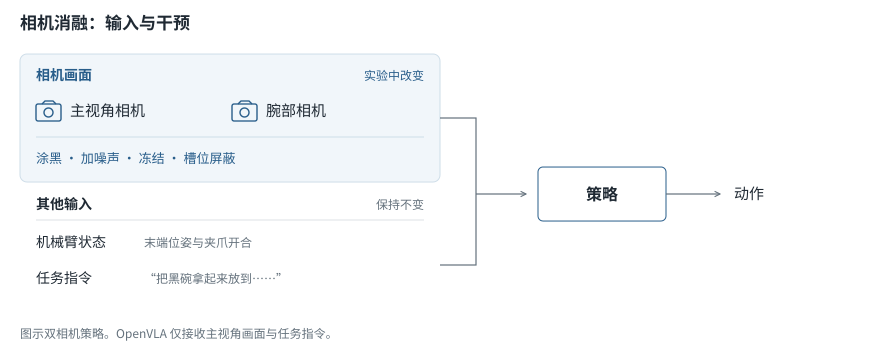
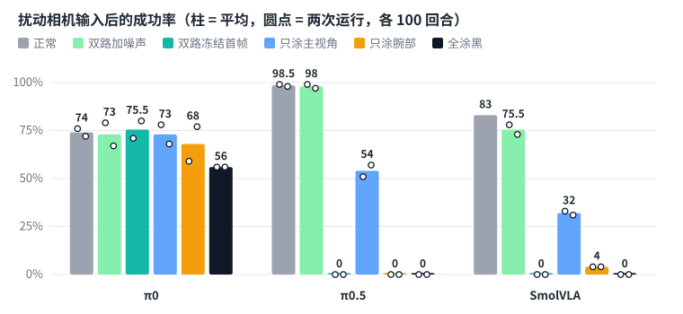
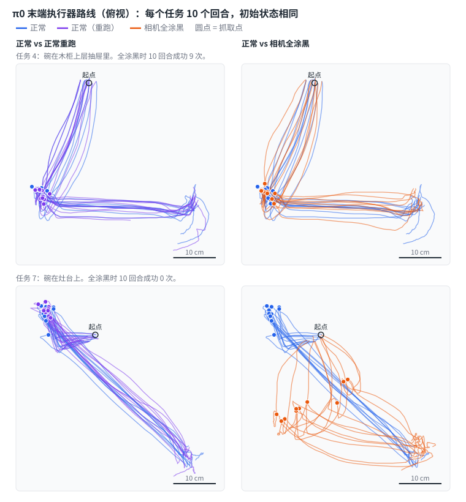
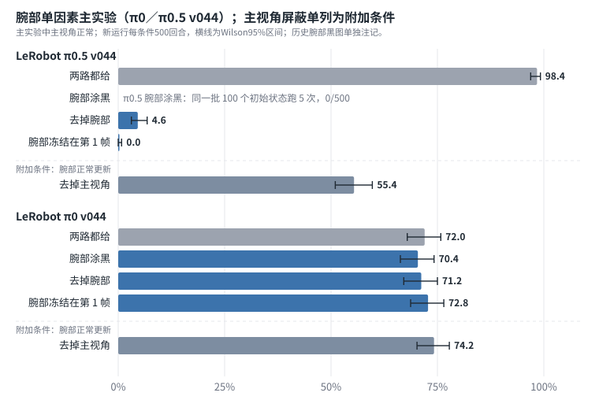
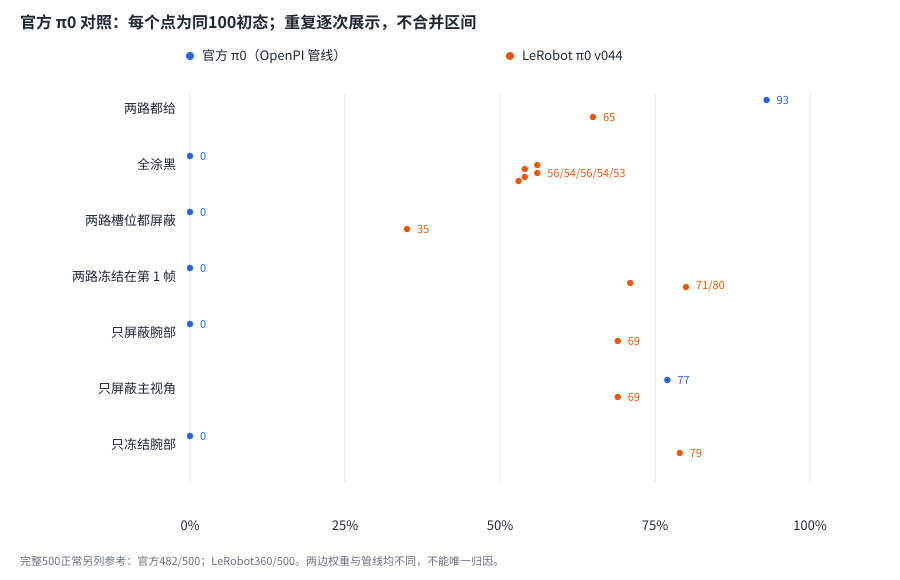
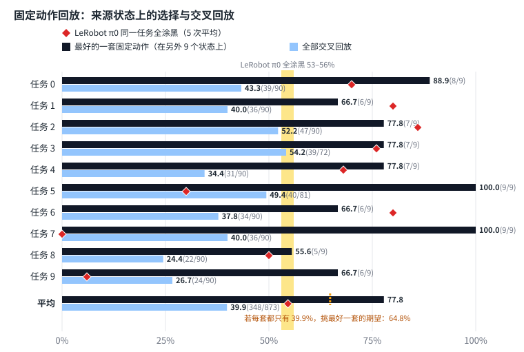
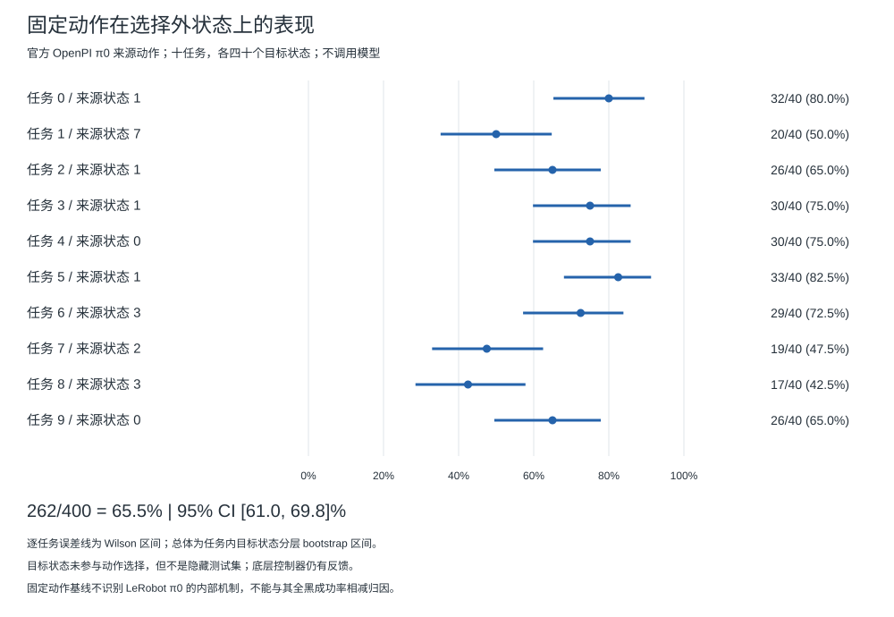
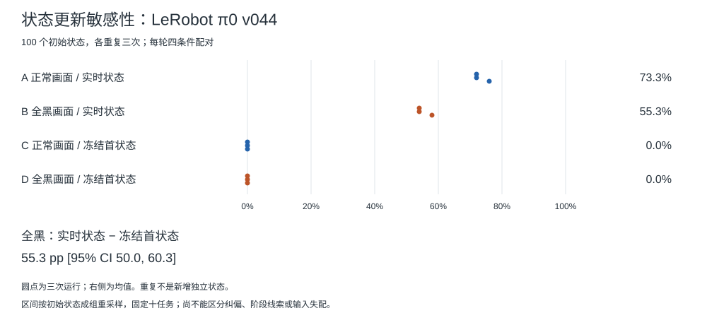
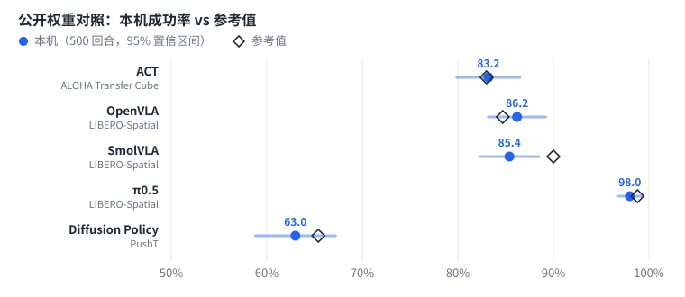
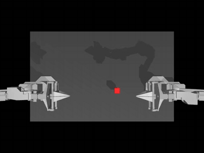

# 实验设计与完整结果

[English](EXPERIMENTS.md) · [项目首页](../README_CN.md) · [文档导航](README_CN.md)

本页保留相机消融、官方 π0 对照、开环回放和公开权重复现的完整结果。设计与更正按时间保存在[实验日志](NOTES_CN.md)；本页是结果说明，不替代原始记录。

[全涂黑](#11-所有相机涂黑) · [噪声与冻结](#12-单路相机噪声冻结画面) · [轨迹](#13-看不见的-π0-在成功的任务上走的是同一条路线) · [单路相机](#14-只去掉腕部相机500-回合) · [官方 π0](#15-官方-π0-对照) · [固定动作回放](#16-固定动作回放) · [状态更新](#17-状态输入更新敏感性) · [复现](#2-公开权重的复现)

---

## 1. 相机消融

π0、π0.5和SmolVLA接收两路相机、机械臂状态和任务指令；OpenVLA只接收主视角与指令。1.1–1.5节改变相机输入，1.6节为固定动作基线，1.7节单独改变模型状态输入。

1.1–1.3节每次100回合（十任务各十个初始状态），相同初始状态配对；后续章节另标回合数。重复不增加独立状态，差异的区间取决于配对与重复结构，不采用统一的13点阈值。π0早期同条件重复最多相差18点（1.2节）。

### 1.1 所有相机涂黑

| 模型 | 正常 | 全涂黑 |
|---|---|---|
| π0.5 | 99% | 0% |
| OpenVLA | 81% | 0% |
| SmolVLA | 83% | 0% |
| **π0** | 76% | **56%** |

三个模型在全黑画面的所测回合中均未成功完成任务，各自重跑一次仍是0%；0%成功不等于机械臂不运动。π0 仍有 56% 的回合成功：七个任务上 10 次成功 6 到 9 次，另外三个任务上 0 或 1 次。另外四次运行是 54%、56%、54% 和 53%，[lerobot#3591](https://github.com/huggingface/lerobot/issues/3591) 对同一个权重报告的是约 60%。

### 1.2 单路相机、噪声、冻结画面

两次运行的成功率（%），各 100 回合，写作“第一次 / 第二次”。第二次用同样的脚本和同一个种子重跑。

| 模型 | 正常 | 加高斯噪声 | 冻结首帧 | 只涂主视角 | 只涂腕部 | 全涂黑 |
|---|---|---|---|---|---|---|
| π0 | 76 / 72 | 79 / 67 | 71 / 80 | 78 / 68 | 59 / 77 | 56 / 56 |
| π0.5 | 99 / 98 | 99 / 97 | 0 / 0 | 51 / 57 | 0 / 0 | 0 / 0 |
| SmolVLA | 83 / – | 78 / 73 | 0 / 0 | 33 / 31 | 4 / 4 | 0 / 0 |

- **π0.5和SmolVLA对画面冻结敏感。** 两次均降为0%。首帧虽然是真实图像，但持续冻结会改变图像—状态联合输入与时间一致性，不能称为整体分布内干预。噪声条件的变化较小，本实验未分离视觉内容、同步和分布偏移各自的作用。
- **本组 π0 全黑运行的成功率均低于正常运行。** 观察到的降幅约为 20 个百分点。加噪声、冻结首帧、只涂一路相机时，两次运行相差9到18点，结果在59%到80%之间，正常运行在71–76%。这些早期结果不足以确定单路相机的作用（1.4 节另给500回合配对比较）。只看第一次腕部涂黑为59%；又跑四次为 77%、72%、67% 和 70%，五次平均69%，正常五次平均74%。这不证明其他干预没有影响。
- **所测 π0.5 和 SmolVLA 的腕部涂黑降幅大于主视角涂黑**，两次运行均如此；这是特定干预下的敏感性比较，不等于所有条件下的相机重要性排序。

OpenVLA 只接收主视角画面和指令；本项目对它只测试了“全涂黑”条件。

### 1.3 末端轨迹的描述性比较

逐步记录了末端执行器的位置，用动态时间规整比较路线（消除速度差异）。

| 比较 | 路线差异 | 抓取点差异 |
|---|---|---|
| 看不见的 π0 对看得见的 π0，取前者至少成功一半的任务 | 2.8 / 3.2 cm | 2.4 / 2.2 cm |
| π0.5 对 π0，都看得见，同样的任务 | 2.9 / 3.0 cm | 2.6 / 2.5 cm |
| 看得见的 π0 对它自己的重跑 | 3.4 / 3.3 cm | 2.4 / 2.4 cm |
| 看不见的 π0 对看得见的 π0，任务 7（前者从未成功） | 10.9 / 10.3 cm | 24.1 / 23.7 cm |

每格是整套比较的第一次和第二次运行。看不见的 π0 至少成功一半的任务，第一次有七个（0–4、6、8），第二次有六个（0–4、6）。

按全黑成功率事后筛选的任务组中，正常与全黑路径的平均差为2.8/3.2 cm，正常重跑参考为3.4/3.3 cm。两组任务构成不同，未设轨迹等效界限或进行等效检验，不能由均值相近断言路线相同。在任务 7 上，全黑与正常路径两次均有更大差异；这个任务上两次正常运行之间相差 2.6 和 2.2 cm。任务 9（全黑时 10 次成功 0 次和 1 次）差异没有任务7清楚：路线相差 7.8 和 4.9 cm，两次正常运行之间是 3.3 和 3.6 cm。任务 5（成功 3 次和 4 次）下不了结论：相差 6.0 和 6.6 cm，两次正常运行之间是 6.6 和 4.7 cm。

“重跑”一行剔除了两次正常运行几乎重合的任务：第一次是任务0–3，第二次是任务0。这一剔除改变了参考任务组；剩余均值只是本次观察到的重跑差异参考，不是普遍的噪声下限。

这不能说明全黑输入下的 π0 是不是在重复记住的动作。这种轨迹比较分不出“跟着碗走”的策略和“每个任务重复一套动作”的策略；场景变化摘要与固定动作回放见1.6节。各任务的数字见 [`results/trajectory.csv`](../results/trajectory.csv) 和[看板](https://chaoshengsc.github.io/libero-camera-ablation/dashboard/?lang=zh)。

### 1.4 只去掉腕部相机：500 回合

1.2节的腕部涂黑结果留下两个问题：π0.5的0%如何区分腕部视觉作用与黑图引入的输入失配；π0每次100回合的波动又限制了单路相机比较。本节采用三种腕部干预，每个条件合计500回合；新运行使用10个任务×50个初始状态，π0.5腕部涂黑合计的是同一批100状态的五次重复（见表中说明）：

- **涂黑**：像素为 0，注意力掩码仍为 1，模型照常“看”这张黑图。
- **去掉**：在模型内部把这一路的槽位填空、掩码设为 0，与配置里那个始终为空的第三个相机槽的填法相同。
- **冻结**：整个回合都给它本回合第 1 帧的真实画面。

实验设计、验收条件和预期都在运行前写下（[docs/NOTES_CN.md](NOTES_CN.md) 的“预先登记”一节）。它没有在出结果前提交到仓库，没有公开时间戳，所以只是事前记录，不是严格意义上的预注册。

| 腕部相机 | π0.5 | π0 |
|---|---|---|
| 两路都给 | 98.4% | 72.0%（重跑 71.2%） |
| 涂黑 | 0/500（同一批 100 个初始状态跑 5 次：1.2 节的两次，另加三次） | 70.4% |
| 去掉 | 4.6% | 71.2%（重跑 72.6%） |
| 冻结在第 1 帧 | 0.0% | 72.8% |
| 去掉主视角，只给腕部 | 55.4% | 74.2% |

- **π0.5对腕部输入干预高度敏感。** 三种处理均接近0%，单一的黑图陌生解释不足以涵盖结果；冻结同时改变图像—状态同步，尚不能唯一识别实时视觉内容的作用。冻结为0.0%，屏蔽为4.6%，按各自协议解释。
- **π0 腕部干预的配对差落在事前±8点范围内。** 三种处理与“两路都给”按初始状态配对，差值的95%区间均在该范围内（McNemar p ≥ 0.58；p值本身不证明等效）。这限定了本协议所测成功率差异的范围，不表示成功率完全不变或相机没有作用。两路全黑仍为53–56%（1.1节），也不能据此认定主视角足够。
- **只给腕部时 π0.5 还剩 55.4%**，与 1.2 节“只涂主视角”的 51% 和 57% 一致；各任务差别很大（任务 5 为 1/50，任务 2 为 49/50）。
- **做法上要注意。** 在 LeRobot v0.6.1 里，直接从输入里删掉主视角会让腕部画面挪进主视角的槽位，不会报错（[lerobot#5118](https://github.com/huggingface/lerobot/issues/5118)，修复已提交为 [lerobot#5129](https://github.com/huggingface/lerobot/pull/5129)）。这里的“去掉”是在原槽位上屏蔽，每次运行都在日志里打印各槽位的掩码作为证据。

每回合的结果与首帧哈希在 `results/single_camera.csv`，汇总与配对统计在 `results/single_camera_summary.csv`。

### 1.5 官方 π0 对照

LeRobot π0 全涂黑仍有 53–56%，这是 π0 的共性，还是这个权重的特性？这一节换成 Physical Intelligence 官方的 `pi0_libero` 检查点，在同一环境、同一批初始状态上重复去掉视觉。设计、门槛（正常 ≥ 92%）和判读规则在运行前写好并推送到仓库（提交 `6c54c5d`）；后补的单路相机和 360 渲染条件也在运行前写下，但只在本地记录、没有公开时间戳，是事前记录而不是预注册，相应结论属探索性。

- **先用 LeRobot 转换版，跑不出来。** `lerobot/pi0_libero_base` 在 LeRobot v0.6.1 管线下冒烟 0/50，三组对照各 0/20。LeRobot 维护者说过，把 OpenPI 的图像处理和归一化移植进 LeRobot 并不直接（[lerobot#2533](https://github.com/huggingface/lerobot/issues/2533)）。按预先写好的退路改用 OpenPI 原版：OpenPI 在独立环境里作为本机服务给出动作块，LeRobot 的 LIBERO 环境当客户端（`scripts/openpi/`）。
- **门槛与初始状态。** 正常500回合482/500 = 96.4%，接近OpenPI旧README的96.8%。每回合第1步的末端位置与1.4节π0正常运行逐回合相同（500/500）；这是记录中的匹配检查，不等同于完整仿真状态逐位核对。

| 条件 | 官方 π0（OpenPI，渲染 256） | LeRobot π0 v044（LeRobot，渲染 360） |
|---|---|---|
| 两路都给 | 96.4%（500 回合） | 72.0%（500 回合） |
| 全涂黑 | **0/100** | 53–56%（五次，各 100 回合） |
| 两路槽位都屏蔽 | **0/100** | 35/100 |
| 两路冻结在第 1 帧（辅助） | 0/100 | 71%、80% |
| 只屏蔽腕部 | **0/100** | 71.2%（500 回合） |
| 只屏蔽主视角 | **77/100** | 74.2%（500 回合） |
| 只冻结腕部（第 1 帧真实画面） | **0/100** | 72.8%（500 回合） |

- **官方 π0 在所测全黑回合中未成功。** 依照`6c54c5d`公开规则，全黑下保留成功的现象在本次对照中见于LeRobot v044及其管线，不能推广为π0的共性。LeRobot槽位屏蔽为35%，低于规则中的40%，因此该项判读只依据全黑对照，不把不同干预视为等价。
- **官方 π0 对所测腕部干预高度敏感，主视角屏蔽也有下降（探索性）。** 只屏蔽腕部0/100；只屏蔽主视角为77%（区间68–84%），同一批100个初始状态上正常为93/100（配对McNemar p = 0.0025）。77%未达到事前记录的85%判据；这两个阈值是在看到两路屏蔽为0%之后确定的。腕部持续使用第1帧真实图像、掩码保持为真时，也为0/100（运行前推送记录`c7e9023`）。冻结结果说明现象不局限于黑图或空槽位，但仍可能涉及图像—状态不同步和其他输入失配，不能单独识别实时视觉内容的作用。这是测试时干预，不是单相机训练结果。
- **权重与执行路径尚未隔离。** 两边还涉及JAX/PyTorch、图像缩放、归一化、增量还原与权重转换差异。官方权重的LeRobot转换路径冒烟为0/50，OpenPI路径为50/50，表明执行路径兼容性需要验收，不能把差距单独归因到训练量或权重。LeRobot管线下π0.5全黑为0%也只表明这一现象并非所有所测检查点都有。P1/P2提供状态更新敏感性和固定动作基线，仍未识别LeRobot π0全黑成功的唯一机制。
- **360渲染复测未恢复去视觉条件的成功。** 官方π0改为与LeRobot侧相同的360渲染（本地事前记录）：正常99/100，全黑0/100，两路槽位屏蔽0/100；首帧哈希与1.4节逐回合相同。所测256/360渲染下结论同向，不能仅用这次分辨率变更解释观察差异；其他权重、转换和推理差异尚未逐项隔离。
- **同一个 LeRobot 权重，去视觉的方式不同，结果也不同。** 槽位屏蔽 35% 低于五次全涂黑（53–56%）中的每一次。五次全涂黑用的是同一批 100 个初始状态，不是 500 个独立样本，所以不合并检验，只报告逐次按初始状态配对的范围：McNemar p 为 0.0015–0.0064。

### 1.6 固定动作回放

**早期交叉回放与选择偏差。** 动作来自官方π0正常运行，按`c7e9023`事前记录原样回放。自回放 **95/97**，全部交叉回放 **348/873 = 39.9%**；每任务位置最大坐标跨度3–9 cm。事后挑选每任务最好一套得到 **77.8%**，有选择偏差；若各序列都以39.9%独立成功，按原候选数挑最大值的期望也有 **64.8%**。历史判读“主要反映基准”已撤回，旧记录和1处事后判读修改保留在[日志](NOTES_CN.md)。这些不同来源/状态上的结果不能推断LeRobot π0内部采用固定动作，也不能量化固定动作解释了其成功的多少。

**P2：先固定动作选择，再验证选择外状态。** 使用上述来源中已固定的十条动作，并列取最小来源编号；选择编号为1、7、1、1、0、1、3、2、3、0。先在各自来源状态自回放，通过原定至少8/10的恢复门槛，再在每任务init10–49各回放一次。选择外状态曾用于旧正常评测及位置统计，未参与动作挑选，但不是隐藏测试集。渲染128、relative控制、10步等待、seed=1000+target保持旧回放协议；不调用模型，不裁剪或延长来源动作。

| 检查 / 评测 | 成功数 | 结果 |
|---|---:|---|
| 选定动作自回放 | 10/10 | 通过恢复门槛；不并入正式统计 |
| 选择外状态回放 | **262/400** | **65.5%，95%区间61.0–69.8%** |

区间固定十任务，在每任务40个目标状态内分层bootstrap 20000次，seed=20261031；逐任务另给Wilson区间。400个不同task/state组合、动作哈希与实际动作前缀验收通过；技术无效0，138个失败均为来源序列用尽未成功，不称环境超时。

**这补强了固定动作基线的适用范围，不识别LeRobot π0的实际机制。** 底层控制器仍有反馈；不能把65.5%与不同权重/状态协议的全黑55.3%相减归因，也不证明整个基准不需要视觉。区间不覆盖动作来源选择、重复物理噪声或新任务泛化。

[原始逐回合记录与冻结动作](../dashboard/data/replay_holdout/) · [逐任务结果](../results/replay_holdout_summary.csv) · [全部410回合](../results/replay_holdout_episodes.csv) · [原回放循环的打包入口](../scripts/analysis/replay_holdout.py)

原始数据在 `dashboard/data/official_pi0/`，汇总与初始状态核对在 `results/official_pi0_summary.csv`（其中 LeRobot 全涂黑一行是同一批 100 个状态五次运行的合计），过程与偏离见 [docs/NOTES_CN.md](NOTES_CN.md) 2026-10-28/29 各节。

### 1.7 状态输入更新敏感性

P1单独检查 `lerobot/pi0_libero_finetuned_v044@45dcc8fc` 的模型状态输入。正常/全黑画面与实时/冻结首状态正交；只替换 `prepare_state` 输出，真实环境、底层控制与动作后处理不冻结。360渲染、每块执行5步、环境seed1000、batch1；每回合策略噪声seed为`20261031 + 1000*repeat + 50*task + initial`。这是新协议下的三轮配对评测，不用旧正常列代替本次对照。

| 条件 | 三轮成功数（各/100） | 三轮均值 |
|---|---|---:|
| A：正常画面＋实时状态 | 72 / 72 / 76 | **73.3%** |
| B：全黑画面＋实时状态 | 54 / 54 / 58 | **55.3%** |
| C：正常画面＋冻结首状态 | 0 / 0 / 0 | **0%** |
| D：全黑画面＋冻结首状态 | 0 / 0 / 0 | **0%** |

40个工程检查回合不进入统计。正式1200次执行对应100个初始状态各三轮、四条件，不视为每组300个独立状态。固定十任务，在任务内对初始状态成组bootstrap 20000次、seed=20261031，保留其全部重复和条件配对。

| 比较 | 差值（百分点） | 95%配对区间 |
|---|---:|---|
| B−D，主比较 | **55.3** | **[50.0, 60.3]** |
| A−C，次比较 | 73.3 | [67.7, 78.7] |
| (B−D)−(A−C)，探索性交互 | −18.0 | [−23.0, −13.0] |

达到事前的主判读规则：主效应至少15点、区间下界>0且三轮同向。C/D都处于0%下界，交互不能单独证明视觉与状态的补偿机制。冻结组仍运动；输入冻结同时改变状态演化与一致性，**只能报告状态更新敏感性，不能区分在线纠偏、阶段线索或输入失配**。冻结状态时模型仍重新推理，不能称固定动作回放或整个系统开环。

完整输入/轨迹工件已在本地验收，但未逐步保存终止标记或完整图像，不能补造缺失字段。公开JSON可核对成功标记、配对和统计；不等于完整NPZ张量验收。区间仅覆盖给定任务和状态协议，不推广到官方OpenPI π0或真机。

[原始结果与配对元数据](../dashboard/data/state_feedback/) · [全部回合](../results/state_feedback_episodes.csv) · [逐运行Wilson区间](../results/state_feedback_runs.csv) · [配对比较](../results/state_feedback_comparisons.csv) · [执行与统计入口](../scripts/README_CN.md#状态与回放补充实验)

<b>关于早期相机消融数字</b>：π0 权重、“正常”一列、置信区间、两次运行之间的波动、噪声、相关工作

- **π0 权重。** `lerobot/pi0_libero_finetuned_v044` 500 回合的正常成功率是 73.4%。OpenPI 旧版 README 给出过按 `pi0_libero` 配置训练的 π0 在 Spatial 上 96.8%。这个权重从没写进 OpenPI 的 README，但可以从 OpenPI 的公开存储桶下载（`gs://openpi-assets/checkpoints/pi0_libero`）；[LIBERO-Plus](https://arxiv.org/abs/2510.13626) 报告它不加扰动时 94.2%，所有相机涂黑后不超过 2%（其 Table 1 与图 2）；本仓库在 OpenPI 原版管线下复测，正常为 96.4%（1.5 节）。本 README 旧版写过“没有发布官方 π0 LIBERO 权重”，这是错的（见 [`docs/NOTES_CN.md`](NOTES_CN.md) 的更正）。LeRobot 维护者在 [lerobot#2114](https://github.com/huggingface/lerobot/issues/2114) 说过更早的 LeRobot π0 权重还需要更多训练；v044 是否如此本仓库没有检验，它与官方权重差距的原因未知。
- **“正常”一列。** 第一个数取自各模型 500 回合评测里每个任务的前 10 回合，它们与消融实验用的是同一批初始状态。第二个数是另外单独跑的 100 回合；SmolVLA 没有跑。π0 的五次正常运行是 76%、73%、76%、72% 和 71%。
- **置信区间。** 早期单次成功率的正态近似95%区间最宽约±10点，未完整建模任务、状态与重复结构，不能当作新任务泛化区间。后续配对或成组分析按各节协议解释；重复同一初始状态不增加独立状态数。
- **两次运行之间的波动。** 同一个种子的两次运行并不完全相同：评测固定了随机种子，但没有让 GPU 计算确定化，π0两次运行可能从第一步开始分叉，但重跑不是新增独立初始状态。π0.5 和 SmolVLA 两次相差不超过 6 个百分点；π0 在同一个条件上最多相差 18 个百分点。
- **噪声。** 高斯噪声，标准差 0.1，像素范围 [0, 1]。
- **相关工作。** [LIBERO-PRO](https://arxiv.org/abs/2510.03827) 和 [LIBERO-Plus](https://arxiv.org/abs/2510.13626) 用范围大得多的扰动研究了 LIBERO 策略的鲁棒性。

## 2. 公开权重的复现

| 模型 | 任务 | 本仓库（500 回合） | 基准 | 本项目判据 |
|---|---|---|---|---|
| ACT | ALOHA Transfer Cube | **83.2%** | 83.0%（Hugging Face 仓库） | ✅ |
| OpenVLA | LIBERO-Spatial | **86.2%** | 84.7 ± 0.9%（官方 README） | ✅ |
| SmolVLA | LIBERO-Spatial | **85.4%** | 90%（论文，100 回合） | ✅ |
| π0.5 | LIBERO-Spatial | **98.0%** | 98.8%（OpenPI），97.0%（LeRobot） | ✅ |
| Diffusion Policy | PushT（2D，非 MuJoCo） | **63.0%** | 65.4%（LeRobot 模型卡） | ✅ |

本仓库500回合评测的95%区间约为±1–4点。本项目将其与参考范围比较：来源报告的±值、可按回合数估计的区间，或未给范围时的单点；重叠记为达到“复现”判据。并非所有参考范围都是95%置信区间，这一约定不是性能等效检验或严格同训练配置复现。SmolVLA为`lerobot/smolvla_libero`，`n_action_steps=10`，与第1节同一权重；它只在LIBERO-Spatial训练，论文在四套件训练，论文100回合对应的估计参考区间约±6点。

 ACT · ALOHA Transfer Cube：右臂抓起方块交给左臂。

各任务明细在[看板](https://chaoshengsc.github.io/libero-camera-ablation/dashboard/?lang=zh)上。回放视频体积大，没有发布；本地有视频文件时看板可以播放。基准出处与完整实验记录见 [`docs/NOTES_CN.md`](NOTES_CN.md)。
